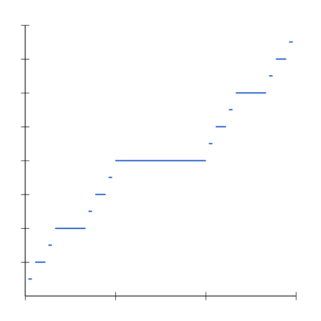

> Typeset from my handwritten notes for section 2D of Axler's *Measure,
> Integration & Real Analysis*. The exercise statements are the textbook's;
> the answers are mine, as I wrote them. Where an answer of mine stopped
> short, the end is completed along the same lines. Part of the
> [course overview](/posts/measure-theory-overview/).
{: .prompt-info }

## Notes

In this subchapter, we aim to prove that outer measure, when restricted to the
Borel subsets of $$\mathbb{R}$$, is in fact a measure.

> **Theorem (Additivity of outer measure if one of the sets is open).**
> Suppose $$A$$ and $$G$$ are disjoint subsets of $$\mathbb{R}$$ and $$G$$ is
> open. Then
> $$\lvert A \cup G\rvert = \lvert A\rvert + \lvert G\rvert$$.
{: .theorem #thm-additivity-open }

*Proof.* We may assume $$\lvert G\rvert < \infty$$ since if not,
$$\lvert A \cup G\rvert = \lvert A\rvert + \lvert G\rvert = \infty$$. Also,
countable subadditivity of outer measure indeed says that
$$\lvert A \cup G\rvert \le \lvert A\rvert + \lvert G\rvert$$. Thus, we only
have to prove that $$\lvert A \cup G\rvert \ge \lvert A\rvert + \lvert G\rvert$$.

First, consider where $$G = (a, b)$$ for some $$a < b$$ ($$a, b \in
\mathbb{R}$$). Assuming $$a, b \notin A$$ is fair as changing a set by at
most two points does not change its outer measure. Let $$I_1, I_2, \dots$$ be
a sequence of open intervals whose union contains $$A \cup G$$.

For each $$n \in \mathbb{Z}^+$$, let $$J_n = I_n \cap (-\infty, a)$$,
$$K_n = I_n \cap (a, b)$$, $$L_n = I_n \cap (b, \infty)$$. Then,
$$\ell(I_n) = \ell(J_n) + \ell(K_n) + \ell(L_n)$$ (the endpoints $$a, b$$ do not
change lengths).

Now, since $$A$$ and $$G$$ are disjoint, $$J_1, L_1, J_2, L_2, \dots$$ is a
sequence of open intervals whose union contains $$A$$ and $$K_1, K_2, \dots$$ is
a sequence of open intervals whose union contains $$G$$. Thus,

$$
\sum_n \ell(I_n) = \sum_n \bigl( \ell(J_n) + \ell(L_n) \bigr)
+ \sum_n \ell(K_n) \ge \lvert A\rvert + \lvert G\rvert.
$$

Thus, $$\inf\{\sum_n \ell(I_n)\} = \lvert A \cup G\rvert \ge \lvert A\rvert +
\lvert G\rvert$$.

Now, if $$G$$ is an arbitrary open set, it is clear that $$G$$ is a countable
union of disjoint open intervals that are all disjoint from $$A$$, meaning
$$G = \bigcup_n I_n$$ with $$I_n \cap A = \emptyset$$ for all
$$n \in \mathbb{Z}^+$$. Also, by induction, it is clear that
$$\lvert A \cup G\rvert = \lvert A\rvert + \lvert G\rvert$$ if $$G$$ is a union
of $$m$$ disjoint open intervals that are all disjoint from $$A$$ (with
$$m \in \mathbb{Z}^+$$).

Thus, we have, for all $$m \in \mathbb{Z}^+$$,

$$
\lvert A \cup G\rvert \ge \Bigl\lvert A \cup \bigcup_{n=1}^{m} I_n\Bigr\rvert
= \lvert A\rvert + \sum_{n=1}^{m} \ell(I_n).
$$

As $$m \to \infty$$, $$\lvert A \cup G\rvert \ge \lvert A\rvert +
\sum_{n=1}^{\infty} \ell(I_n)$$. Thus,
$$\lvert A \cup G\rvert = \lvert A\rvert + \lvert G\rvert$$. $$\square$$

> **Theorem (Additivity of outer measure if one of the sets is closed).**
> Suppose $$A$$ and $$F$$ are disjoint subsets of $$\mathbb{R}$$ and $$F$$ is
> closed. Then $$\lvert A \cup F\rvert = \lvert A\rvert + \lvert F\rvert$$.
{: .theorem #thm-additivity-closed }

*Proof.* Suppose $$I_1, I_2, \dots$$ is a sequence of open intervals whose union
contains $$A \cup F$$. Let $$G = \bigcup_k I_k$$. Then, $$G$$ is open with
$$A \cup F \subseteq G$$. Hence, as $$A$$ is disjoint from $$F$$,
$$A \subseteq G \setminus F$$.

$$\therefore\ \lvert A\rvert \le \lvert G \setminus F\rvert$$.

Also, as $$F$$ is closed, $$\mathbb{R} \setminus F$$ is open, meaning that
$$G \setminus F = G \cap (\mathbb{R} \setminus F)$$ is open. Thus, from
$$G = F \cup (G \setminus F)$$ (with the previous theorem),
$$\lvert G\rvert = \lvert F\rvert + \lvert G \setminus F\rvert$$.

$$
\therefore\ \lvert A\rvert + \lvert F\rvert \le \lvert F\rvert
+ \lvert G \setminus F\rvert = \lvert G\rvert \le \sum_k \ell(I_k).
$$

$$\therefore\ \lvert A\rvert + \lvert F\rvert \le \inf\bigl\{\sum_k \ell(I_k)
\bigr\} = \lvert A \cup F\rvert$$, and the reverse inequality is
subadditivity. $$\square$$

> **Theorem (Approximation of Borel sets from below by closed sets).**
> Suppose $$B \subseteq \mathbb{R}$$ is a Borel set. Then, for every
> $$\varepsilon > 0$$, there exists a closed set $$F \subseteq B$$ such that
> $$\lvert B \setminus F\rvert < \varepsilon$$.
{: .theorem #thm-borel-approximation }

*Proof.* Let $$\mathcal{L} = \{D \subseteq \mathbb{R} : \forall \varepsilon > 0,\
\exists F \subseteq D \text{ such that } F \text{ is closed and }
\lvert D \setminus F\rvert < \varepsilon\}$$.

The strategy of the proof is to show that $$\mathcal{L}$$ is a
$$\sigma$$-algebra. Then, taking $$D = F$$, $$\mathcal{L}$$ contains every
closed subset of $$\mathbb{R}$$, and thus (by taking complements) all open
subsets of $$\mathbb{R}$$, and ultimately all Borel subsets of $$\mathbb{R}$$.
To get started with proving that $$\mathcal{L}$$ is a $$\sigma$$-algebra, let's
prove that $$\mathcal{L}$$ is closed under countable intersections.

Suppose $$D_1, D_2, \dots$$ is a sequence in $$\mathcal{L}$$ and let
$$\varepsilon > 0$$. For each $$k \in \mathbb{Z}^+$$, there exists a closed set
$$F_k$$ such that $$F_k \subseteq D_k$$ and
$$\lvert D_k \setminus F_k\rvert < \frac{\varepsilon}{2^k}$$. Thus
$$\bigcap_k F_k$$ is closed, $$\bigcap_k F_k \subseteq \bigcap_k D_k$$, and
$$(\bigcap_k D_k) \setminus (\bigcap_k F_k) \subseteq \bigcup_k (D_k \setminus
F_k)$$.

$$
\therefore\ \Bigl\lvert \bigl(\bigcap_k D_k\bigr) \setminus
\bigl(\bigcap_k F_k\bigr) \Bigr\rvert \le \Bigl\lvert \bigcup_k (D_k \setminus
F_k) \Bigr\rvert < \sum_k \frac{\varepsilon}{2^k} = \varepsilon.
$$

Thus, $$\bigcap_k D_k \in \mathcal{L}$$.

Now we want to prove that $$\mathcal{L}$$ is closed under complementations.
Suppose $$D \in \mathcal{L}$$ and $$\varepsilon > 0$$. Then, we have to show that
there is a closed subset of $$\mathbb{R} \setminus D$$ whose set difference with
$$\mathbb{R} \setminus D$$ has outer measure less than $$\varepsilon$$.

- First, consider where $$\lvert D\rvert < \infty$$. Let $$F \subseteq D$$ be a
  closed set such that $$\lvert D \setminus F\rvert < \frac{1}{2}\varepsilon$$.
  Also, by definition of outer measure, there exists an open set
  $$G \subseteq \mathbb{R}$$ such that $$D \subseteq G$$ and
  $$\lvert G\rvert < \lvert D\rvert + \frac{1}{2}\varepsilon$$. Now,
  $$\mathbb{R} \setminus G$$ is closed and
  $$\mathbb{R} \setminus G \subseteq \mathbb{R} \setminus D$$. Also,
  $$(\mathbb{R} \setminus D) \setminus (\mathbb{R} \setminus G) = G \setminus D
  \subseteq G \setminus F$$.

  $$
  \begin{aligned}
  \therefore\ \bigl\lvert (\mathbb{R} \setminus D) \setminus (\mathbb{R}
  \setminus G) \bigr\rvert &\le \lvert G \setminus F\rvert
  = \lvert G\rvert - \lvert F\rvert \quad (\text{as } F \text{ is closed}) \\
  &= (\lvert G\rvert - \lvert D\rvert) + (\lvert D\rvert - \lvert F\rvert)
  < \tfrac{1}{2}\varepsilon + \tfrac{1}{2}\varepsilon = \varepsilon.
  \end{aligned}
  $$

  $$\therefore\ \mathbb{R} \setminus D \in \mathcal{L}$$.
- Consider where $$\lvert D\rvert = \infty$$. For $$k \in \mathbb{Z}^+$$, let
  $$D_k = D \cap [-k, k]$$. Since $$[-k, k]$$ is closed (meaning that
  $$[-k, k] \in \mathcal{L}$$) and $$D \in \mathcal{L}$$,
  $$D_k \in \mathcal{L}$$, and $$\lvert D_k\rvert < \infty$$.
  $$\therefore\ \mathbb{R} \setminus D_k \in \mathcal{L}$$. Also, clearly
  $$D = \bigcup_k D_k$$ and therefore
  $$\mathbb{R} \setminus D = \bigcap_k (\mathbb{R} \setminus D_k) \in
  \mathcal{L}$$.

Hence $$\mathcal{L}$$ is closed under complements and countable intersections,
and $$\emptyset \in \mathcal{L}$$, so it is a $$\sigma$$-algebra. $$\square$$

> **Theorem (Additivity of outer measure if one of the sets is a Borel set).**
> Suppose $$A$$ and $$B$$ are disjoint subsets of $$\mathbb{R}$$ and $$B$$ is a
> Borel set. Then $$\lvert A \cup B\rvert = \lvert A\rvert + \lvert B\rvert$$.
{: .theorem #thm-additivity-borel }

*Proof.* Let $$\varepsilon > 0$$ and let $$F$$ be a closed set such that
$$F \subseteq B$$ and $$\lvert B \setminus F\rvert < \varepsilon$$. Now,

$$
\lvert A \cup B\rvert \ge \lvert A \cup F\rvert = \lvert A\rvert + \lvert F\rvert
\ge \lvert A\rvert + \lvert B\rvert - \varepsilon.
$$

$$\varepsilon \to 0 \Rightarrow \lvert A \cup B\rvert \ge \lvert A\rvert +
\lvert B\rvert$$, and subadditivity gives the reverse.
$$\therefore\ \lvert A \cup B\rvert = \lvert A\rvert + \lvert B\rvert$$.
$$\square$$

> **Theorem (Existence of a subset of $$\mathbb{R}$$ that is not a Borel
> set).** There exists a set $$B \subseteq \mathbb{R}$$ such that
> $$\lvert B\rvert < \infty$$ and $$B$$ is not a Borel set.
{: .theorem #thm-non-borel-set }

*Proof.* We proved that there exist disjoint sets $$A, B \subseteq \mathbb{R}$$
such that $$\lvert A \cup B\rvert \ne \lvert A\rvert + \lvert B\rvert$$. For any
such sets, $$\lvert B\rvert < \infty$$ since if $$\lvert B\rvert = \infty$$,
$$\infty = \infty$$. Now, by the direct consequence of the theorem above,
$$B$$ is not a Borel set. $$\square$$

> **Theorem (Outer measure is a measure on Borel sets).** Outer measure is a
> measure on $$(\mathbb{R}, \mathcal{B})$$ where $$\mathcal{B}$$ is the
> $$\sigma$$-algebra of Borel subsets of $$\mathbb{R}$$.
{: .theorem #thm-outer-measure-borel }

*Proof.* Suppose $$B_1, B_2, \dots$$ is a disjoint sequence of Borel subsets of
$$\mathbb{R}$$. Then, for all $$n \in \mathbb{Z}^+$$,

$$
\Bigl\lvert \bigcup_k B_k\Bigr\rvert \ge \Bigl\lvert \bigcup_{k=1}^{n}
B_k\Bigr\rvert = \sum_{k=1}^{n} \lvert B_k\rvert,
$$

implying that $$\lvert \bigcup_k B_k\rvert \ge \sum_k \lvert B_k\rvert$$. Taking
$$n \to \infty$$ and using countable subadditivity for the reverse inequality,
$$\lvert \bigcup_k B_k\rvert = \sum_k \lvert B_k\rvert$$. $$\square$$

> **Definition (Lebesgue measure).** *Lebesgue measure* is the measure on
> $$(\mathbb{R}, \mathcal{B})$$, where $$\mathcal{B}$$ is the $$\sigma$$-algebra
> of Borel subsets of $$\mathbb{R}$$, that assigns to each Borel set its outer
> measure.
{: .definition #def-lebesgue-measure }

Outer measure ($$=$$ Lebesgue measure) is a measure on a somewhat larger class
of sets called the *Lebesgue measurable sets*. Here, let's define the sets with
the attitude that we don't care much about sets of outer measure $$0$$. There
are many EQUIVALENT definitions of a Lebesgue measurable set that can be proved
from either direction.

> **Definition (Lebesgue measurable set).** A set $$A \subseteq \mathbb{R}$$ is
> called *Lebesgue measurable* if there exists a Borel set $$B \subseteq A$$
> such that $$\lvert A \setminus B\rvert = 0$$.
{: .definition #def-lebesgue-measurable }

> **Theorem (Equivalences of a Lebesgue measurable set).** Suppose
> $$A \subseteq \mathbb{R}$$. Then the following are equivalent.
>
> - **(a)** $$A$$ is Lebesgue measurable.
> - **(b)** There exists a Borel set $$B \subseteq A$$ such that
>   $$\lvert A \setminus B\rvert = 0$$. (def)
> - **(c)** For each $$\varepsilon > 0$$, there exists a closed set
>   $$F \subseteq A$$ such that $$\lvert A \setminus F\rvert < \varepsilon$$.
> - **(d)** There exist closed sets $$F_1, F_2, \dots$$ contained in $$A$$ such
>   that $$\lvert A \setminus \bigcup_k F_k\rvert = 0$$.
> - **(e)** For each $$\varepsilon > 0$$, there exists an open set
>   $$G \supseteq A$$ such that $$\lvert G \setminus A\rvert < \varepsilon$$.
> - **(f)** There exist open sets $$G_1, G_2, \dots$$ containing $$A$$ such that
>   $$\lvert \bigcap_k G_k \setminus A\rvert = 0$$.
> - **(g)** There exists a Borel set $$B \supseteq A$$ such that
>   $$\lvert B \setminus A\rvert = 0$$.
{: .theorem #thm-lebesgue-equivalences }

*Proof.* Let $$\mathcal{L}$$ denote the collection of sets
$$A \subseteq \mathbb{R}$$ that satisfy (c). By the proof of approximation of
Borel sets from below by closed sets, we know all Borel sets are in
$$\mathcal{L}$$ and $$\mathcal{L}$$ is a $$\sigma$$-algebra on $$\mathbb{R}$$.
Also, it is trivial that $$\mathcal{L}$$ contains every set with outer measure
$$0$$. (Take $$F = \emptyset$$ for all $$A \subseteq \mathbb{R}$$ with
$$\lvert A\rvert = 0$$.)

1. (c) $$\Rightarrow$$ (d): Suppose (c) holds. For all $$n \in \mathbb{Z}^+$$,
   there exists $$F_n \subseteq A$$ such that $$F_n$$ is closed and
   $$\lvert A \setminus F_n\rvert < \frac{1}{n}$$. Also,
   $$A \setminus \bigcup_k F_k \subseteq A \setminus F_n$$, so
   $$\lvert A \setminus \bigcup_k F_k\rvert < \frac{1}{n}$$ for all $$n$$. With
   $$n \to \infty$$, $$\lvert A \setminus \bigcup_k F_k\rvert = 0$$.
2. (d) $$\Rightarrow$$ (b): $$\bigcup_k F_k$$ is a Borel set contained in
   $$A$$, and $$\lvert A \setminus \bigcup_k F_k\rvert = 0$$.
3. (b) $$\Rightarrow$$ (c): Suppose (b) holds: there exists $$B \subseteq A$$
   such that $$B$$ is a Borel set and $$\lvert A \setminus B\rvert = 0$$. Now,
   $$A = B \cup (A \setminus B)$$ where $$B \in \mathcal{L}$$ as $$B$$ is a
   Borel set and $$A \setminus B \in \mathcal{L}$$ as
   $$\lvert A \setminus B\rvert = 0$$. Also, since $$\mathcal{L}$$ is a
   $$\sigma$$-algebra, $$A \in \mathcal{L}$$. Thus, (c) holds.
4. (c) $$\Rightarrow$$ (e): Suppose (c) holds. Thus, $$A \in \mathcal{L}$$.
   Since $$\mathcal{L}$$ is a $$\sigma$$-algebra, $$\mathbb{R} \setminus A \in
   \mathcal{L}$$, meaning that, for $$\varepsilon > 0$$, there exists a closed
   set $$F \subseteq \mathbb{R} \setminus A$$ such that
   $$\lvert (\mathbb{R} \setminus A) \setminus F\rvert < \varepsilon$$. Since
   $$\mathbb{R} \setminus F$$ is open and $$\mathbb{R} \setminus F \supseteq A$$,
   and $$(\mathbb{R} \setminus A) \setminus F = (\mathbb{R} \setminus F)
   \setminus A$$, (e) holds.
5. (e) $$\Rightarrow$$ (f): Suppose (e) holds. For all $$n \in \mathbb{Z}^+$$,
   there exists $$G_n \supseteq A$$ such that $$G_n$$ is open and
   $$\lvert G_n \setminus A\rvert < \frac{1}{n}$$. Now
   $$(\bigcap_k G_k) \setminus A \subseteq G_n \setminus A$$, so
   $$\lvert (\bigcap_k G_k) \setminus A\rvert < \frac{1}{n}$$ for all
   $$n \in \mathbb{Z}^+$$. With $$n \to \infty$$,
   $$\lvert (\bigcap_k G_k) \setminus A\rvert = 0$$, proving (f).
6. (f) $$\Rightarrow$$ (g): $$\bigcap_k G_k$$ is a Borel set, proving (g).
7. (g) $$\Rightarrow$$ (c): Suppose (g) holds. There exists $$B \supseteq A$$
   such that $$B$$ is a Borel set and $$\lvert B \setminus A\rvert = 0$$. Now,
   $$A = B \cap (\mathbb{R} \setminus (B \setminus A))$$. Also, as
   $$B \in \mathcal{L}$$ and $$B \setminus A \in \mathcal{L}$$ (it has outer
   measure $$0$$), so $$\mathbb{R} \setminus (B \setminus A) \in \mathcal{L}$$,
   $$A \in \mathcal{L}$$, meaning that $$A \in \mathcal{L}$$, proving that (c)
   holds.

$$\square$$

> **Theorem.** Outer measure is a measure on Lebesgue measurable sets.
>
> - **(a)** The set $$\mathcal{L}$$ of Lebesgue measurable subsets of
>   $$\mathbb{R}$$ is a $$\sigma$$-algebra on $$\mathbb{R}$$.
> - **(b)** Outer measure is a measure on $$(\mathbb{R}, \mathcal{L})$$.
{: .theorem #thm-lebesgue-sigma-algebra }

*Proof.* (a) Already proved in the proof of approximating Borel sets from
below with closed sets.

(b) Suppose $$A_1, A_2, \dots$$ is a disjoint sequence of Lebesgue measurable
sets. For all $$k \in \mathbb{Z}^+$$, there exists a Borel set
$$B_k \subseteq A_k$$ such that $$\lvert A_k \setminus B_k\rvert = 0$$. Then

$$
\Bigl\lvert \bigcup_k A_k\Bigr\rvert \ge \Bigl\lvert \bigcup_k B_k\Bigr\rvert
= \sum_k \lvert B_k\rvert = \sum_k \lvert A_k\rvert,
$$

where $$\lvert B_k\rvert = \lvert A_k\rvert$$ since
$$\lvert A_k\rvert \le \lvert B_k\rvert + \lvert A_k \setminus B_k\rvert$$.
Together with countable subadditivity, outer measure is a measure on
$$(\mathbb{R}, \mathcal{L})$$. $$\square$$

We now see that the set of Lebesgue measurable sets is the smallest
$$\sigma$$-algebra on $$\mathbb{R}$$ containing the Borel sets and the sets
with outer measure $$0$$.

> **Definition (Updated definition of Lebesgue measure).** *Lebesgue measure*
> is the measure on $$(\mathbb{R}, \mathcal{L})$$, where $$\mathcal{L}$$ is the
> $$\sigma$$-algebra of Lebesgue measurable subsets of $$\mathbb{R}$$, that
> assigns to each Lebesgue measurable set its outer measure.
{: .definition #def-lebesgue-measure-updated }

Every countable set has outer measure $$0$$, but would the converse hold? The
Cantor set, a famous example, has the key to its answer.

> **Definition (Cantor set).** The Cantor set $$C$$ is
> $$[0, 1] \setminus \bigl( \bigcup_n G_n \bigr)$$, where
> $$G_1 = (\frac{1}{3}, \frac{2}{3})$$ and $$G_n$$ for $$n > 1$$ is the union of
> the middle-third open intervals in the intervals of
> $$[0, 1] \setminus \bigl( \bigcup_{j=1}^{n-1} G_j \bigr)$$.
{: .definition #def-cantor-set }

\* It is known that the Cantor set is the set of numbers in $$[0, 1]$$ that
have a base $$3$$ representation containing only $$0$$s and $$2$$s.

> **Theorem.** $$C$$ is closed, has measure $$0$$, and contains no nontrivial
> intervals.
>
> - **(a)** $$C$$ is a closed subset of $$\mathbb{R}$$.
> - **(b)** $$C$$ has Lebesgue measure $$0$$.
> - **(c)** $$C$$ contains no interval with more than one element.
{: .theorem #thm-cantor-set }

*Proof.* (a) Each set $$G_n$$ is a union of open intervals. $$\therefore\
\bigcup_n G_n$$ is open, and hence its complement is closed. $$\therefore\
C = [0, 1] \cap (\mathbb{R} \setminus \bigcup_n G_n)$$ is an intersection of
two closed sets, meaning it is closed.

(b) By induction on $$n$$, each $$G_n$$ is the union of $$2^{n-1}$$ open
intervals, each of which has outer measure $$1/3^n$$.

$$
\therefore\ \Bigl\lvert \bigcup_n G_n\Bigr\rvert = \sum_n \lvert G_n\rvert =
\sum_n \frac{1}{3}\Bigl(\frac{2}{3}\Bigr)^{n-1} = 1.
$$

$$\therefore\ \lvert C\rvert = \lvert [0, 1] \setminus \bigcup_n G_n\rvert =
1 - 1 = 0$$.

(c) A set with Lebesgue measure $$0$$ cannot contain an interval that has more
than one element. $$\square$$

> **Definition (Cantor function).** The Cantor function
> $$\Lambda : [0, 1] \to [0, 1]$$ is defined by converting base $$3$$
> representations into base $$2$$ representations.
>
> - If $$x \in C$$, then $$\Lambda(x)$$ is computed from the unique base $$3$$
>   representation of $$x$$, by replacing each $$2$$ by $$1$$ and interpreting
>   the resulting string as a base $$2$$ number.
> - If $$x \in [0, 1] \setminus C$$, then $$\Lambda(x)$$ is computed from a
>   base $$3$$ representation of $$x$$ by truncating after the first one,
>   replacing each $$2$$ before the first one by $$1$$, and interpreting the
>   resulting string as a base $$2$$ number.
{: .definition #def-cantor-function }

**Example.** If $$x \in [\frac{1}{3}, \frac{2}{3}]$$, then
$$x = \dfrac{1}{3} + \displaystyle\sum_{n=2}^{\infty} \dfrac{a_n}{3^n}$$
($$a_n \in \{0, 1, 2\}$$). $$\therefore\ \Lambda(x) = 0.1_{(2)} =
\dfrac{1}{2}$$.

{: width="420" }
_The Cantor function $$\Lambda$$ on $$[0, 1]$$: it is constant on each interval
removed in the construction of $$C$$._

> **Theorem (Property of the Cantor function).** The Cantor function $$\Lambda$$
> is a continuous, increasing function from $$[0, 1]$$ ONTO $$[0, 1]$$ and
> $$\Lambda(C) = [0, 1]$$.
{: .theorem #thm-cantor-function }

*Proof.* We begin by showing that $$\Lambda(C) = [0, 1]$$. Suppose
$$y \in [0, 1]$$. In the base $$2$$ representation of $$y$$, replace every
$$1$$ by $$2$$ and interpret the resulting string in base $$3$$, getting
$$x \in [0, 1]$$. Now, $$x$$ is made up of only $$0$$s and $$2$$s, meaning that
$$x \in C$$. Now, $$\Lambda(x) = y$$, meaning that for all
$$y \in [0, 1]$$ there exists $$x \in C$$ such that $$\Lambda(x) = y$$. Thus,
$$\Lambda(C) = [0, 1]$$ ($$\Lambda(C) \subseteq [0, 1]$$).

It is trivial that $$\Lambda$$ is an increasing function. If
$$x \in [0, 1] \setminus C$$, $$\Lambda$$ is constant on an open interval
containing $$x$$, and thus $$\Lambda$$ is continuous at $$x$$.

If $$x \in C$$, we have to prove that for all $$\varepsilon > 0$$ there exists
$$\delta > 0$$ such that $$\lvert \Lambda(t) - \Lambda(x)\rvert < \varepsilon$$
for all $$t \in [0, 1]$$ with $$\lvert t - x\rvert < \delta$$. Now fix
$$\varepsilon > 0$$. Also, because $$\Lambda(C) = [0, 1]$$,
$$y = \Lambda(x) \in [0, 1]$$.

Then, we know that for $$y_{low} = \max(0, y - \varepsilon/2)$$ and
$$y_{high} = \min(y + \varepsilon/2, 1)$$ there exist
$$x_{low}, x_{high} \in C$$ such that $$\Lambda(x_{low}) = y_{low}$$ and
$$\Lambda(x_{high}) = y_{high}$$ (take $$x_{low} = x$$ if $$y_{low} = y$$ and
$$x_{high} = x$$ if $$y_{high} = y$$). Now, setting $$\delta$$ to be the
smaller of the positive numbers among $$\lvert x - x_{low}\rvert$$ and
$$\lvert x_{high} - x\rvert$$, for all $$t \in [0, 1]$$ with
$$\lvert t - x\rvert < \delta$$, $$t \in (x_{low}, x_{high})$$ (or the one
sided version at an endpoint) and, thus, $$\Lambda(t) \in [y_{low}, y_{high}]$$
since $$\Lambda$$ is an increasing function.

$$\therefore$$ for all $$\varepsilon > 0$$ there exists $$\delta > 0$$ such that
$$\lvert \Lambda(t) - \Lambda(x)\rvert < \varepsilon$$ for all
$$t \in [0, 1]$$ with $$\lvert t - x\rvert < \delta$$, meaning that $$\Lambda$$
is continuous. $$\square$$

> **Corollary.** $$C$$ is uncountable.
{: .theorem #cor-cantor-uncountable }

*Proof.* The Cantor set is uncountable. If the domain $$A$$ of a function $$f$$
is countable, its image $$f(A)$$ is at most countable. However, as
$$\Lambda(C)$$ is uncountable ($$= [0, 1]$$), $$C$$ is uncountable. $$\square$$

Even a continuous function can map a set with Lebesgue measure $$0$$ to
nonmeasurable sets.

> **Theorem (Continuous image of a Lebesgue measurable set can be
> nonmeasurable).** There exists a Lebesgue measurable set
> $$A \subseteq [0, 1]$$ such that $$\lvert A\rvert = 0$$ and $$\Lambda(A)$$ is
> not a Lebesgue measurable set.
{: .theorem #thm-continuous-image }

*Proof.* Let $$E$$ be a subset of $$[0, 1]$$ that is not Lebesgue measurable.
Let $$A = C \cap \Lambda^{-1}(E)$$. Then, $$\lvert A\rvert = 0$$ since
$$A \subseteq C$$ and $$\lvert C\rvert = 0$$. Thus, $$A$$ is Lebesgue
measurable but $$\Lambda(A) = E$$. $$\square$$

## Exercises

> **Exercise 1.** (a) Show that the set consisting of those numbers in
> $$(0, 1)$$ that have a decimal expansion containing one hundred consecutive
> $$4$$s is a Borel subset of $$\mathbb{R}$$.
>
> (b) What is the Lebesgue measure of the set in (a)?
{: .problem #ex-2d-1 }

*Solution.* (a) Consider the set
$$A_1 = \Bigl[\dfrac{4}{10} + \dfrac{4}{10^2} + \cdots + \dfrac{4}{10^{100}},\
\dfrac{4}{10} + \cdots + \dfrac{4}{10^{99}} + \dfrac{5}{10^{100}}\Bigr]$$.
Assume $$0.\underbrace{4\cdots4}_{99\ 4\text{'s}}5 =
0.\underbrace{4\cdots4}_{100\ 4\text{'s}}99\cdots$$ for convenience.

Let $$A_n = \bigcup_{k=0}^{9} \dfrac{1}{10}(k + A_{n-1})$$ for all
$$n \ge 2$$, $$n \in \mathbb{Z}^+$$.

Then, the set of interest is $$A = \bigcup_n A_n$$.

Since $$A_1$$ is closed, $$A_n$$ is closed for all $$n \in \mathbb{Z}^+$$ (a
finite union of closed sets) and thus $$A$$, a countable union of closed sets,
is a Borel subset of $$\mathbb{R}$$.

(b) Let $$S_n$$ be the set of all numbers in $$(0, 1)$$ whose decimal expansion
does not have $$100$$ consecutive $$4$$s in any of the positions
$$100(j-1)+1, \dots, 100j$$ for $$j \le n$$. Chop up $$(0, 1)$$ into
$$10^{100n}$$ equal intervals; $$(10^{100} - 1)^n$$ intervals don't have
the block of $$100$$ $$4$$s in any of those positions.

$$\lvert S_n\rvert = \bigl(1 - 10^{-100}\bigr)^n$$.

$$\therefore\ A \supseteq (0, 1) \setminus \bigcap_n S_n \Rightarrow
\lvert A\rvert \ge 1 - \lvert \bigcap_n S_n\rvert \ge 1 - \lvert S_n\rvert$$ for
all $$n$$, and $$\lvert S_n\rvert \to 0$$.

$$\therefore\ \lvert A\rvert = 1$$.

> **Exercise 2.** Prove that there exists a bounded set $$A \subseteq
> \mathbb{R}$$ such that $$\lvert F\rvert \le \lvert A\rvert - 1$$ for every
> closed set $$F \subseteq A$$.
{: .problem #ex-2d-2 }

*Solution.* Let $$A$$ be any bounded non-Lebesgue-measurable set. There exists
$$\varepsilon_0 > 0$$ such that for every closed set $$F \subseteq A$$,
$$\lvert A \setminus F\rvert \ge \varepsilon_0$$.

$$\therefore\ \lvert F\rvert + \lvert A \setminus F\rvert \ge \lvert F\rvert +
\varepsilon_0$$.

Also, since $$F$$ is closed, $$\lvert A\rvert = \lvert F\rvert +
\lvert A \setminus F\rvert$$.

$$\therefore\ \lvert A\rvert \ge \lvert F\rvert + \varepsilon_0$$.

Scaling $$A$$ by $$\frac{1}{\varepsilon_0}$$ (outer measure and closedness
scale accordingly),
$$\lvert A\rvert \ge \lvert F\rvert + 1$$.

$$\therefore\ \lvert A\rvert - 1 \ge \lvert F\rvert$$.

> **Exercise 3.** Prove that there exists a set $$A \subseteq \mathbb{R}$$ such
> that $$\lvert G \setminus A\rvert = \infty$$ for every open set $$G$$ that
> contains $$A$$.
{: .problem #ex-2d-3 }

*Solution.* Let $$V$$ be any bounded non-Lebesgue measurable set. Assuming that
$$V$$ is bounded in $$(0, 1)$$, there exists $$\varepsilon > 0$$ such that
$$\lvert G \setminus V\rvert > \varepsilon$$ for all open supersets $$G$$ of
$$V$$.

Now, consider $$A = \bigcup_{n \in \mathbb{Z}} (V + n)$$. Let $$G \supseteq A$$
be open. Also, $$G = \bigcup_k G_k$$ where $$G_k = G \cap (k, k + 1)$$ for all
$$k \in \mathbb{Z}$$ (up to the integers, which do not matter).

Here, $$V + k \subseteq G_k$$ and $$G_k$$ is a disjoint sequence of open sets.

$$\therefore\ \lvert G_k \setminus (V + k)\rvert \ge \varepsilon$$ (as
$$G_k - k$$ is an open superset of $$V$$, and by translation invariance).

$$
\therefore\ \lvert G \setminus A\rvert = \Bigl\lvert \bigcup_{k \in \mathbb{Z}}
\bigl( G_k \setminus (V + k) \bigr)\Bigr\rvert \ge \lim_{k \to \infty} k\varepsilon
= \infty.
$$

> **Exercise 4.** The phrase *nontrivial interval* is used to denote an
> interval of $$\mathbb{R}$$ that contains more than one element. Recall that an
> interval might be open, closed, or neither.
>
> (a) Prove that the union of each collection of nontrivial intervals of
> $$\mathbb{R}$$ is the union of a countable subset of that collection.
>
> (b) Prove that the union of each collection of nontrivial intervals of
> $$\mathbb{R}$$ is a Borel set.
>
> (c) Prove that there exists a collection of closed intervals of
> $$\mathbb{R}$$ whose union is not a Borel set.
{: .problem #ex-2d-4 }

*Solution.* (a) Let $$S = \bigcup_{I \in \mathcal{C}} I$$ be such a set, where
$$\mathcal{C}$$ is a collection of nontrivial intervals. Then, from basic real
analysis, we know that there exists some countable
$$\mathcal{C}' \subseteq \mathcal{C}$$ such that
$$S' = \bigcup_{I \in \mathcal{C}} \mathrm{Int}\,I =
\bigcup_{I \in \mathcal{C}'} \mathrm{Int}\,I$$.

Hence, our concern shifts to the boundary of the intervals in $$\mathcal{C}$$.
WLOG, we'll consider the right endpoints $$x \in S \setminus S'$$. Then, there
exists some $$(\alpha, x] \in \mathcal{C}$$ or $$[\alpha, x] \in \mathcal{C}$$ for
some $$\alpha$$. Denote this $$(\alpha, x]$$ or $$[\alpha, x]$$ as $$I(x)$$.

Now, for all $$x, y \in S \setminus S'$$ ($$x \ne y$$), if
$$\mathrm{Int}\,I(x) \cap \mathrm{Int}\,I(y) \ne \emptyset$$, WLOG assuming
$$\mathrm{Int}\,I(x) = (\alpha, x)$$, $$\mathrm{Int}\,I(y) = (\beta, y)$$ with
$$x < y$$, it must be that $$\beta < x < y$$, so
$$x \in \mathrm{Int}\,I(y) \subseteq S'$$, a contradiction.
$$\therefore\ \mathrm{Int}\,I(x) \cap \mathrm{Int}\,I(y) = \emptyset$$.

Since the $$\mathrm{Int}\,I(x)$$'s are all pairwise disjoint, we can establish a
mapping from a subset of $$\mathbb{Q}$$ to
$$\{\mathrm{Int}\,I(x) : x \in S \setminus S'\}$$ (pick a rational number from
each). Hence, $$S \setminus S'$$ (its right endpoints) is at most countable.

The above follows for the left endpoints. There is a countable subset of
$$\mathcal{C}$$ whose union equals the union of a collection of nontrivial
intervals of $$\mathbb{R}$$.

(b) Trivial. (By (a), the union is a countable union of intervals, and every
interval is a Borel set.)

(c) $$\bigcup_{x \in S} [x, x] = S$$ for some non-Borel $$S$$.

> **Exercise 5.** Prove that if $$A \subseteq \mathbb{R}$$ is Lebesgue
> measurable, then there exists an increasing sequence
> $$F_1 \subseteq F_2 \subseteq \cdots$$ of closed sets contained in $$A$$ such
> that $$\lvert A \setminus \bigcup_{k=1}^{\infty} F_k\rvert = 0$$.
{: .problem #ex-2d-5 }

*Solution.* Take $$F_1', F_2', \dots, F_k', \dots$$ a sequence of closed sets in
$$A$$ with $$\lvert A \setminus \bigcup_k F_k'\rvert = 0$$ (as in (d) of the
equivalences). Define $$F_n = \bigcup_{k=1}^{n} F_k'$$. Then,
$$F_1 \subseteq F_2 \subseteq \cdots$$ and the $$F_k$$'s are all closed, with
$$\bigcup_k F_k = \bigcup_k F_k'$$. Now it is trivial.

> **Exercise 6.** Suppose $$A \subseteq \mathbb{R}$$ and
> $$\lvert A\rvert < \infty$$. Prove that $$A$$ is Lebesgue measurable if and
> only if for every $$\varepsilon > 0$$ there exists a set $$G$$ that is the
> union of finitely many disjoint bounded open intervals such that
> $$\lvert A \setminus G\rvert + \lvert G \setminus A\rvert < \varepsilon$$.
{: .problem #ex-2d-6 }

*Solution.* ($$\Leftarrow$$) If for all $$\varepsilon > 0$$ there exists $$G$$
such that $$G = \bigcup_{k=1}^{n} I_k$$ with $$I_i \cap I_j = \emptyset$$ if
$$i \ne j$$ and $$\lvert A \setminus G\rvert + \lvert G \setminus A\rvert <
\varepsilon$$, we want to prove that $$A$$ is Lebesgue measurable (the $$I_k$$'s
are open intervals).

Let $$\mathcal{L}$$ denote the collection of sets $$A \subseteq \mathbb{R}$$
such that for all $$\varepsilon > 0$$, there exists a closed set
$$F \subseteq A$$ with $$\lvert A \setminus F\rvert < \varepsilon$$. We only
have to prove that $$A \in \mathcal{L}$$, as $$\mathcal{L}$$ is a
$$\sigma$$-algebra with every Borel set.

For each $$n \in \mathbb{Z}^+$$, define $$G_n$$ as the set from the assumption
for $$\varepsilon/2^n$$:
$$\lvert A \setminus G_n\rvert + \lvert G_n \setminus A\rvert <
\dfrac{1}{2^n}\varepsilon$$. Then
$$\lvert A \setminus \bigcup G_n\rvert \le \sum_n \lvert A \setminus G_n\rvert <
\sum_n \dfrac{1}{2^n}\varepsilon = \varepsilon$$.

To finish, take $$\varepsilon = 2^{-j}$$ for $$j \in \mathbb{Z}^+$$ and let
$$U_j = \bigcup_n G_n$$ be the corresponding open set, so that
$$\lvert A \setminus U_j\rvert < 2^{-j}$$ and
$$\lvert U_j \setminus A\rvert < 2^{-j}$$. Let
$$B = \bigcup_j \bigcap_{i \ge j} U_i$$ (a Borel set). A point of $$A$$ outside
$$B$$ lies in $$A \setminus U_i$$ for infinitely many $$i$$, so
$$\lvert A \setminus B\rvert \le \sum_{i \ge j} 2^{-i} \to 0$$. A point of
$$B \setminus A$$ lies in $$U_i \setminus A$$ for all large $$i$$, so
$$\lvert B \setminus A\rvert \le \lvert U_i \setminus A\rvert < 2^{-i}$$ for
every $$i$$ beyond some $$j$$, hence $$\lvert B \setminus A\rvert = 0$$. Thus
$$A = (B \setminus (B \setminus A)) \cup (A \setminus B)$$ is in
$$\mathcal{L}$$ (a Borel set, minus a null set, union a null set), proving that
$$A$$ is Lebesgue measurable.

($$\Rightarrow$$) Suppose $$A$$ is Lebesgue measurable and
$$\varepsilon > 0$$. By (e) of the equivalences there is an open set
$$H \supseteq A$$ with $$\lvert H \setminus A\rvert < \frac{\varepsilon}{2}$$.
$$H$$ is a disjoint union of open intervals $$I_1, I_2, \dots$$ with
$$\sum_k \ell(I_k) = \lvert H\rvert \le \lvert A\rvert +
\frac{\varepsilon}{2} < \infty$$ (so the intervals are bounded). Choose $$n$$
with $$\sum_{k > n} \ell(I_k) < \frac{\varepsilon}{2}$$ and let
$$G = \bigcup_{k=1}^{n} I_k$$. Then $$\lvert A \setminus G\rvert \le \lvert H \setminus G\rvert =
\sum_{k>n} \ell(I_k) < \frac{\varepsilon}{2}$$ and
$$\lvert G \setminus A\rvert \le \lvert H \setminus A\rvert <
\frac{\varepsilon}{2}$$, so the sum is less than $$\varepsilon$$.

> **Exercise 7.** Prove that if $$A \subseteq \mathbb{R}$$ is Lebesgue
> measurable, then there exists a decreasing sequence
> $$G_1 \supseteq G_2 \supseteq \cdots$$ of open sets containing $$A$$ such that
> $$\lvert \bigcap_{k=1}^{\infty} G_k \setminus A\rvert = 0$$.
{: .problem #ex-2d-7 }

*Solution.* Trivial.

> **Exercise 8.** Prove that the collection of Lebesgue measurable subsets of
> $$\mathbb{R}$$ is translation invariant. More precisely, prove that if
> $$A \subseteq \mathbb{R}$$ is Lebesgue measurable and $$t \in \mathbb{R}$$,
> then $$t + A$$ is Lebesgue measurable.
{: .problem #ex-2d-8 }

*Solution.* If $$A \subseteq \mathbb{R}$$ is Lebesgue measurable, by definition,
there exists a Borel set $$B \subseteq A$$ such that
$$\lvert A \setminus B\rvert = 0$$. Thus, $$t + B \subseteq t + A$$ for
$$t \in \mathbb{R}$$, and
$$\lvert (t + A) \setminus (t + B)\rvert = \lvert t + (A \setminus B)\rvert =
\lvert A \setminus B\rvert = 0$$ (translation invariance of outer measure).
$$t + B$$ is a Borel set.

> **Exercise 9.** Prove that the collection of Lebesgue measurable subsets of
> $$\mathbb{R}$$ is dilation invariant. More precisely, prove that if
> $$A \subseteq \mathbb{R}$$ is Lebesgue measurable and $$t \in \mathbb{R}$$,
> then $$tA$$ (which is defined to be $$\{ta : a \in A\}$$) is Lebesgue
> measurable.
{: .problem #ex-2d-9 }

*Solution.* Trivial.

> **Exercise 10.** Prove that if $$A$$ and $$B$$ are disjoint subsets of
> $$\mathbb{R}$$ and $$B$$ is Lebesgue measurable, then
> $$\lvert A \cup B\rvert = \lvert A\rvert + \lvert B\rvert$$.
{: .problem #ex-2d-10 }

*Solution.* If $$A$$ and $$B$$ are disjoint subsets of $$\mathbb{R}$$, and $$B$$
is Lebesgue measurable, consider the Borel set $$B' \subseteq B$$ such that
$$\lvert B \setminus B'\rvert = 0$$.

Thus, $$\lvert A \cup B\rvert \le \lvert A\rvert + \lvert B\rvert$$ and
$$\lvert A \cup B\rvert \ge \lvert A \cup B'\rvert = \lvert A\rvert +
\lvert B'\rvert$$ (as $$B'$$ is Borel).

Also, $$\lvert B\rvert \le \lvert B'\rvert + \lvert B \setminus B'\rvert =
\lvert B'\rvert$$, so $$\lvert A\rvert + \lvert B\rvert \le \lvert A\rvert +
\lvert B'\rvert$$.

$$\therefore\ \lvert A \cup B\rvert \ge \lvert A\rvert + \lvert B'\rvert \ge
\lvert A\rvert + \lvert B\rvert$$, and with the first inequality,
$$\lvert A \cup B\rvert = \lvert A\rvert + \lvert B\rvert$$.

> **Exercise 12.** Suppose $$b < c$$ and $$A \subseteq (b, c)$$. Prove that
> $$A$$ is Lebesgue measurable if and only if
> $$\lvert A\rvert + \lvert (b, c) \setminus A\rvert = c - b$$.
{: .problem #ex-2d-12 }

*Solution.* If $$A$$ is Lebesgue measurable, it is trivial (Exercise 10 with
$$(b, c) = A \cup ((b, c) \setminus A)$$).

If $$\lvert A\rvert + \lvert (b, c) \setminus A\rvert = c - b$$, we have to
prove that there exists some Borel set $$C$$ such that $$\lvert A\rvert =
\lvert C\rvert$$ and $$A \subseteq C \subseteq (b, c)$$.

- For all $$\varepsilon > 0$$, there exists an open interval cover
  $$\mathcal{C}(\varepsilon)$$ such that
  $$\sum_{I \in \mathcal{C}(\varepsilon)} \ell(I) \le \lvert A\rvert +
  \varepsilon$$, where $$I \in \mathcal{C}$$ are open intervals that cover
  $$A$$. Define $$C = (b, c) \cap \bigcap_n \bigcup_{I \in
  \mathcal{C}(1/n)} I$$. Thus, for all $$n \in \mathbb{Z}^+$$,
  $$\lvert A\rvert \le \lvert C\rvert \le \lvert A\rvert + \frac{1}{n}$$ and
  $$A \subseteq C \subseteq (b, c)$$.

Let $$B$$ be a Borel set such that $$\lvert B\rvert = \lvert A\rvert$$ and
$$A \subseteq B \subseteq (b, c)$$. Also, let $$B'$$ be a Borel set such that
$$\lvert B'\rvert = \lvert (b, c) \setminus A\rvert$$ and
$$(b, c) \setminus A \subseteq B' \subseteq (b, c)$$.

Also, $$B \cup B' = (b, c)$$ and $$\lvert B\rvert + \lvert B'\rvert = c - b$$,
so $$\lvert B \cap B'\rvert = 0$$. Hence,
$$(b, c) \setminus B' \subseteq A \subseteq B$$ where $$(b, c) \setminus B'$$
is a Borel set, and
$$\lvert B \setminus ((b, c) \setminus B')\rvert = \lvert B \cap B'\rvert = 0$$.

Thus, $$\lvert A \setminus ((b, c) \setminus B')\rvert = 0$$ and therefore $$A$$
is Lebesgue measurable.

> **Exercise 13.** Suppose $$A \subseteq \mathbb{R}$$. Prove that $$A$$ is
> Lebesgue measurable if and only if
> $$\lvert (-n, n) \cap A\rvert + \lvert (-n, n) \setminus A\rvert = 2n$$ for
> every $$n \in \mathbb{Z}^+$$.
{: .problem #ex-2d-13 }

*Solution.* ($$\Rightarrow$$) Trivial.

($$\Leftarrow$$) If $$\lvert (-n, n) \cap A\rvert + \lvert (-n, n) \setminus
A\rvert = 2n$$ for all $$n \in \mathbb{Z}^+$$, we know that
$$(-n, n) \cap A$$ is Lebesgue measurable (by Exercise 12). Hence
$$A = \bigcup_n \bigl( (-n, n) \cap A \bigr)$$, which is Lebesgue measurable.

> **Exercise 18.** Prove that every open interval of $$\mathbb{R}$$ contains
> either infinitely many or no elements in the Cantor set.
{: .problem #ex-2d-18 }

*Solution.* Suppose that there exists an open interval $$I$$ of $$\mathbb{R}$$
that has finitely many elements in the Cantor set (and at least one). Let them
be $$0 \le p_1 < \cdots < p_n \le 1$$ ($$n \in \mathbb{Z}^+$$).

Now consider the Cantor function. Since $$p_1 \in C$$, $$\Lambda$$ is not
constant on any neighborhood of $$p_1$$ (changing a far-out base $$3$$ digit
of $$p_1$$ produces a point $$p \in C$$ as close to $$p_1$$ as we like with
$$\Lambda(p) \ne \Lambda(p_1)$$). Hence there exist $$a < b$$ in $$I \cap C$$
with $$0 \le \Lambda(a) < \Lambda(b) \le 1$$, and therefore there exists
$$x \in [0, 1]$$ such that $$\Lambda(a) < x < \Lambda(b)$$ (in fact a whole
interval of such $$x$$).

For that $$x$$, there exists $$y \in C$$ such that $$\Lambda(y) = x$$. Since
$$a, b \in I$$ and $$I$$ is an open interval and $$\Lambda$$ is increasing,
$$a < y < b$$ and thus $$y \in I \cap C$$. As $$x$$ ranges over the interval
$$(\Lambda(a), \Lambda(b))$$, these $$y$$ are distinct, so $$I \cap C$$ is
infinite, contradicting the assumption.

> **Exercise 23.** Show that there exists a function $$f : \mathbb{R} \to
> \mathbb{R}$$ such that the image under $$f$$ of every nonempty open interval
> is $$\mathbb{R}$$.
{: .problem #ex-2d-23 }

*Solution.* For all $$a, b \in \mathbb{R}$$ with $$a < b$$,
$$f((a, b)) = \mathbb{R}$$. $$\rightarrow$$ Show this. See the Conway base
$$13$$ function.

(Conway's base $$13$$ function: write $$x$$ in base $$13$$ with digits
$$0, \dots, 9$$ and three further symbols $$+$$, $$-$$, $$.$$. If the expansion
of $$x$$ ends with $$+ d_1 \cdots d_k . e_1 e_2 \cdots$$ or
$$- d_1 \cdots d_k . e_1 e_2 \cdots$$ followed by only decimal digits forever,
let $$f(x)$$ be the real number $$\pm d_1 \cdots d_k . e_1 e_2 \cdots$$; otherwise
$$f(x) = 0$$. Every open interval contains numbers whose base $$13$$ expansion
is eventually of this form for any prescribed $$\pm d_1 \cdots d_k . e_1
e_2 \cdots$$ (take any point of the interval, keep its first digits, and append
the prescribed tail), so $$f$$ takes every real value on every interval.)

> **Exercise 24.** For $$A \subseteq \mathbb{R}$$, the quantity
> $$\sup\{\lvert F\rvert : F \text{ is a closed bounded subset of } \mathbb{R}
> \text{ and } F \subseteq A\}$$ is called the *inner measure* of $$A$$.
>
> (a) Show that if $$A$$ is a Lebesgue measurable subset of $$\mathbb{R}$$, then
> the inner measure of $$A$$ equals the outer measure of $$A$$.
{: .problem #ex-2d-24 }

*Solution.* (a) If $$A$$ is a Lebesgue measurable set, there exist closed
subsets $$F_1, F_2, \dots$$ contained in $$A$$ such that
$$\lvert A \setminus (\bigcup_k F_k)\rvert = 0$$.

Equivalently, $$\lvert \bigcup_k F_k\rvert = \lvert A\rvert$$, hence the inner
measure of $$A$$ equals the outer measure of $$A$$.

(Details: by Exercise 5 the $$F_k$$ may be taken increasing; replacing $$F_k$$
by the closed bounded sets $$F_k \cap [-k, k]$$, which are still increasing with
the same union, continuity of the measure from below on Borel sets gives
$$\lim_k \lvert F_k \cap [-k, k]\rvert = \lvert \bigcup_k F_k\rvert =
\lvert A\rvert$$. So the supremum in the definition is at least $$\lvert A\rvert$$,
and at most $$\lvert A\rvert$$ by monotonicity.)

## References

- Sheldon Axler, *Measure, Integration & Real Analysis* — Section 2D and
  Exercises 2D. The exercise statements are quoted from the book.
- The notes and the exercise answers are mine, typeset from my handwritten
  notebook. The structure of each answer is unchanged; small slips in the
  answers are corrected, and answers that stopped short are completed along
  the same lines. I did not attempt Exercises 11, 14 to 17, 19 to 22 and 24(b), so they are not worked here.
