> The exercise statements are from the textbook; the answers are my own, translated into English. These exercises use [Parts 1 to 5](/posts/mathstat1-binomial/) of Chapter 3. Throughout, skewness and kurtosis of $$X$$ are the third and fourth cumulants $$C_3(Z)$$ and $$C_4(Z)$$ of the standardized variable $$Z = (X - \mu)/\sigma$$, with $$\mu = E(X)$$ and $$\sigma^2 = \mathrm{Var}(X)$$ ($$\sigma > 0$$). Writing $$C_X(t)$$ for the cumulant generating function of $$X$$, $$C_r(Z) = C_r(X)/\sigma^r$$.
{: .prompt-info }

### Exercise 3.1

> **Exercise 3.1.** Show that for a random variable $$X$$ following the binomial distribution $$B(n, p)$$ ($$n$$ a natural number, $$p \in [0, 1]$$), the mode of $$X$$ is $$[(n+1)p]$$ when $$p < 1$$, and $$n$$ when $$p = 1$$.
{: .problem #ex3-1 }

Let $$f$$ be the pdf of $$X$$, $$f(x) = \binom{n}{x}p^x(1 - p)^{n-x}$$, $$x = 0, 1, \dots, n$$. We first solve the inequality $$f(x) \ge f(x - 1)$$, that is,

$$
\binom{n}{x}p^x(1 - p)^{n-x} \ge \binom{n}{x-1}p^{x-1}(1 - p)^{n+1-x}, \qquad x = 1, 2, \dots, n.
$$

**1) $$p = 0$$.** For $$x = 1$$, $$\binom{n}{1}p(1 - p)^{n-1} = 0 < \binom{n}{0}(1 - p)^{n+1} = 1$$, and for $$1 < x \le n$$, $$\binom{n}{x}p^x(1 - p)^{n-x} = 0 = \binom{n}{x-1}p^{x-1}(1 - p)^{n+1-x}$$. Hence $$f(0) > f(1)$$ and $$f(1) = f(2) = \cdots = f(n)$$, so the point maximizing $$f$$ is $$0$$. Since $$(n+1)p = 0$$, the mode is $$[(n+1)p]$$.

**2) $$p = 1$$.** For $$x = n$$, $$\binom{n}{n}p^n = 1 > \binom{n}{n-1}p^{n-1}(1 - p) = 0$$, and for $$1 \le x < n$$, $$\binom{n}{x}p^x(1 - p)^{n-x} = 0 = \binom{n}{x-1}p^{x-1}(1 - p)^{n+1-x}$$. Hence $$f(0) = f(1) = \cdots = f(n-1) < f(n)$$, so the mode is $$n$$. (Here $$(n+1)p = n + 1$$, so $$[(n+1)p] \ne n$$: the formula for the mode does not hold when $$p = 1$$.)

**3) $$0 < p < 1$$.** For $$x = 1, 2, \dots, n$$, $$f(x) \ge f(x - 1)$$ is

$$
\frac{n!}{x!(n-x)!}\,p \ge \frac{n!}{(x-1)!(n+1-x)!}\,(1 - p) \qquad (0 < p < 1,\ 0 < 1 - p < 1),
$$

that is, $$\dfrac{p}{x} \ge \dfrac{1 - p}{n + 1 - x}$$, so $$p(n+1) - px \ge (1 - p)x$$, and therefore $$x \le (n+1)p$$.

In other words, $$f(x) \ge f(x - 1)$$ for every natural number $$x$$ with $$1 \le x \le (n+1)p$$, and $$f(x) < f(x - 1)$$ for every $$x$$ with $$(n+1)p < x \le n$$. Let $$m = [(n+1)p]$$. Then $$f(0) \le f(1) \le \cdots \le f(m)$$ and $$f(m) > f(m+1) > \cdots > f(n)$$, so $$f(m) \ge f(k)$$ for every $$0 \le k \le n$$, and the maximizing value of $$f$$ is $$m = [(n+1)p]$$.

Combining 1) to 3): for every real $$p$$ with $$0 \le p < 1$$ the mode of $$B(n, p)$$ is $$[(n+1)p]$$, and for $$p = 1$$ it is $$n$$.

### Exercise 3.2

> **Exercise 3.2.** For $$X \sim B(n, p)$$ show that $$E\Bigl(\prod_{i=0}^{r-1}(X - i)\Bigr) = p^r\prod_{i=0}^{r-1}(n - i)$$ ($$r = 1, 2, \dots, n$$).
{: .problem #ex3-2 }

Since the binomial distribution is a discrete distribution, for every natural number $$r$$ with $$1 \le r \le n$$,

$$
E\Bigl(\prod_{i=0}^{r-1}(X - i)\Bigr) = \sum_{x=0}^{n}\Bigl(\prod_{i=0}^{r-1}(x - i)\Bigr)f(x), \qquad f(x) = \binom{n}{x}p^x(1 - p)^{n-x}.
$$

For $$0 \le x < r$$ the product $$\prod_{i=0}^{r-1}(x - i)$$ contains the factor $$0$$, so it vanishes. For $$r \le x \le n$$,

$$
\prod_{i=0}^{r-1}(x - i) = x(x-1)\cdots(x-r+1) = \frac{x(x-1)\cdots(x-r+1)(x-r)\cdots 1}{(x-r)\cdots 1} = \frac{x!}{(x-r)!}.
$$

Therefore

$$
E\Bigl(\prod_{i=0}^{r-1}(X - i)\Bigr) = \sum_{x=r}^{n}\frac{x!}{(x-r)!}\binom{n}{x}p^x(1 - p)^{n-x} = \sum_{x=r}^{n}\frac{x!}{(x-r)!}\cdot\frac{n!}{x!(n-x)!}\,p^x(1 - p)^{n-x} = \sum_{x=r}^{n}\frac{n!}{(x-r)!(n-x)!}\,p^x(1 - p)^{n-x}.
$$

Put $$x - r = t$$. Then the sum is

$$
\sum_{t=0}^{n-r}\frac{n!}{t!(n-r-t)!}\,p^{t+r}(1 - p)^{n-r-t} = \frac{n!}{(n-r)!}\,p^r\sum_{t=0}^{n-r}\frac{(n-r)!}{t!(n-r-t)!}\,p^t(1 - p)^{n-r-t},
$$

and by the binomial theorem $$\sum_{t=0}^{n-r}\binom{n-r}{t}p^t(1 - p)^{n-r-t} = (p + (1 - p))^{n-r} = 1$$. Hence

$$
E\Bigl(\prod_{i=0}^{r-1}(X - i)\Bigr) = \frac{n!}{(n-r)!}\,p^r = n(n-1)\cdots(n-r+1)\,p^r = \Bigl(\prod_{i=0}^{r-1}(n - i)\Bigr)p^r.
$$

### Exercise 3.3

> **Exercise 3.3.** Find the skewness and the kurtosis of $$X \sim B(n, p)$$ ($$0 < p < 1$$).
{: .problem #ex3-3 }

Since $$X \sim B(n, p)$$, $$E(X) = np$$ and $$\mathrm{Var}(X) = np(1 - p)$$, so for $$0 < p < 1$$, $$\mathrm{Var}(X) > 0$$ and $$\sigma = \sqrt{np(1 - p)} > 0$$.

The cumulant generating function of $$X$$ is

$$
C_X(t) = n\ln\bigl(1 + p(e^t - 1)\bigr) = n\sum_{k=1}^{\infty}\frac{1}{k}(-1)^{k-1}p^k\Bigl(\sum_{j=1}^{\infty}\frac{t^j}{j!}\Bigr)^k.
$$

Writing it out up to the fourth-order term,

$$
C_X(t) = n\Bigl\{p\Bigl(\frac{t}{1!} + \frac{t^2}{2!} + \frac{t^3}{3!} + \frac{t^4}{4!}\Bigr) - \frac{1}{2}p^2\Bigl(\frac{t}{1!} + \frac{t^2}{2!} + \frac{t^3}{3!}\Bigr)^2 + \frac{1}{3}p^3\Bigl(\frac{t}{1!} + \frac{t^2}{2!}\Bigr)^3 - \frac{1}{4}p^4\Bigl(\frac{t}{1!}\Bigr)^4\Bigr\} + o(t^4)
$$

$$
= \frac{1}{1!}np\,t + \frac{1}{2!}np(1 - p)\,t^2 + \frac{1}{3!}np(1 - p)(1 - 2p)\,t^3 + \frac{1}{4!}np(1 - p)\bigl(1 - 6p(1 - p)\bigr)\,t^4 + o(t^4).
$$

That is, $$C_3(X) = np(1 - p)(1 - 2p)$$ and $$C_4(X) = np(1 - p)(1 - 6p(1 - p))$$. Therefore

$$
\text{skewness} = C_3(Z) = \frac{C_3(X)}{\sigma^3} = \frac{np(1 - p)(1 - 2p)}{np(1 - p)\sqrt{np(1 - p)}} = \frac{1 - 2p}{\sqrt{np(1 - p)}},
$$

$$
\text{kurtosis} = C_4(Z) = \frac{C_4(X)}{\sigma^4} = \frac{np(1 - p)(1 - 6p(1 - p))}{n^2p^2(1 - p)^2} = \frac{1 - 6p(1 - p)}{np(1 - p)}.
$$

### Exercise 3.4

> **Exercise 3.4.** Let $$X = (X_1, \dots, X_k)^t \sim \mathrm{Multi}(n, (p_1, \dots, p_k)^t)$$. (a) For $$1 \le r < k$$ find the distribution of $$Y = (X_1, \dots, X_r,\ n - X_1 - \cdots - X_r)^t$$. (b) Find the conditional probability density function of $$(X_{r+1}, \dots, X_k)^t$$ given $$X_1 = x_1, \dots, X_r = x_r$$.
{: .problem #ex3-4 }

**(a)** Since $$X \sim \mathrm{Multi}(n, (p_1, \dots, p_k)^t)$$, $$X \overset{d}{=} Z_1 + \cdots + Z_n$$ with $$Z_i = (Z_{i1}, \dots, Z_{ik})^t \overset{iid}{\sim} \mathrm{Multi}(1, (p_1, \dots, p_k)^t)$$ ($$i = 1, \dots, n$$). The random variable $$Y$$ distinguishes only the types $$1$$ to $$r$$ among the $$k$$ types, and counts the types $$r + 1$$ to $$k$$ together as one type. So with $$Z_i' = (Z_{i1}, \dots, Z_{ir},\ 1 - Z_{i1} - \cdots - Z_{ir})^t \overset{iid}{\sim} \mathrm{Multi}(1, (p_1, \dots, p_r, 1 - p_1 - \cdots - p_r)^t)$$ ($$i = 1, \dots, n$$) we have $$Y \overset{d}{=} Z_1' + \cdots + Z_n'$$. Hence

$$
Y \sim \mathrm{Multi}\bigl(n, (p_1, \dots, p_r, 1 - p_1 - \cdots - p_r)^t\bigr).
$$

**(b)** The conditional probability density function of $$(X_{r+1}, \dots, X_k)^t$$ given $$X_1 = x_1, \dots, X_r = x_r$$ is

$$
f_{r+1, \dots, k \mid 1, \dots, r}(x_{r+1}, \dots, x_k \mid x_1, \dots, x_r) = \frac{P(X_1 = x_1, \dots, X_r = x_r, X_{r+1} = x_{r+1}, \dots, X_k = x_k)}{P(X_1 = x_1, \dots, X_r = x_r)}.
$$

By (a), if $$f$$ is the pdf of $$Y$$,

$$
f(x_1, \dots, x_r, n - x_1 - \cdots - x_r) = \binom{n}{x_1 \cdots x_r\ (n - x_1 - \cdots - x_r)}p_1^{x_1}p_2^{x_2}\cdots p_r^{x_r}(1 - p_1 - \cdots - p_r)^{n - x_1 - \cdots - x_r},
$$

and

$$
P(X_1 = x_1, \dots, X_r = x_r) = P\bigl(X_1 = x_1, \dots, X_r = x_r,\ n - X_1 - \cdots - X_r = n - x_1 - \cdots - x_r\bigr) = f(x_1, \dots, x_r, n - x_1 - \cdots - x_r).
$$

Also, if $$g$$ is the pdf of $$X$$, then $$g(x_1, \dots, x_k) = \binom{n}{x_1 \cdots x_k}p_1^{x_1}\cdots p_k^{x_k}$$, where $$x_1 + \cdots + x_k = n$$ and each $$x_i$$ ($$1 \le i \le k$$) is an integer at least $$0$$. Therefore

$$
f_{r+1, \dots, k \mid 1, \dots, r}(x_{r+1}, \dots, x_k \mid x_1, \dots, x_r) = \frac{g(x_1, \dots, x_k)}{f(x_1, \dots, x_r, n - x_1 - \cdots - x_r)}
= \frac{\dfrac{n!}{x_1!\cdots x_k!}\,p_1^{x_1}\cdots p_k^{x_k}}{\dfrac{n!}{x_1!\cdots x_r!\,(n - x_1 - \cdots - x_r)!}\,p_1^{x_1}\cdots p_r^{x_r}(1 - p_1 - \cdots - p_r)^{n - x_1 - \cdots - x_r}}
$$

$$
= \frac{(n - x_1 - \cdots - x_r)!}{x_{r+1}!\cdots x_k!}\cdot\frac{p_{r+1}^{x_{r+1}}\cdots p_k^{x_k}}{(1 - p_1 - \cdots - p_r)^{n - x_1 - \cdots - x_r}}
= \frac{1}{(1 - p_1 - \cdots - p_r)^{n - x_1 - \cdots - x_r}}\binom{n - x_1 - \cdots - x_r}{x_{r+1} \cdots x_k}p_{r+1}^{x_{r+1}}\cdots p_k^{x_k},
$$

since $$x_{r+1} + \cdots + x_k = n - x_1 - \cdots - x_r$$. In other words, given $$X_1 = x_1, \dots, X_r = x_r$$, the vector $$(X_{r+1}, \dots, X_k)^t$$ follows $$\mathrm{Multi}\bigl(n - x_1 - \cdots - x_r,\ (p_{r+1}, \dots, p_k)^t/(1 - p_1 - \cdots - p_r)\bigr)$$.

### Exercise 3.5

> **Exercise 3.5.** Show that for $$X \sim \mathrm{Geo}(p)$$ ($$0 < p < 1$$), $$P(X > k + j \mid X > k) = P(X > j)$$ ($$j, k$$ any integers at least $$0$$).
{: .problem #ex3-5 }

For any two non-negative integers $$j, k$$, since $$k + j \ge k$$,

$$
P(X > k + j \mid X > k) = \frac{P\bigl((X > k + j) \cap (X > k)\bigr)}{P(X > k)} = \frac{P(X > k + j)}{P(X > k)}.
$$

Let $$f$$ be the pdf of $$X$$: $$f(x) = (1 - p)^{x-1}p$$ ($$x \in \mathbb{N}$$, $$0 < p < 1$$). Then

$$
\frac{P(X > k + j)}{P(X > k)} = \frac{\sum_{x=k+j+1}^{\infty}f(x)}{\sum_{x=k+1}^{\infty}f(x)} = \frac{\sum_{x=k+j+1}^{\infty}(1 - p)^{x-1}p}{\sum_{x=k+1}^{\infty}(1 - p)^{x-1}p} = \frac{\dfrac{(1 - p)^{k+j}p}{1 - (1 - p)}}{\dfrac{(1 - p)^kp}{1 - (1 - p)}} = (1 - p)^j.
$$

Also

$$
P(X > j) = \sum_{x=j+1}^{\infty}f(x) = \sum_{x=j+1}^{\infty}(1 - p)^{x-1}p = \frac{(1 - p)^jp}{1 - (1 - p)} = (1 - p)^j.
$$

Therefore $$P(X > k + j \mid X > k) = P(X > j)$$.

### Exercise 3.6

> **Exercise 3.6.** Find the mode of $$X \sim \mathrm{Negbin}(r, p)$$ ($$r$$ a natural number, $$0 < p < 1$$).
{: .problem #ex3-6 }

Let $$f$$ be the pdf of $$X$$: $$f(x) = \binom{x-1}{r-1}p^r(1 - p)^{x-r}$$, $$x = r, r + 1, \dots$$ We solve the inequality $$f(x) \ge f(x - 1)$$ to find the mode.

For $$0 < p < 1$$, solve the two inequalities $$x > r$$ ($$x$$ a natural number) and

$$
\binom{x-1}{r-1}p^r(1 - p)^{x-r} \ge \binom{x-2}{r-1}p^r(1 - p)^{x-1-r}.
$$

This is

$$
\frac{(x-1)!}{(r-1)!(x-r)!}\,p^r(1 - p)^{x-r} \ge \frac{(x-2)!}{(r-1)!(x-r-1)!}\,p^r(1 - p)^{x-1-r},
$$

and since $$0 < p < 1$$ and $$x > r$$ is a natural number, it is equivalent to $$\dfrac{x-1}{x-r}(1 - p) \ge 1$$. Hence $$(1 - p)x - (1 - p) \ge x - r$$, so

$$
x \le \frac{1}{p}(r + p - 1) = \frac{r - 1}{p} + 1.
$$

Since $$x > r$$ and $$x$$ is a natural number, $$f(x) \ge f(x - 1)$$ for every natural number $$x$$ with $$r < x \le \frac{r-1}{p} + 1$$. Conversely, $$f(x) < f(x - 1)$$ for every natural number $$x > \frac{r-1}{p} + 1$$.

Let $$m = \bigl[\frac{r-1}{p} + 1\bigr] = \bigl[\frac{r-1}{p}\bigr] + 1$$. Then $$f(r) \le f(r + 1) \le \cdots \le f(m)$$ and $$f(m) > f(m + 1) > f(m + 2) > \cdots$$, so $$f(m) \ge f(k)$$ for every natural number $$k \ge r$$, and the maximizing value of $$f$$ is $$m = \bigl[\frac{r-1}{p}\bigr] + 1$$.

That is, the mode of the negative binomial distribution is $$\bigl[\frac{r-1}{p}\bigr] + 1$$ for a natural number $$r$$ and a real number $$p$$ with $$0 < p < 1$$.

### Exercise 3.7

> **Exercise 3.7.** Find the skewness and the kurtosis of $$X \sim \mathrm{Negbin}(r, p)$$ ($$r \in \mathbb{N}$$, $$0 < p < 1$$).
{: .problem #ex3-7 }

Since $$X \sim \mathrm{Negbin}(r, p)$$, $$E(X) = \dfrac{r}{p}$$ and $$\mathrm{Var}(X) = \dfrac{r(1 - p)}{p^2}$$, so for $$0 < p < 1$$, $$\mathrm{Var}(X) > 0$$ and $$\sigma = \dfrac{\sqrt{r(1 - p)}}{p} > 0$$.

The cumulant generating function of $$X$$ is

$$
C_X(t) = -r\log\Bigl(1 - \frac{1 - e^{-t}}{p}\Bigr) = r\sum_{k=1}^{\infty}\frac{1}{k}\Bigl(\frac{1}{p}\Bigr)^k\Bigl(\sum_{j=1}^{\infty}(-1)^{j+1}\frac{t^j}{j!}\Bigr)^k.
$$

Expanding up to the fourth-order term,

$$
C_X(t) = \frac{r}{p}\Bigl(\frac{t}{1!} - \frac{t^2}{2!} + \frac{t^3}{3!} - \frac{t^4}{4!}\Bigr) + \frac{r}{2p^2}\Bigl(\frac{t}{1!} - \frac{t^2}{2!} + \frac{t^3}{3!}\Bigr)^2 + \frac{r}{3p^3}\Bigl(\frac{t}{1!} - \frac{t^2}{2!}\Bigr)^3 + \frac{r}{4p^4}\Bigl(\frac{t}{1!}\Bigr)^4 + o(t^4)
$$

$$
= r\Bigl\{\frac{1}{p}t + \frac{1}{2!}\Bigl(\frac{1 - p}{p^2}\Bigr)t^2 + \frac{1}{3!}\Bigl(\frac{1}{p} - \frac{3}{p^2} + \frac{2}{p^3}\Bigr)t^3 + \frac{1}{4!}\Bigl(-\frac{1}{p} + \frac{7}{p^2} - \frac{12}{p^3} + \frac{6}{p^4}\Bigr)t^4\Bigr\} + o(t^4).
$$

Therefore $$C_3(X) = \dfrac{r(1 - p)(2 - p)}{p^3}$$ and $$C_4(X) = \dfrac{r(1 - p)(6 - 6p + p^2)}{p^4}$$, so

$$
\text{skewness} = C_3(Z) = \frac{C_3(X)}{\sigma^3} = \frac{p^3}{(r(1 - p))^{3/2}}\cdot\frac{r(1 - p)(2 - p)}{p^3} = \frac{2 - p}{\sqrt{r(1 - p)}},
$$

$$
\text{kurtosis} = C_4(Z) = \frac{C_4(X)}{\sigma^4} = \frac{p^4}{r^2(1 - p)^2}\cdot\frac{r(1 - p)(6 - 6p + p^2)}{p^4} = \frac{6 - 6p + p^2}{r(1 - p)} = \frac{6}{r} + \frac{p^2}{r(1 - p)}.
$$

### Exercise 3.8

> **Exercise 3.8.** In a Bernoulli process, let $$W_r$$ be the number of trials up to the $$r$$-th success. Find $$\mathrm{Cov}(W_1, W_r)$$.
{: .problem #ex3-8 }

By the definitions of the geometric and negative binomial distributions, $$W_1 \sim \mathrm{Geo}(p)$$ and $$W_r \sim \mathrm{Negbin}(r, p)$$. Write $$W_r = W_1 + (W_2 - W_1) + \cdots + (W_r - W_{r-1})$$ and let $$X_1 = W_1$$, $$X_i = W_i - W_{i-1}$$ ($$i \in \mathbb{N}$$, $$2 \le i \le r$$). Then $$X_i \overset{iid}{\sim} \mathrm{Geo}(p)$$ for every natural number $$i \le r$$; that is, $$W_r$$ is the sum of $$r$$ mutually independent random variables following $$\mathrm{Geo}(p)$$: $$W_r = X_1 + X_2 + \cdots + X_r$$.

Then

$$
\mathrm{Cov}(W_1, W_r) = \mathrm{Cov}(W_1, X_1 + \cdots + X_r) = \sum_{i=1}^{r}\mathrm{Cov}(W_1, X_i).
$$

For every natural number $$i$$ with $$1 < i \le r$$, $$X_i$$ and $$W_1$$ are independent, so $$\mathrm{Cov}(W_1, X_i) = 0$$, and $$\mathrm{Cov}(W_1, X_1) = \mathrm{Cov}(W_1, W_1) = \mathrm{Var}(W_1) = \dfrac{1 - p}{p^2}$$ since $$W_1 \sim \mathrm{Geo}(p)$$. Therefore

$$
\mathrm{Cov}(W_1, W_r) = \sum_{i=1}^{r}\mathrm{Cov}(W_1, X_i) = \mathrm{Var}(W_1) + (r - 1)\times 0 = \frac{1 - p}{p^2}.
$$

### Exercise 3.9

> **Exercise 3.9.** Find the mode of $$X \sim \mathrm{Poisson}(\lambda)$$ ($$\lambda > 0$$).
{: .problem #ex3-9 }

Let $$f$$ be the pdf of $$X$$: $$f(x) = \dfrac{e^{-\lambda}\lambda^x}{x!}$$ ($$x \in \mathbb{N}_0$$). We solve the inequality $$f(x) \ge f(x - 1)$$ to find the mode.

For $$f(x) \ge f(x - 1)$$ ($$x \in \mathbb{N}$$), $$\dfrac{e^{-\lambda}\lambda^x}{x!} \ge \dfrac{e^{-\lambda}\lambda^{x-1}}{(x-1)!}$$, which is equivalent to $$\dfrac{\lambda}{x} \ge 1$$ (since $$e^{-\lambda} > 0$$, $$\lambda > 0$$, $$x \in \mathbb{N}$$).

Hence the inequality $$f(x) \ge f(x - 1)$$ holds for every natural number $$x$$ with $$1 \le x \le \lambda$$, and conversely $$f(x) < f(x - 1)$$ for every natural number $$x > \lambda$$.

Let $$m = [\lambda]$$. Then $$f(0) \le f(1) \le \cdots \le f(m)$$ and $$f(m) > f(m + 1) > f(m + 2) > \cdots$$, so $$f(m) \ge f(k)$$ for every integer $$k \ge 0$$, and the maximizing value of $$f$$ is $$m = [\lambda]$$.

That is, the mode of the Poisson distribution is $$[\lambda]$$ for a real number $$\lambda > 0$$.

### Exercise 3.10

> **Exercise 3.10.** Find the skewness and the kurtosis of $$X \sim \mathrm{Poisson}(\lambda)$$ ($$\lambda > 0$$).
{: .problem #ex3-10 }

Since $$X \sim \mathrm{Poisson}(\lambda)$$, $$E(X) = \lambda$$ and $$\mathrm{Var}(X) = \lambda$$, so $$\sigma = \sqrt{\lambda}$$. The cumulant generating function of $$X$$ is

$$
C_X(t) = -\lambda + \lambda e^t = \sum_{k=1}^{\infty}\frac{\lambda}{k!}t^k.
$$

Therefore $$C_3(X) = C_4(X) = \lambda$$, so

$$
C_3(Z) = \frac{\lambda}{\sigma^3} = \frac{1}{\sqrt{\lambda}}, \qquad C_4(Z) = \frac{\lambda}{\sigma^4} = \frac{1}{\lambda}.
$$

That is, the skewness is $$\dfrac{1}{\sqrt{\lambda}}$$ and the kurtosis is $$\dfrac{1}{\lambda}$$.

### Exercise 3.11

> **Exercise 3.11.** Let $$X_i \overset{ind}{\sim} \mathrm{Poisson}(\lambda_i)$$ ($$1 \le i \le k$$, $$k \in \mathbb{N}$$). Find the conditional probability density function of $$(X_1, \dots, X_k)^t$$ given $$X_1 + \cdots + X_k = n$$.
{: .problem #ex3-11 }

Let $$\boldsymbol{X} = (X_1, \dots, X_k)^t$$ with pdf $$f_{1, \dots, k}(x_1, \dots, x_k)$$, and let $$\lambda = \lambda_1 + \cdots + \lambda_k$$. Since the $$X_i$$ are mutually independent,

$$
f_{1, \dots, k}(x_1, \dots, x_k) = \prod_{i=1}^{k}\Bigl(\frac{e^{-\lambda_i}\lambda_i^{x_i}}{x_i!}\Bigr) = \frac{e^{-\lambda}\lambda_1^{x_1}\cdots\lambda_k^{x_k}}{x_1!\cdots x_k!}.
$$

Given $$X_1 + \cdots + X_k = n$$, we have $$X_k = n - X_1 - \cdots - X_{k-1}$$, so only $$k - 1$$ variables are needed; let $$g_{1, \dots, k-1}(x_1, \dots, x_{k-1})$$ be the conditional pdf of $$(X_1, \dots, X_{k-1})$$. Then

$$
g_{1, \dots, k-1}(x_1, \dots, x_{k-1}) = P\bigl(\boldsymbol{X} = (x_1, \dots, x_k)^t \mid X_1 + \cdots + X_k = n\bigr) = \frac{P\bigl((\boldsymbol{X} = (x_1, \dots, x_k)^t) \cap (X_1 + \cdots + X_k = n)\bigr)}{P(X_1 + \cdots + X_k = n)}
$$

(here $$x_i \in \mathbb{N}_0$$ for every $$1 \le i \le k - 1$$, and $$x_1 + \cdots + x_{k-1} \le n$$).

Since $$X_i \overset{ind}{\sim} \mathrm{Poisson}(\lambda_i)$$, $$X_1 + \cdots + X_k \sim \mathrm{Poisson}\bigl(\sum_{i=1}^{k}\lambda_i\bigr)$$, that is, it follows $$\mathrm{Poisson}(\lambda)$$. So $$P(X_1 + \cdots + X_k = n) = \dfrac{e^{-\lambda}\lambda^n}{n!}$$. Also

$$
P\bigl((\boldsymbol{X} = (x_1, \dots, x_k)^t) \cap (X_1 + \cdots + X_k = n)\bigr) = P(X_1 = x_1, \dots, X_{k-1} = x_{k-1}, X_k = n - x_1 - \cdots - x_{k-1})
$$

$$
= f_{1, \dots, k}(x_1, \dots, x_{k-1}, n - x_1 - \cdots - x_{k-1}) = \frac{e^{-\lambda}\lambda_1^{x_1}\cdots\lambda_{k-1}^{x_{k-1}}\lambda_k^{n - x_1 - \cdots - x_{k-1}}}{x_1!\cdots x_{k-1}!\,(n - x_1 - \cdots - x_{k-1})!}.
$$

Therefore

$$
g_{1, \dots, k-1}(x_1, \dots, x_{k-1}) = \frac{e^{-\lambda}\lambda_1^{x_1}\cdots\lambda_{k-1}^{x_{k-1}}\lambda_k^{n - x_1 - \cdots - x_{k-1}}\big/\bigl(x_1!\cdots x_{k-1}!\,(n - x_1 - \cdots - x_{k-1})!\bigr)}{e^{-\lambda}\lambda^n/n!}
$$

$$
= \frac{n!}{x_1!\cdots x_{k-1}!\,(n - x_1 - \cdots - x_{k-1})!}\Bigl(\frac{\lambda_1}{\lambda}\Bigr)^{x_1}\cdots\Bigl(\frac{\lambda_{k-1}}{\lambda}\Bigr)^{x_{k-1}}\Bigl(\frac{\lambda_k}{\lambda}\Bigr)^{n - x_1 - \cdots - x_{k-1}}
$$

$$
= \binom{n}{x_1 \cdots x_{k-1}\ (n - x_1 - \cdots - x_{k-1})}\Bigl(\frac{\lambda_1}{\lambda}\Bigr)^{x_1}\cdots\Bigl(\frac{\lambda_{k-1}}{\lambda}\Bigr)^{x_{k-1}}\Bigl(\frac{\lambda_k}{\lambda}\Bigr)^{n - x_1 - \cdots - x_{k-1}}.
$$

That is, given $$X_1 + \cdots + X_k = n$$, $$(X_1, \dots, X_k)^t \sim \mathrm{Multi}\bigl(n, (\lambda_1/\lambda, \dots, \lambda_k/\lambda)^t\bigr)$$.

### Exercise 3.12

> **Exercise 3.12.** Let $$\{N_t : t \ge 0\}$$ be a Poisson process with occurrence rate $$\lambda$$ and let $$W_r$$ be the time until the $$r$$-th occurrence. (a) Show that $$\displaystyle\int_t^{\infty}\frac{\lambda^r}{\Gamma(r)}x^{r-1}e^{-\lambda x}\,dx = \sum_{x=0}^{r-1}\frac{e^{-\lambda t}(\lambda t)^x}{x!}$$. (b) Show that $$\mathrm{Cov}(W_1, W_r) = 1/\lambda^2$$ ($$r \ge 2$$).
{: .problem #ex3-12 }

**(a)** The event $$(W_r > t)$$ says that the time until the $$r$$-th event occurs is greater than $$t$$. In other words, the number of events that occurred by time $$t$$ must be less than $$r$$; that is, this event is the same as $$(N_t < r)$$. Since $$(W_r > t)$$ and $$(N_t < r)$$ are the same event,

$$
P(W_r > t) = P(N_t < r) = P(N_t \le r - 1).
$$

By the theorem, $$W_r \sim \mathrm{Gamma}(r, \frac{1}{\lambda})$$, and $$N_t \sim \mathrm{Poisson}(\lambda t)$$, so

$$
P(W_r > t) = \int_t^{\infty}\frac{\lambda^r}{\Gamma(r)}x^{r-1}e^{-\lambda x}I_{(x>0)}\,dx = \int_t^{\infty}\frac{\lambda^r}{\Gamma(r)}x^{r-1}e^{-\lambda x}\,dx \quad (\text{since } t \ge 0)
$$

(because $$\frac{\lambda^r}{\Gamma(r)}x^{r-1}e^{-\lambda x}I_{(x>0)}$$ is the pdf of $$W_r$$), and

$$
P(N_t < r) = \sum_{x=0}^{r-1}\frac{e^{-\lambda t}(\lambda t)^x}{x!} \qquad \Bigl(\text{since the pdf of } N_t \text{ is } \frac{e^{-\lambda t}(\lambda t)^x}{x!},\ x = 0, 1, 2, \dots\Bigr).
$$

That is, $$\displaystyle\int_t^{\infty}\frac{\lambda^r}{\Gamma(r)}x^{r-1}e^{-\lambda x}\,dx = \sum_{x=0}^{r-1}\frac{e^{-\lambda t}(\lambda t)^x}{x!}$$.

**(b)** By the representational definition of the gamma distribution, $$W_1, W_2 - W_1, \dots, W_r - W_{r-1}$$ are mutually independent and $$W_r = W_1 + (W_2 - W_1) + \cdots + (W_r - W_{r-1})$$ ($$r \ge 2$$). Therefore

$$
\mathrm{Cov}(W_1, W_r) = \mathrm{Cov}(W_1, W_1) + \mathrm{Cov}(W_1, W_2 - W_1) + \cdots + \mathrm{Cov}(W_1, W_r - W_{r-1}).
$$

By independence, $$\mathrm{Cov}(W_1, W_i - W_{i-1}) = 0$$ for every natural number $$i$$ with $$2 \le i \le r$$, so $$\mathrm{Cov}(W_1, W_r) = \mathrm{Cov}(W_1, W_1) = \mathrm{Var}(W_1)$$, and since $$W_1 \sim \mathrm{Exp}(1/\lambda)$$, $$\mathrm{Var}(W_1) = 1/\lambda^2$$. Therefore $$\mathrm{Cov}(W_1, W_r) = \dfrac{1}{\lambda^2}$$.

### Exercise 3.13

> **Exercise 3.13.** Show that the exponential distribution has the memoryless property: for $$X \sim \mathrm{Exp}(1/\lambda)$$ ($$\lambda > 0$$), $$P(X > x + y \mid X > x) = P(X > y)$$ ($$x > 0$$, $$y > 0$$).
{: .problem #ex3-13 }

For any two real numbers $$x, y$$ ($$x > 0$$, $$y > 0$$), $$x + y > x$$, so

$$
P(X > x + y \mid X > x) = \frac{P\bigl((X > x + y) \cap (X > x)\bigr)}{P(X > x)} = \frac{P(X > x + y)}{P(X > x)}.
$$

Let $$f(x)$$ be the pdf and $$F(x)$$ the cdf of $$X$$. Since $$X \sim \mathrm{Exp}(1/\lambda)$$, $$f(x) = \lambda e^{-\lambda x}I_{(x>0)}$$, so $$F(x) = 0$$ when $$x \le 0$$, and when $$x > 0$$,

$$
F(x) = \int_{-\infty}^{x}\lambda e^{-\lambda t}I_{(t>0)}\,dt = 1 - e^{-\lambda x}.
$$

Therefore $$P(X > x) = 1 - P(X \le x) = 1 - F(x) = e^{-\lambda x}$$ (since $$x > 0$$), and $$P(X > x + y) = 1 - F(x + y) = e^{-\lambda(x+y)}$$ (since $$x > 0$$, $$y > 0$$), so

$$
P(X > x + y \mid X > x) = \frac{e^{-\lambda(x+y)}}{e^{-\lambda x}} = e^{-\lambda y}.
$$

Likewise, $$P(X > y) = 1 - F(y) = e^{-\lambda y}$$ (since $$y > 0$$). Therefore $$P(X > x + y \mid X > x) = e^{-\lambda y} = P(X > y)$$.

### Exercise 3.14

> **Exercise 3.14.** For the pdf $$f$$ of the gamma distribution $$\mathrm{Gamma}(\alpha, \beta)$$ with $$\alpha > 1$$, find the value of $$x$$ at which $$f$$ is maximized ($$\beta > 0$$).
{: .problem #ex3-14 }

We look for the value of $$x$$ with $$\dfrac{d}{dx}f(x) = 0$$ and $$\dfrac{d^2}{dx^2}f(x) < 0$$. Since $$f(x) = \dfrac{1}{\Gamma(\alpha)\beta^{\alpha}}x^{\alpha-1}e^{-x/\beta}I_{(x>0)}$$,

$$
\frac{d}{dx}f(x) = \frac{1}{\Gamma(\alpha)\beta^{\alpha}}\,x^{\alpha-2}e^{-x/\beta}\Bigl(\alpha - 1 - \frac{1}{\beta}x\Bigr)I_{(x>0)} \quad (x \ne 0),
$$

$$
\frac{d^2}{dx^2}f(x) = \frac{1}{\Gamma(\alpha)\beta^{\alpha}}\,x^{\alpha-3}e^{-x/\beta}\Bigl\{\Bigl(\frac{1}{\beta}x - (\alpha - 1)\Bigr)^2 - (\alpha - 1)\Bigr\}I_{(x>0)} \quad (x \ne 0).
$$

1) For any real number $$x < 0$$, $$f(x) = \dfrac{d}{dx}f(x) = \dfrac{d^2}{dx^2}f(x) = 0$$. Also $$f(t) \ge 0$$ for all real $$t$$, so $$x$$ does not make $$f$$ maximal.

2) At $$x = 0$$, $$f$$ is continuous (the gamma distribution is a continuous random variable), so $$f(0) = \lim_{x \to 0+}\dfrac{1}{\Gamma(\alpha)\beta^{\alpha}}x^{\alpha-1}e^{-x/\beta} = 0$$ (since $$\alpha > 1$$). By the same reason as in 1), $$f$$ does not take its maximum at $$x = 0$$.

3) For a real number $$x > 0$$, the $$x$$ with $$\dfrac{d}{dx}f(x) = 0$$ satisfies $$\dfrac{1}{\Gamma(\alpha)\beta^{\alpha}}x^{\alpha-2}e^{-x/\beta}\bigl(\alpha - 1 - \frac{1}{\beta}x\bigr) = 0$$, that is, $$x = \beta(\alpha - 1)$$. For $$x = \beta(\alpha - 1)$$, since $$\beta(\alpha - 1) > 0$$ and $$\alpha > 1$$,

$$
\frac{d^2}{dx^2}f\bigl(\beta(\alpha - 1)\bigr) = \frac{1}{\Gamma(\alpha)\beta^{\alpha}}\bigl(\beta(\alpha - 1)\bigr)^{\alpha-3}e^{-(\alpha-1)}\bigl(-(\alpha - 1)\bigr) < 0.
$$

Therefore the pdf $$f$$ takes its maximum at $$x = \beta(\alpha - 1)$$, and

$$
f\bigl(\beta(\alpha - 1)\bigr) = \frac{1}{\Gamma(\alpha)\beta^{\alpha}}\beta^{\alpha-1}(\alpha - 1)^{\alpha-1}e^{-(\alpha-1)} = \frac{1}{\beta\Gamma(\alpha)}(\alpha - 1)^{\alpha-1}e^{-(\alpha-1)} > 0.
$$

### Exercise 3.15

> **Exercise 3.15.** Find the skewness and the kurtosis of $$X \sim \mathrm{Gamma}(\alpha, \beta)$$ ($$\alpha > 0$$, $$\beta > 0$$).
{: .problem #ex3-15 }

Since $$X \sim \mathrm{Gamma}(\alpha, \beta)$$, $$E(X) = \alpha\beta$$ and $$\mathrm{Var}(X) = \alpha\beta^2$$, so for $$\alpha > 0$$, $$\beta > 0$$, $$\mathrm{Var}(X) > 0$$ and $$\sigma = \beta\sqrt{\alpha} > 0$$.

The cumulant generating function of $$X$$ is

$$
C_X(t) = -\alpha\log(1 - \beta t) = \alpha\sum_{k=1}^{\infty}\frac{1}{k}\beta^kt^k = \alpha\sum_{k=1}^{\infty}\frac{(k-1)!}{k!}\beta^kt^k.
$$

Written up to the fourth-order term, $$C_X(t) = \frac{0!}{1!}\alpha\beta t + \frac{1!}{2!}\alpha\beta^2t^2 + \frac{2!}{3!}\alpha\beta^3t^3 + \frac{3!}{4!}\alpha\beta^4t^4 + o(t^4)$$. Therefore $$C_3(X) = 2!\,\alpha\beta^3 = 2\alpha\beta^3$$ and $$C_4(X) = 3!\,\alpha\beta^4 = 6\alpha\beta^4$$, so

$$
C_3(Z) = \frac{C_3(X)}{\sigma^3} = \frac{2\alpha\beta^3}{(\beta\sqrt{\alpha})^3} = \frac{2}{\sqrt{\alpha}}, \qquad C_4(Z) = \frac{C_4(X)}{\sigma^4} = \frac{6\alpha\beta^4}{(\beta\sqrt{\alpha})^4} = \frac{6}{\alpha}.
$$

That is, the skewness is $$\dfrac{2}{\sqrt{\alpha}}$$ and the kurtosis is $$\dfrac{6}{\alpha}$$.

### Exercise 3.16

> **Exercise 3.16.** The mgf of a random variable $$X$$ exists and $$E(X^{2k}) = \dfrac{(2k)!}{2^kk!}$$, $$E(X^{2k-1}) = 0$$ ($$k = 0, 1, 2, \dots$$). Find the mgf and the pdf of $$X$$.
{: .problem #ex3-16 }

Since the mgf exists, let it be $$M_X(t)$$. Then $$M_X(t) = E(e^{tX}) = \sum_{k=0}^{\infty}\dfrac{E(X^k)}{k!}t^k < \infty$$, and

$$
\sum_{k=0}^{\infty}\frac{E(X^k)}{k!}t^k = \sum_{k=0}^{\infty}\frac{E(X^{2k})}{(2k)!}t^{2k} + \sum_{k=0}^{\infty}\frac{E(X^{2k-1})}{(2k-1)!}t^{2k-1}.
$$

Therefore

$$
M_X(t) = \sum_{k=0}^{\infty}\frac{1}{(2k)!}\cdot\frac{(2k)!}{2^kk!}\,t^{2k} + \sum_{k=0}^{\infty}\frac{0}{(2k-1)!}\,t^{2k-1} = \sum_{k=0}^{\infty}\frac{1}{k!}\Bigl(\frac{t^2}{2}\Bigr)^k = e^{t^2/2}, \qquad -\infty < t < \infty.
$$

For $$Y \sim N(0, 1)$$, $$M_Y(t) = e^{t^2/2}$$, so $$M_X(t) = M_Y(t)$$ and hence $$X \sim N(0, 1)$$. Therefore, if $$f(x)$$ is the pdf of $$X$$, $$f(x) = \dfrac{1}{\sqrt{2\pi}}e^{-x^2/2}$$ ($$-\infty < x < \infty$$).

### Exercise 3.17

> **Exercise 3.17.** Find the skewness and the kurtosis of $$X \sim N(\mu, \sigma^2)$$ ($$\sigma > 0$$).
{: .problem #ex3-17 }

Since $$X \sim N(\mu, \sigma^2)$$, $$E(X) = \mu$$ and $$\mathrm{Var}(X) = \sigma^2$$. The cumulant generating function of $$X$$ is $$C_X(t) = \mu t + \frac{1}{2}\sigma^2t^2$$; in other words, $$C_X(t) = \mu t + \frac{1}{2}\sigma^2t^2 + \sum_{k=3}^{\infty}\dfrac{0}{k!}t^k$$, so $$C_3(X) = 0$$ and $$C_4(X) = 0$$. Therefore

$$
C_3(Z) = \frac{0}{\sigma^3} = 0, \qquad C_4(Z) = \frac{0}{\sigma^4} = 0,
$$

and both the skewness and the kurtosis are $$0$$.

### Exercise 3.18

> **Exercise 3.18.** (a) For a random variable $$X$$ taking only positive values, if $$\log X \sim N(\mu, \sigma^2)$$, that is, $$X \sim \mathrm{Lognormal}(\mu, \sigma^2)$$, find the $$k$$-th moment of $$X$$ ($$k = 1, 2, \dots$$). (b) Show that the mgf of $$X \sim \mathrm{Lognormal}(0, 1)$$ does not exist.
{: .problem #ex3-18 }

**(a)** Let $$Y = \log X$$ and let $$f(x)$$ and $$g(y)$$ be the pdfs of $$X$$ and $$Y$$; in other words, $$X = e^Y$$. Since $$Y \sim N(\mu, \sigma^2)$$, $$g(y) = \dfrac{1}{\sqrt{2\pi}\sigma}e^{-\frac{1}{2\sigma^2}(y - \mu)^2}I_{(-\infty, \infty)}(y)$$.

The exponential function maps $$(-\infty, \infty)$$ onto $$(0, \infty)$$ one-to-one, so the correspondence $$X = e^Y$$ between $$X$$ and $$Y$$ is one-to-one. The exponential function is also continuously differentiable, so with $$y = u(x) = e^x$$ we have $$\Bigl\lvert \dfrac{d}{dy}u^{-1}(y)\Bigr\rvert  = \Bigl\lvert\dfrac{d}{dy}\log y\Bigr\rvert  = \dfrac{1}{y}$$ (since $$y > 0$$, $$u^{-1}(y) = \log y$$). Hence, by the change-of-variables formula for one-to-one transformations,

$$
f(x) = g(u^{-1}(x))\Bigl\lvert \frac{d}{dx}u^{-1}(x)\Bigr\rvert  = \frac{1}{\sqrt{2\pi}\sigma}e^{-\frac{1}{2\sigma^2}(\log x - \mu)^2}I_{(-\infty < \log x < \infty)}\cdot\frac{1}{x} = \frac{1}{\sqrt{2\pi}\,\sigma x}e^{-\frac{1}{2\sigma^2}(\log x - \mu)^2}I_{(x>0)}.
$$

Therefore, for any natural number $$k$$,

$$
E(X^k) = \int_{-\infty}^{\infty}x^kf(x)\,dx = \int_0^{\infty}\frac{x^k}{x\sigma\sqrt{2\pi}}e^{-\frac{(\log x - \mu)^2}{2\sigma^2}}\,dx.
$$

Substituting $$\log x = t$$, $$\frac{1}{x}dx = dt$$,

$$
E(X^k) = \int_{-\infty}^{\infty}\frac{e^{tk}}{\sigma\sqrt{2\pi}}e^{-\frac{(t - \mu)^2}{2\sigma^2}}\,dt = \frac{e^{\mu k + \frac{1}{2}\sigma^2k^2}}{\sqrt{2\pi}\,\sigma}\int_{-\infty}^{\infty}e^{-\frac{1}{2\sigma^2}(t - \mu - \sigma^2k)^2}\,dt = e^{\mu k + \frac{1}{2}\sigma^2k^2}\cdot\frac{1}{\sqrt{2\pi}\,\sigma}\cdot\sqrt{2\pi}\,\sigma = e^{\mu k + \frac{1}{2}\sigma^2k^2},
$$

since $$\int_{-\infty}^{\infty}e^{-\frac{1}{2\sigma^2}(t - \mu - \sigma^2k)^2}\,dt = \int_{-\infty}^{\infty}e^{-\frac{1}{2\sigma^2}t^2}\,dt$$.

**(b)** Let $$X \sim \mathrm{Lognormal}(0, 1)$$ and $$Y = \log X$$. We show that the mgf of $$X$$ does not exist; it is enough to show that the expectation $$E(e^{tX})$$ does not exist (is infinite) for every real number $$t > 0$$.

Let $$f(x)$$ and $$M_X(t)$$ be the pdf and the mgf of $$X$$, and $$g(y)$$ the pdf of $$Y$$. Since $$Y \sim N(0, 1)$$, $$g(y) = \dfrac{1}{\sqrt{2\pi}}e^{-y^2/2}$$, and by (a), $$f(x) = \dfrac{1}{x\sqrt{2\pi}}e^{-\frac{1}{2}(\log x)^2}I_{(x>0)}$$.

Then $$M_X(t) = E(e^{tX}) = E(e^{te^Y}) = \int_{-\infty}^{\infty}e^{te^y}g(y)\,dy$$, and for any positive real number $$t$$,

$$
M_X(t) = \int_{-\infty}^{\infty}e^{te^y}\frac{1}{\sqrt{2\pi}}e^{-y^2/2}\,dy = \int_{-\infty}^{\infty}\frac{1}{\sqrt{2\pi}}e^{te^y - y^2/2}\,dy \ge \frac{1}{\sqrt{2\pi}}\int_{3/t}^{\infty}e^{te^y - y^2/2}\,dy.
$$

For $$y > 0$$, $$e^y \ge y^3/6$$, so for $$y \ge 3/t$$, $$te^y - \dfrac{y^2}{2} \ge \dfrac{ty^3}{6} - \dfrac{y^2}{2} = \dfrac{y^2}{6}(ty - 3) \ge 0$$, and hence $$e^{te^y - y^2/2} \ge 1$$ there. Therefore

$$
M_X(t) \ge \frac{1}{\sqrt{2\pi}}\int_{3/t}^{\infty}1\,dy = \infty.
$$

That is, for every real number $$t > 0$$ the expectation $$E(e^{tX})$$ does not exist, so the mgf of $$X$$ does not exist.

## Additional problems

### Stirling's formula

> **Problem 2 (Stirling's formula).** For a natural number $$n$$,
>
> $$
> \sqrt{2\pi n}\,(n/e)^n < n! < \sqrt{2\pi n}\,(n/e)^n\Bigl(1 + \frac{1}{4n}\Bigr).
> $$
>
> Show this through the following steps.
>
> (a) With $$A_n := \int_1^n\log x\,dx = n\log n - n + 1$$ and $$T_n := \log n! - \frac{1}{2}\log n$$, show that $$T_n \le A_n$$ for all $$n$$.
> (b) Define $$a_n = A_n - T_n$$; show that $$a_{k+1} - a_k > 0$$, so that $$a_n$$ is monotonically increasing.
> (c) Show that $$a_{k+1} - a_k < \frac{1}{2}\log\bigl(1 + \frac{1}{2k}\bigr) - \frac{1}{2}\log\bigl(1 + \frac{1}{2(k+1)}\bigr)$$.
> (d) Show that $$a_n < \frac{1}{2}\log\frac{3}{2}$$.
> (e) Show that $$a = \lim_{n \to \infty}a_n$$ exists.
> (f) Show that $$a - a_n < \frac{1}{2}\log\bigl(1 + \frac{1}{2n}\bigr)$$.
> (g) Show that $$\sqrt{2\pi n}\,(n/e)^n < n! < \sqrt{2\pi n}\,(n/e)^n\bigl(1 + \frac{1}{4n}\bigr)$$.
{: .problem #hw4-stirling }

**(a)** First, by Jensen's inequality, $$y = \log x$$ is strictly concave on the interval $$(n, n+1)$$, so for any real number $$t$$ with $$0 < t < 1$$,

$$
\log(n + t) > t\log(n + 1) + (1 - t)\log n.
$$

Therefore

$$
A_{n+1} - A_n = \int_1^{n+1}\log x\,dx - \int_1^{n}\log x\,dx = \int_0^1\log(n + t)\,dt > \int_0^1\bigl(t\log(n + 1) + (1 - t)\log n\bigr)dt = \frac{1}{2}\log(n + 1) + \frac{1}{2}\log n = T_{n+1} - T_n.
$$

Now $$A_1 = 0 = T_1$$, and if $$A_n \ge T_n$$ for some natural number $$n$$, then $$A_{n+1} - T_{n+1} > A_n - T_n \ge 0$$, so $$A_{n+1} \ge T_{n+1}$$. By mathematical induction, $$A_n \ge T_n$$ for every natural number $$n$$.

**(b)** From (a), $$A_{n+1} - T_{n+1} > A_n - T_n$$. Defining $$a_n = A_n - T_n$$, this says $$a_{n+1} > a_n$$. Therefore $$a_{n+1} - a_n > 0$$ for every natural number $$n$$, and $$a_n$$ is monotonically increasing.

**(c)** By the definitions of $$A_n$$ and $$T_n$$, for every natural number $$n$$,

$$
a_n = A_n - T_n = (n\log n - n + 1) - \bigl(\log n! - \tfrac{1}{2}\log n\bigr).
$$

Therefore $$a_{n+1} - a_n = (n + \tfrac{1}{2})\{\log(n + 1) - \log n\} - 1 = (n + \tfrac{1}{2})\log\bigl(1 + \tfrac{1}{n}\bigr) - 1$$.

When $$n = 1$$, $$a_2 - a_1 = \tfrac{3}{2}\log 2 - 1 = \tfrac{1}{2}\log\tfrac{8}{e^2} < \tfrac{1}{2}\log\tfrac{6}{5} = \tfrac{1}{2}\log\bigl(1 + \tfrac{1}{2}\bigr) - \tfrac{1}{2}\log\bigl(1 + \tfrac{1}{4}\bigr)$$, so the stated inequality holds (because $$40 < 6\cdot(2.7)^2 < 6e^2$$).

Now consider $$n > 1$$. For a real number $$x$$ with $$\lvert x\rvert  < 1$$, $$\log(1 + x) = \sum_{k=1}^{\infty}\dfrac{(-1)^{k+1}}{k}x^k$$, and for every natural number $$n > 1$$ we have $$\frac{1}{n} < 1$$, so

$$
a_{n+1} - a_n = (n + \tfrac{1}{2})\log\bigl(1 + \tfrac{1}{n}\bigr) - 1 = n\sum_{k=1}^{\infty}\frac{(-1)^{k+1}}{k}\Bigl(\frac{1}{n}\Bigr)^k + \frac{1}{2}\sum_{k=1}^{\infty}\frac{(-1)^{k+1}}{k}\Bigl(\frac{1}{n}\Bigr)^k - 1 = \sum_{k=1}^{\infty}\frac{k - 1}{2k(k+1)}(-1)^k\Bigl(\frac{1}{n}\Bigr)^k.
$$

For every natural number $$k \ge 2$$, $$\dfrac{k - 1}{2k(k+1)} \ge \dfrac{k}{2(k+1)(k+2)}$$, so the coefficients decrease. Subtracting the terms for $$k = 1, 2$$ (which are $$0$$ and $$\frac{1}{2\cdot 2\cdot 3}\bigl(\frac{1}{n}\bigr)^2 = \frac{1}{12n^2}$$) and pairing the remaining terms,

$$
(a_{n+1} - a_n) - \frac{1}{12n^2} = \sum_{k=3}^{\infty}\frac{k - 1}{2k(k+1)}(-1)^k\Bigl(\frac{1}{n}\Bigr)^k = -\sum_{k=2}^{\infty}\Bigl(\frac{2k - 2}{2(2k-1)2k}\Bigl(\frac{1}{n}\Bigr)^{2k-1} - \frac{2k - 1}{2\cdot 2k(2k+1)}\Bigl(\frac{1}{n}\Bigr)^{2k}\Bigr) < 0.
$$

That is, $$a_{n+1} - a_n < \dfrac{1}{12n^2}$$.

On the other hand,

$$
\frac{1}{2}\log\Bigl(1 + \frac{1}{2n}\Bigr) - \frac{1}{2}\log\Bigl(1 + \frac{1}{2(n+1)}\Bigr) = \frac{1}{2}\log\Bigl(1 + \frac{1}{2n^2 + 3n}\Bigr).
$$

For every natural number $$n > 1$$, $$u = \dfrac{1}{2n^2 + 3n} < 1$$, so $$\log(1 + u) = \sum_{k=1}^{\infty}\dfrac{(-1)^{k+1}}{k}u^k$$. For every natural number $$k$$, $$\dfrac{u^{2k-1}}{2k-1} > \dfrac{u^{2k}}{2k}$$, so

$$
\log(1 + u) - \Bigl(u - \frac{u^2}{2}\Bigr) = \sum_{k=2}^{\infty}\Bigl(\frac{u^{2k-1}}{2k-1} - \frac{u^{2k}}{2k}\Bigr) > 0.
$$

Hence $$\dfrac{1}{2}\log\bigl(1 + \dfrac{1}{2n^2 + 3n}\bigr) > \dfrac{u}{2} - \dfrac{u^2}{4} = \dfrac{4n^2 + 6n - 1}{4(2n^2 + 3n)^2}$$.

Moreover, for every natural number $$n \ge 2$$, $$\dfrac{1}{12n^2} < \dfrac{4n^2 + 6n - 1}{4(2n^2 + 3n)^2}$$: since $$4(2n^2 + 3n)^2 = 4n^2(2n + 3)^2$$, this is equivalent to $$(2n + 3)^2 < 3(4n^2 + 6n - 1)$$, that is, $$8n^2 + 6n - 12 > 0$$, which holds. Therefore

$$
a_{n+1} - a_n < \frac{1}{12n^2} < \frac{4n^2 + 6n - 1}{4(2n^2 + 3n)^2} < \frac{1}{2}\log\Bigl(1 + \frac{1}{2n}\Bigr) - \frac{1}{2}\log\Bigl(1 + \frac{1}{2(n+1)}\Bigr)
$$

for every natural number $$n$$.

**(d)** $$a_1 = A_1 - T_1 = 0 < \frac{1}{2}\log\frac{3}{2}$$. Also, for every natural number $$n \ge 2$$, by the inequality in (c),

$$
a_n = a_n - a_1 = \sum_{k=1}^{n-1}(a_{k+1} - a_k) < \sum_{k=1}^{n-1}\Bigl\{\frac{1}{2}\log\Bigl(1 + \frac{1}{2k}\Bigr) - \frac{1}{2}\log\Bigl(1 + \frac{1}{2(k+1)}\Bigr)\Bigr\} = \frac{1}{2}\log\frac{3}{2} - \frac{1}{2}\log\Bigl(1 + \frac{1}{2n}\Bigr) < \frac{1}{2}\log\frac{3}{2}.
$$

That is, $$a_n < \frac{1}{2}\log\frac{3}{2}$$ for every natural number $$n$$, and $$a_n$$ is bounded above.

**(e)** From (b) and (d), $$a_n$$ is monotonically increasing and bounded above. Therefore, by the monotone convergence theorem, $$a_n$$ converges; that is, there exists a real number $$a$$ with $$\lim_{n \to \infty}a_n = a$$.

**(f)** For any two natural numbers $$m, n$$ with $$m > n$$, by (c),

$$
a_m - a_n = \sum_{k=n}^{m-1}(a_{k+1} - a_k) < \sum_{k=n}^{m-1}\Bigl\{\frac{1}{2}\log\Bigl(1 + \frac{1}{2k}\Bigr) - \frac{1}{2}\log\Bigl(1 + \frac{1}{2(k+1)}\Bigr)\Bigr\} = \frac{1}{2}\log\Bigl(1 + \frac{1}{2n}\Bigr) - \frac{1}{2}\log\Bigl(1 + \frac{1}{2m}\Bigr).
$$

Letting $$m \to \infty$$ with $$n$$ replaced by $$n + 1$$,

$$
a - a_{n+1} = \lim_{m \to \infty}(a_m - a_{n+1}) \le \frac{1}{2}\log\Bigl(1 + \frac{1}{2(n+1)}\Bigr),
$$

and by (c), $$a_{n+1} - a_n < \frac{1}{2}\log\bigl(1 + \frac{1}{2n}\bigr) - \frac{1}{2}\log\bigl(1 + \frac{1}{2(n+1)}\bigr)$$. Adding these,

$$
a - a_n = (a - a_{n+1}) + (a_{n+1} - a_n) < \frac{1}{2}\log\Bigl(1 + \frac{1}{2n}\Bigr).
$$

**(g)** By the definitions of $$A_n$$, $$T_n$$ and $$a_n$$,

$$
\log n! = T_n + \frac{1}{2}\log n = A_n - a_n + \frac{1}{2}\log n = \bigl(n + \tfrac{1}{2}\bigr)\log n - n + 1 - a_n. \qquad (0)
$$

Since $$a_n$$ is monotonically increasing with limit $$a$$, $$a_n < a$$, and by (f), $$a_n > a - \frac{1}{2}\log\bigl(1 + \frac{1}{2n}\bigr)$$. Substituting into (0),

$$
\bigl(n + \tfrac{1}{2}\bigr)\log n - n + 1 - a < \log n! < \bigl(n + \tfrac{1}{2}\bigr)\log n + \frac{1}{2}\log\Bigl(1 + \frac{1}{2n}\Bigr) - n + 1 - a,
$$

that is,

$$
\sqrt{n}\Bigl(\frac{n}{e}\Bigr)^ne^{1-a} < n! < \sqrt{n}\Bigl(\frac{n}{e}\Bigr)^n\sqrt{1 + \frac{1}{2n}}\;e^{1-a}.
$$

For every natural number $$n$$, $$\sqrt{1 + \frac{1}{2n}} < 1 + \frac{1}{4n}$$, so

$$
e^{1-a}\sqrt{n}\Bigl(\frac{n}{e}\Bigr)^n < n! < e^{1-a}\sqrt{n}\Bigl(\frac{n}{e}\Bigr)^n\Bigl(1 + \frac{1}{4n}\Bigr).
$$

It remains to find $$C = e^{1-a} = \lim_{n \to \infty}e^{1-a_n}$$. By (0), $$n! = \sqrt{n}\,(n/e)^ne^{1-a_n}$$. Using the Wallis product

$$
\frac{\pi}{2} = \prod_{n=1}^{\infty}\frac{(2n)^2}{(2n-1)(2n+1)} = \lim_{n \to \infty}\frac{2^{4n}(n!)^4}{((2n)!)^2(2n+1)},
$$

we get

$$
\frac{\pi}{2} = \lim_{n \to \infty}\frac{2^{4n}\bigl(\sqrt{n}\,(n/e)^ne^{1-a_n}\bigr)^4}{\bigl(\sqrt{2n}\,(2n/e)^{2n}e^{1-a_{2n}}\bigr)^2(2n+1)} = \lim_{n \to \infty}\frac{n^2}{2n(2n+1)}\cdot\frac{e^{4-4a_n}}{e^{2-2a_{2n}}} = \frac{1}{4}C^2,
$$

so $$C = e^{1-a} = \sqrt{2\pi}$$. Therefore

$$
\sqrt{2\pi n}\Bigl(\frac{n}{e}\Bigr)^n < n! < \sqrt{2\pi n}\Bigl(\frac{n}{e}\Bigr)^n\Bigl(1 + \frac{1}{4n}\Bigr).
$$

### Shapes of the gamma, exponential and chi-square densities

> **Problem 3 (shape of the gamma density).** Classify and explain the shape of the gamma density according to the values of its parameters, and draw representative shapes with R. Do the same for the exponential density and the chi-square density.
{: .problem #hw4-gamma-shape }

**① Fixed rate parameter.** For $$X \sim \mathrm{Gamma}(\alpha, \lambda)$$ (shape $$\alpha$$, rate $$\lambda$$), the pdf of $$X$$ is $$f(x \mid \alpha, \lambda) = \dfrac{\lambda^{\alpha}}{\Gamma(\alpha)}x^{\alpha-1}e^{-\lambda x}I_{(x>0)}$$. If $$\alpha > 1$$, there exists $$x \in (0, \infty)$$ such that

$$
\frac{d}{dx}f(x) = \frac{1}{\Gamma(\alpha)}\lambda^{\alpha}x^{\alpha-2}e^{-\lambda x}\bigl(\alpha - 1 - \lambda x\bigr)I_{(x>0)} = 0,
$$

and elsewhere, $$\dfrac{d}{dx}f(x) < 0$$ for every $$x \in (0, \infty)$$.

1\) Rate parameter $$\lambda = 1$$.

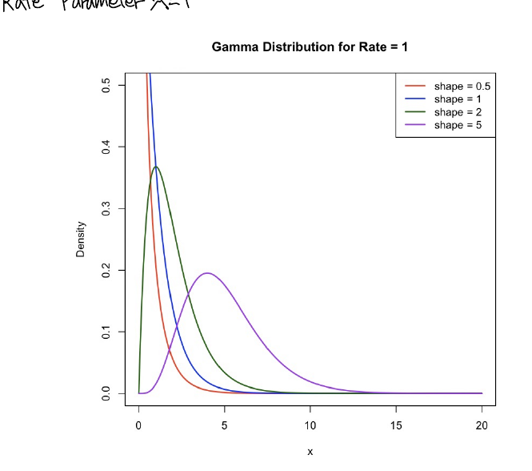{: width="520" }
_Gamma densities with rate 1 and shape 0.5, 1, 2, 5._

2\) Rate parameter $$\lambda = 1/2$$ (chi-squared).

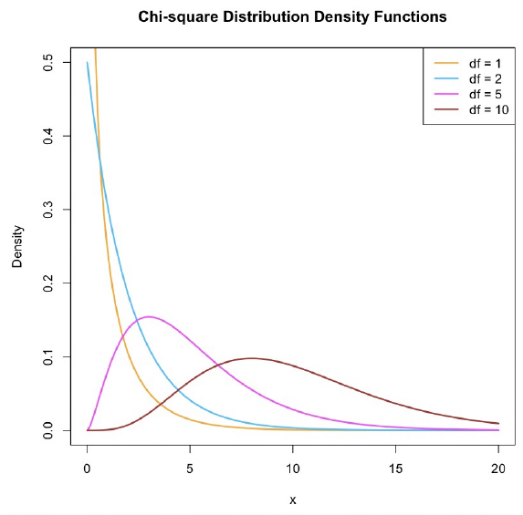{: width="520" }
_Chi-square density functions with 1, 2, 5, 10 degrees of freedom._

**② Fixed shape parameter.** For $$X \sim \mathrm{Gamma}(\alpha, \lambda)$$, the pdf of $$X$$ is $$f(x \mid \alpha, \lambda) = \dfrac{\lambda^{\alpha}}{\Gamma(\alpha)}x^{\alpha-1}e^{-\lambda x}I_{(x>0)}$$. As $$\lambda$$ increases, $$f$$ becomes steeper.

1\) Shape parameter $$\alpha = 1$$ (exponential).

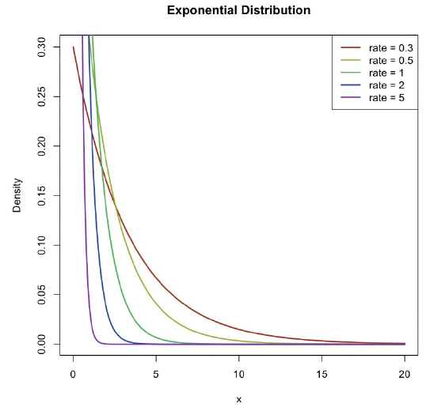{: width="520" }
_Exponential densities with rates 0.3, 0.5, 1, 2, 5._

3\) Shape parameter $$\alpha = 5$$.

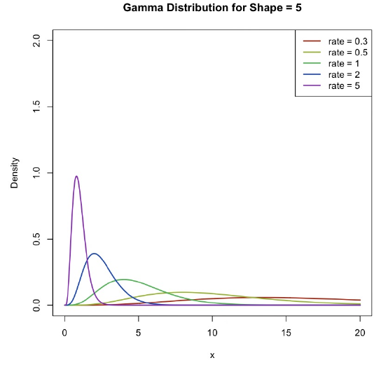{: width="520" }
_Gamma densities with shape 5 and rates 0.3, 0.5, 1, 2, 5._

### Shapes of the beta density

> **Problem 4 (shape of the beta density).** Classify and explain the shape of the beta density according to the values of its parameters, and draw representative shapes with R.
{: .problem #hw4-beta-shape }

For $$X \sim \mathrm{Beta}(\alpha, \beta)$$, the pdf of $$X$$ is $$f(x \mid \alpha, \beta) = \dfrac{\Gamma(\alpha + \beta)}{\Gamma(\alpha)\Gamma(\beta)}x^{\alpha-1}(1 - x)^{\beta-1}I_{(0<x<1)}$$.

**① The case where $$\beta$$ is fixed.**

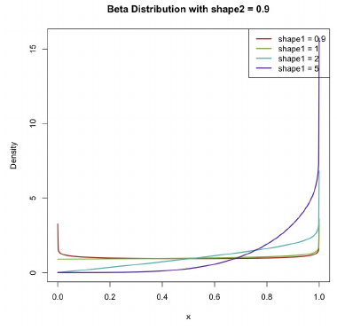{: width="400" }
_Beta distribution with shape2 = 0.9 (shape1 = 0.9, 1, 2, 5)._

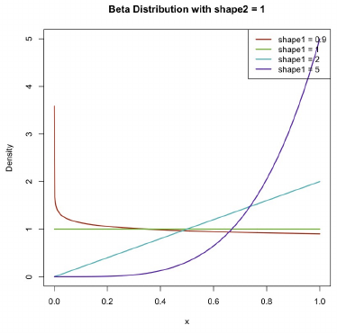{: width="400" }
_Beta distribution with shape2 = 1._

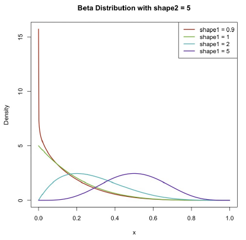{: width="400" }
_Beta distribution with shape2 = 5._

**② The case where $$\alpha$$ is fixed.**

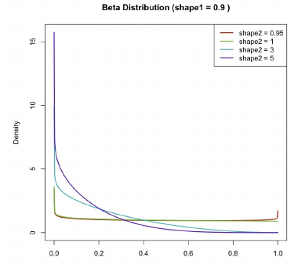{: width="400" }
_Beta distribution with shape1 = 0.9 (shape2 = 0.95, 1, 3, 5)._

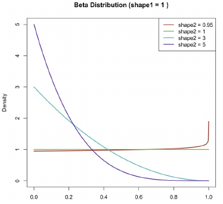{: width="400" }
_Beta distribution with shape1 = 1._

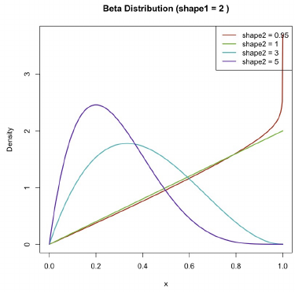{: width="400" }
_Beta distribution with shape1 = 2._

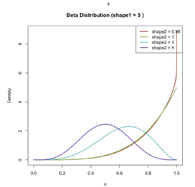{: width="400" }
_Beta distribution with shape1 = 5._

### Partitioned matrices

> **Problem 5 (partitioned matrices).** Let $$A = \begin{pmatrix}A_{11} & A_{12} \\ A_{21} & A_{22}\end{pmatrix}$$ with $$A_{22}$$ a nonsingular matrix, $$B = \begin{pmatrix}I & -A_{12}A_{22}^{-1} \\ 0 & I\end{pmatrix}$$, $$C = \begin{pmatrix}I & 0 \\ -A_{22}^{-1}A_{21} & I\end{pmatrix}$$, and $$A_{11 \cdot 2} = A_{11} - A_{12}A_{22}^{-1}A_{21}$$. Show the following.
>
> (a) $$BA = \begin{pmatrix}A_{11 \cdot 2} & 0 \\ A_{21} & A_{22}\end{pmatrix}$$, $$AC = \begin{pmatrix}A_{11 \cdot 2} & A_{12} \\ 0 & A_{22}\end{pmatrix}$$, $$BAC = \begin{pmatrix}A_{11 \cdot 2} & 0 \\ 0 & A_{22}\end{pmatrix}$$.
> (b) $$\det A = \det(A_{11 \cdot 2})\det(A_{22})$$.
> (c) $$A^{-1} = \begin{pmatrix}A_{11 \cdot 2}^{-1} & -A_{11 \cdot 2}^{-1}A_{12}A_{22}^{-1} \\ -A_{22}^{-1}A_{21}A_{11 \cdot 2}^{-1} & A_{22}^{-1}A_{21}A_{11 \cdot 2}^{-1}A_{12}A_{22}^{-1} + A_{22}^{-1}\end{pmatrix}$$.
> (d) (Woodbury formula) For matrices $$A, U, C, V$$ for which the inverses and products below exist, $$(A + UCV)^{-1} = A^{-1} - A^{-1}U(C^{-1} + VA^{-1}U)^{-1}VA^{-1}$$.
> (e) For a nonsingular matrix $$C$$, $$\det(C + yy^T) = \det(C)\,(1 + y^TC^{-1}y)$$.
{: .problem #hw4-partitioned }

**(a)**

$$
BA = \begin{pmatrix}I & -A_{12}A_{22}^{-1} \\ 0 & I\end{pmatrix}\begin{pmatrix}A_{11} & A_{12} \\ A_{21} & A_{22}\end{pmatrix} = \begin{pmatrix}A_{11} - A_{12}A_{22}^{-1}A_{21} & A_{12} - A_{12}A_{22}^{-1}A_{22} \\ A_{21} & A_{22}\end{pmatrix} = \begin{pmatrix}A_{11 \cdot 2} & 0 \\ A_{21} & A_{22}\end{pmatrix}.
$$

Also

$$
AC = \begin{pmatrix}A_{11} & A_{12} \\ A_{21} & A_{22}\end{pmatrix}\begin{pmatrix}I & 0 \\ -A_{22}^{-1}A_{21} & I\end{pmatrix} = \begin{pmatrix}A_{11} - A_{12}A_{22}^{-1}A_{21} & A_{12} \\ A_{21} - A_{22}A_{22}^{-1}A_{21} & A_{22}\end{pmatrix} = \begin{pmatrix}A_{11 \cdot 2} & A_{12} \\ 0 & A_{22}\end{pmatrix}.
$$

And

$$
BAC = (BA)C = \begin{pmatrix}A_{11 \cdot 2} & 0 \\ A_{21} & A_{22}\end{pmatrix}\begin{pmatrix}I & 0 \\ -A_{22}^{-1}A_{21} & I\end{pmatrix} = \begin{pmatrix}A_{11 \cdot 2} & 0 \\ A_{21} - A_{22}A_{22}^{-1}A_{21} & A_{22}\end{pmatrix} = \begin{pmatrix}A_{11 \cdot 2} & 0 \\ 0 & A_{22}\end{pmatrix}.
$$

**(b)** $$B$$ is an upper triangular block matrix whose diagonal blocks are all identity matrices, and $$C$$ is a lower triangular block matrix whose diagonal blocks are all identity matrices, so $$\det(B) = \det(C) = (\det(I))^2 = 1$$. Also $$\det(BAC) = \det(B)\det(A)\det(C)$$, so $$\det(BAC) = \det(A)$$. Therefore

$$
\det(A) = \det(BAC) = \det\begin{pmatrix}A_{11 \cdot 2} & 0 \\ 0 & A_{22}\end{pmatrix} = \det(A_{11 \cdot 2})\det(A_{22}).
$$

**(c)** Since $$BAC = \begin{pmatrix}A_{11 \cdot 2} & 0 \\ 0 & A_{22}\end{pmatrix}$$, we have $$(BAC)^{-1} = C^{-1}A^{-1}B^{-1} = \begin{pmatrix}A_{11 \cdot 2}^{-1} & 0 \\ 0 & A_{22}^{-1}\end{pmatrix}$$ ($$BAC$$ is a block diagonal matrix). Then

$$
A^{-1} = C(C^{-1}A^{-1}B^{-1})B = \begin{pmatrix}I & 0 \\ -A_{22}^{-1}A_{21} & I\end{pmatrix}\begin{pmatrix}A_{11 \cdot 2}^{-1} & 0 \\ 0 & A_{22}^{-1}\end{pmatrix}\begin{pmatrix}I & -A_{12}A_{22}^{-1} \\ 0 & I\end{pmatrix}
$$

$$
= \begin{pmatrix}A_{11 \cdot 2}^{-1} & 0 \\ -A_{22}^{-1}A_{21}A_{11 \cdot 2}^{-1} & A_{22}^{-1}\end{pmatrix}\begin{pmatrix}I & -A_{12}A_{22}^{-1} \\ 0 & I\end{pmatrix} = \begin{pmatrix}A_{11 \cdot 2}^{-1} & -A_{11 \cdot 2}^{-1}A_{12}A_{22}^{-1} \\ -A_{22}^{-1}A_{21}A_{11 \cdot 2}^{-1} & A_{22}^{-1}A_{21}A_{11 \cdot 2}^{-1}A_{12}A_{22}^{-1} + A_{22}^{-1}\end{pmatrix}.
$$

**(d)** In a way similar to (a) to (c), when $$A_{11}$$ is a nonsingular matrix, let $$A_{22 \cdot 1} = A_{22} - A_{21}A_{11}^{-1}A_{12}$$, and let $$P = \begin{pmatrix}I & 0 \\ -A_{21}A_{11}^{-1} & I\end{pmatrix}$$ and $$Q = \begin{pmatrix}I & -A_{11}^{-1}A_{12} \\ 0 & I\end{pmatrix}$$. Then

$$
PAQ = \begin{pmatrix}I & 0 \\ -A_{21}A_{11}^{-1} & I\end{pmatrix}\begin{pmatrix}A_{11} & A_{12} \\ A_{21} & A_{22}\end{pmatrix}\begin{pmatrix}I & -A_{11}^{-1}A_{12} \\ 0 & I\end{pmatrix} = \begin{pmatrix}A_{11} & A_{12} \\ 0 & A_{22 \cdot 1}\end{pmatrix}\begin{pmatrix}I & -A_{11}^{-1}A_{12} \\ 0 & I\end{pmatrix} = \begin{pmatrix}A_{11} & 0 \\ 0 & A_{22 \cdot 1}\end{pmatrix}.
$$

Therefore

$$
A^{-1} = Q(PAQ)^{-1}P = \begin{pmatrix}I & -A_{11}^{-1}A_{12} \\ 0 & I\end{pmatrix}\begin{pmatrix}A_{11}^{-1} & 0 \\ 0 & A_{22 \cdot 1}^{-1}\end{pmatrix}\begin{pmatrix}I & 0 \\ -A_{21}A_{11}^{-1} & I\end{pmatrix}
$$

$$
= \begin{pmatrix}A_{11}^{-1} + A_{11}^{-1}A_{12}A_{22 \cdot 1}^{-1}A_{21}A_{11}^{-1} & -A_{11}^{-1}A_{12}A_{22 \cdot 1}^{-1} \\ -A_{22 \cdot 1}^{-1}A_{21}A_{11}^{-1} & A_{22 \cdot 1}^{-1}\end{pmatrix}.
$$

So, by comparing the lower-right blocks in (c) and (d), when $$A_{11}$$ and $$A_{22}$$ are nonsingular matrices,

$$
A_{22 \cdot 1}^{-1} = A_{22}^{-1}A_{21}A_{11 \cdot 2}^{-1}A_{12}A_{22}^{-1} + A_{22}^{-1},
$$

that is,

$$
\bigl(A_{22} - A_{21}A_{11}^{-1}A_{12}\bigr)^{-1} = A_{22}^{-1} + A_{22}^{-1}A_{21}\bigl(A_{11} - A_{12}A_{22}^{-1}A_{21}\bigr)^{-1}A_{12}A_{22}^{-1}.
$$

Therefore the Woodbury formula $$(A + UCV)^{-1} = A^{-1} - A^{-1}U(C^{-1} + VA^{-1}U)^{-1}VA^{-1}$$ can be proved (with $$A \to A_{22}$$, $$U \to -A_{21}$$, $$C \to A_{11}^{-1}$$, $$V \to A_{12}$$).

**(e)** Let $$C$$ be a nonsingular matrix and let $$U = \begin{pmatrix}1 & y^T \\ -y & C\end{pmatrix}$$. Then by (b),

$$
\det(U) = \det(C)\det\bigl(1 + y^TC^{-1}y\bigr) = \det(C)\bigl(1 + y^TC^{-1}y\bigr).
$$

Also, in $$\det(U) = \det\begin{pmatrix}1 & y^T \\ -y & C\end{pmatrix}$$, let $$C$$ be an $$n \times n$$ matrix and $$y = (y_1, \dots, y_n)^T$$. Let $$V$$ be the matrix obtained by adding $$y_i$$ times the first row to the $$(i+1)$$-th row of $$U$$, for each $$i$$. Then

$$
\det(U) = \det(V) = \det\begin{pmatrix}1 & y^T \\ 0 & C + yy^T\end{pmatrix} = \det(C + yy^T).
$$

Therefore $$\det(C + yy^T) = \det(C)\bigl(1 + y^TC^{-1}y\bigr)$$.

## References

- 김우철, *수리통계학* (Mathematical Statistics), revised 2nd edition, 민영사, 2021 — Chapter 3 exercises 3.1 to 3.18. The exercise statements are translated from the book.
- Mathematical Statistics 1 (326.311), Seoul National University, Spring 2025. Instructor: Jaeyong Lee (이재용). The additional problems are from the course's Homework 4.
- The answers are mine, translated into English.

[Overview](/posts/mathstat1-overview/) · [Chapter 2 Exercises](/posts/mathstat1-exercises-chapter-2/) · [Chapter 3 Part 5](/posts/mathstat1-normal/) · [Chapter 4 Exercises](/posts/mathstat1-exercises-chapter-4/)
