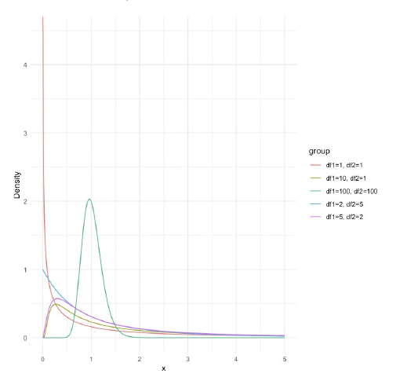
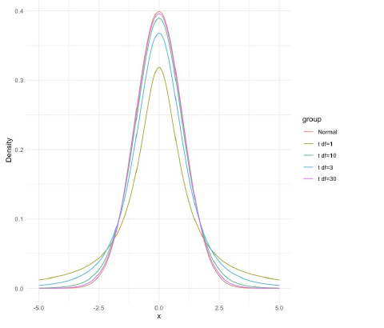
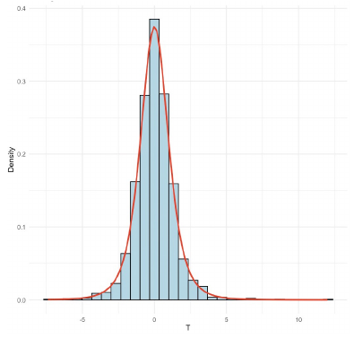
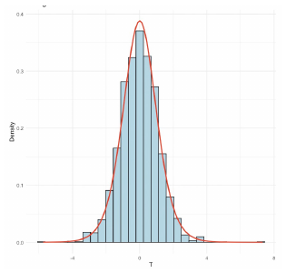
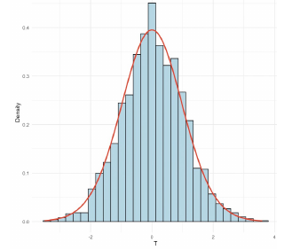
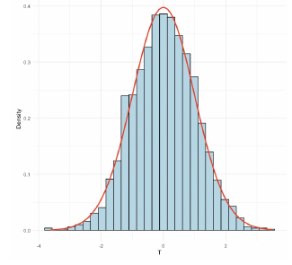

> The exercise statements are from the textbook; the answers are my own, translated into English. These exercises use [Parts 1 to 4](/posts/mathstat1-transformations-sampling/) of Chapter 4. Throughout, $$u$$ denotes the transformation, $$u^{-1}$$ its inverse, and $$f$$ with a subscript the pdf of the variables named there.
{: .prompt-info }

### Exercise 4.1

> **Exercise 4.1.** For a random variable $$X$$ following the uniform distribution $$U(-\pi/2, \pi/2)$$, find the pdf of $$Y = \tan X$$.
{: .problem #ex4-1 }

Let $$f_X(x)$$ and $$f_Y(y)$$ be the pdfs of $$X$$ and $$Y$$, and $$u(X) = Y$$, so $$u(X) = \tan X$$. Since $$X \sim U(-\frac{\pi}{2}, \frac{\pi}{2})$$, $$f_X(x) = \frac{1}{\pi}I_{(-\frac{\pi}{2} < x < \frac{\pi}{2})}$$.

The function $$u$$ is a one-to-one correspondence from $$(-\frac{\pi}{2}, \frac{\pi}{2})$$ onto $$\mathbb{R}$$, and $$u^{-1}(y) = \arctan y = x$$, so

$$
f_Y(y) = f_X(u^{-1}(y))\Bigl\lvert\frac{du^{-1}(y)}{dy}\Bigr\rvert = \frac{1}{\pi}I_{(-\frac{\pi}{2} < \arctan y < \frac{\pi}{2})}\Bigl\lvert\frac{d}{dy}\arctan y\Bigr\rvert = \frac{1}{\pi(1 + y^2)}I_{(-\infty < y < \infty)}.
$$

### Exercise 4.2

> **Exercise 4.2.** The joint pdf of random variables $$X_1, X_2$$ is $$f(x_1, x_2) = 2e^{-x_1-x_2}I_{(0<x_1<x_2)}$$. Find the joint pdf of $$Y_1 = X_1$$, $$Y_2 = X_2 - X_1$$, and decide whether $$Y_1$$ and $$Y_2$$ are independent.
{: .problem #ex4-2 }

Let $$u(X_1, X_2) = (X_1, X_2 - X_1) = (Y_1, Y_2)$$. The function $$u$$ is a one-to-one correspondence and $$u^{-1}(Y_1, Y_2) = (Y_1, Y_1 + Y_2) = (X_1, X_2)$$, so

$$
f_{Y_1,Y_2}(y_1, y_2) = f(u^{-1}(y_1, y_2))\Bigl\lvert\det\Bigl(\frac{\partial u^{-1}(y_1, y_2)}{\partial(y_1, y_2)}\Bigr)\Bigr\rvert = f(y_1, y_1 + y_2)\Bigl\lvert\det\begin{pmatrix}1 & 0 \\ 1 & 1\end{pmatrix}\Bigr\rvert
$$

$$
= 2e^{-(2y_1+y_2)}I_{(0<y_1<y_1+y_2)} = 2e^{-2y_1}I_{(y_1>0)}\,e^{-y_2}I_{(y_2>0)}.
$$

Since the joint pdf of $$(Y_1, Y_2)$$ is a product of a function of $$y_1$$ and a function of $$y_2$$, the two random variables $$Y_1$$ and $$Y_2$$ are independent.

### Exercise 4.3

> **Exercise 4.3.** The joint pdf of $$X_1, X_2$$ is $$f(x_1, x_2) = 8x_1x_2I_{(0<x_1<x_2<1)}$$. Find the joint pdf of $$Y_1 = X_1/X_2$$, $$Y_2 = X_2$$, and decide whether $$Y_1$$ and $$Y_2$$ are independent.
{: .problem #ex4-3 }

Let $$u(X_1, X_2) = (X_1/X_2, X_2) = (Y_1, Y_2)$$. For two different vectors $$(x_1, x_2)$$ and $$(x_1', x_2')$$ (with $$0 < x_1 < x_2 < 1$$ and $$0 < x_1' < x_2' < 1$$), suppose $$u(x_1, x_2) = u(x_1', x_2')$$. Then $$\frac{x_1}{x_2} = \frac{x_1'}{x_2'}$$ and $$x_2 = x_2'$$, so $$x_1 = x_1'$$; that is, $$(x_1, x_2) = (x_1', x_2')$$, a contradiction. By contraposition, $$(x_1, x_2) \ne (x_1', x_2')$$ implies $$u(x_1, x_2) \ne u(x_1', x_2')$$, so $$u$$ is a one-to-one correspondence. Also $$u^{-1}(Y_1, Y_2) = (Y_1Y_2, Y_2) = (X_1, X_2)$$, so

$$
f_{Y_1,Y_2}(y_1, y_2) = f(y_1y_2, y_2)\Bigl\lvert\det\begin{pmatrix}y_2 & y_1 \\ 0 & 1\end{pmatrix}\Bigr\rvert = 8y_1y_2^3I_{(0<y_1y_2<y_2<1)} = 2y_1I_{(0<y_1<1)}\times 4y_2^3I_{(0<y_2<1)}.
$$

Since the joint pdf of $$(Y_1, Y_2)$$ is a product of a function of $$y_1$$ and a function of $$y_2$$, $$Y_1$$ and $$Y_2$$ are independent.

### Exercise 4.4

> **Exercise 4.4.** The joint pdf of $$X_1, X_2, X_3$$ is $$f(x_1, x_2, x_3) = 6e^{-x_1-x_2-x_3}I_{(0\le x_1\le x_2\le x_3)}$$. Find the joint pdf of $$Y_1 = X_1$$, $$Y_2 = X_2 - X_1$$, $$Y_3 = X_3 - X_2$$, and decide whether $$Y_1, Y_2, Y_3$$ are independent.
{: .problem #ex4-4 }

Let $$u(X_1, X_2, X_3) = (X_1, X_2 - X_1, X_3 - X_2) = (Y_1, Y_2, Y_3)$$. The function $$u$$ is a one-to-one correspondence and $$u^{-1}(Y_1, Y_2, Y_3) = (Y_1, Y_1 + Y_2, Y_1 + Y_2 + Y_3) = (X_1, X_2, X_3)$$, so

$$
f_{Y_1,Y_2,Y_3}(y_1, y_2, y_3) = f(y_1, y_1 + y_2, y_1 + y_2 + y_3)\Bigl\lvert\det\begin{pmatrix}1 & 0 & 0 \\ 1 & 1 & 0 \\ 1 & 1 & 1\end{pmatrix}\Bigr\rvert
$$

$$
= 6e^{-3y_1-2y_2-y_3}I_{(0\le y_1\le y_1+y_2\le y_1+y_2+y_3)} = 3e^{-3y_1}I_{(y_1>0)}\ 2e^{-2y_2}I_{(y_2>0)}\ e^{-y_3}I_{(y_3>0)}.
$$

Since the joint pdf of $$(Y_1, Y_2, Y_3)$$ is a product of functions of $$y_1$$, $$y_2$$, $$y_3$$ respectively, the three random variables $$Y_1, Y_2, Y_3$$ are independent.

### Exercise 4.5

> **Exercise 4.5.** The random variables $$X_1, X_2, X_3$$ are independent and each has the marginal pdf $$f(x) = e^{-x}I_{(0,\infty)}(x)$$. (a) Find the joint pdf of $$Y_1 = X_1$$, $$Y_2 = X_1 + X_2$$, $$Y_3 = X_1 + X_2 + X_3$$. (b) Find the joint pdf of $$Y_1, Y_3$$.
{: .problem #ex4-5 }

**(a)** Let $$f_{X_1,X_2,X_3}(x_1, x_2, x_3)$$ be the joint pdf of $$(X_1, X_2, X_3)$$. Since $$X_1, X_2, X_3$$ are independent, $$f_{X_1,X_2,X_3}(x_1, x_2, x_3) = e^{-x_1-x_2-x_3}I_{(x_1>0)}I_{(x_2>0)}I_{(x_3>0)}$$.

Let $$u(X_1, X_2, X_3) = (X_1, X_1 + X_2, X_1 + X_2 + X_3) = (Y_1, Y_2, Y_3)$$. The function $$u$$ is a one-to-one correspondence and $$u^{-1}(Y_1, Y_2, Y_3) = (Y_1, Y_2 - Y_1, Y_3 - Y_2) = (X_1, X_2, X_3)$$, so

$$
f_{Y_1,Y_2,Y_3}(y_1, y_2, y_3) = f(y_1, y_2 - y_1, y_3 - y_2)\Bigl\lvert\det\begin{pmatrix}1 & 0 & 0 \\ -1 & 1 & 0 \\ 0 & -1 & 1\end{pmatrix}\Bigr\rvert
$$

$$
= e^{-y_3}I_{(y_1>0)}I_{(y_2-y_1>0)}I_{(y_3-y_2>0)} = e^{-y_3}I_{(0<y_1<y_2<y_3)}.
$$

**(b)** The joint pdf of $$(Y_1, Y_3)$$ is

$$
f_{Y_1,Y_3}(y_1, y_3) = \int_{-\infty}^{\infty}f_{Y_1,Y_2,Y_3}(y_1, y_2, y_3)\,dy_2 = e^{-y_3}I_{(0<y_1<y_3)}\int_{y_1}^{y_3}dy_2 = (y_3 - y_1)e^{-y_3}I_{(0<y_1<y_3)}.
$$

### Exercise 4.6

> **Exercise 4.6.** The joint pdf of $$X_1, X_2$$ is $$f_{1,2}(x_1, x_2) = 2e^{-x_1-x_2}I_{(0<x_1<x_2<\infty)}$$, and $$Y_1 = X_1/X_2$$, $$Y_2 = X_2$$. (a) Find the pdf of $$Y_1$$. (b) Find $$E(Y_2 \mid Y_1)$$ and $$\mathrm{Var}(Y_2 \mid Y_1)$$.
{: .problem #ex4-6 }

**(a)** Let $$u(X_1, X_2) = (X_1/X_2, X_2) = (Y_1, Y_2)$$. As in 4.3, for two different vectors $$(x_1, x_2)$$ and $$(x_1', x_2')$$ (with $$0 < x_1 < x_2$$ and $$0 < x_1' < x_2'$$), $$(x_1, x_2) \ne (x_1', x_2')$$ implies $$u(x_1, x_2) \ne u(x_1', x_2')$$, so $$u$$ is a one-to-one correspondence. Also $$u^{-1}(Y_1, Y_2) = (Y_1Y_2, Y_2) = (X_1, X_2)$$, so

$$
f_{Y_1,Y_2}(y_1, y_2) = f(y_1y_2, y_2)\Bigl\lvert\det\begin{pmatrix}y_2 & y_1 \\ 0 & 1\end{pmatrix}\Bigr\rvert = 2y_2e^{-(y_1+1)y_2}I_{(0<y_1y_2<y_2)} = 2y_2e^{-(y_1+1)y_2}I_{(0<y_1<1)}I_{(y_2>0)}.
$$

Then

$$
f_{Y_1}(y_1) = \int_{-\infty}^{\infty}f_{Y_1,Y_2}(y_1, y_2)\,dy_2 = \int_0^{\infty}2y_2e^{-(y_1+1)y_2}\,dy_2\,I_{(0<y_1<1)} = \frac{2}{(y_1+1)^2}I_{(0<y_1<1)}.
$$

**(b)** Let $$f_{Y_2\mid Y_1}(y_2 \mid y_1)$$ be the conditional pdf of $$Y_2$$ given $$Y_1 = y_1$$ ($$0 < y_1 < 1$$). Then

$$
f_{Y_2\mid Y_1}(y_2 \mid y_1) = \frac{f_{Y_1,Y_2}(y_1, y_2)}{f_{Y_1}(y_1)} = (y_1+1)^2y_2e^{-(y_1+1)y_2}I_{(y_2>0)}.
$$

Let $$Z = (y_1 + 1)Y_2$$ and let $$f_Z(z)$$ be the pdf of $$Z$$. The function $$u(Y_2 \mid Y_1 = y_1) = (y_1 + 1)Y_2$$ is a one-to-one correspondence with $$u^{-1}(z) = \frac{z}{y_1+1}$$, so

$$
f_Z(z) = f_{Y_2\mid Y_1}(u^{-1}(z))\Bigl\lvert\frac{du^{-1}(z)}{dz}\Bigr\rvert = ze^{-z}I_{(z>0)}.
$$

That is, $$Z \sim \mathrm{Gamma}(2, 1)$$, so under the condition $$Y_1 = y_1$$, $$(y_1 + 1)Y_2 \sim \mathrm{Gamma}(2, 1)$$. Therefore $$E((y_1+1)Y_2 \mid Y_1 = y_1) = 2 \times 1 = 2$$ and $$\mathrm{Var}((y_1+1)Y_2 \mid Y_1 = y_1) = 2 \times 1^2 = 2$$. Hence $$E(Y_2 \mid Y_1 = y_1) = \dfrac{2}{y_1+1}$$ and $$\mathrm{Var}(Y_2 \mid Y_1 = y_1) = \dfrac{2}{(y_1+1)^2}$$; that is,

$$
E(Y_2 \mid Y_1) = \frac{2}{Y_1 + 1}, \qquad \mathrm{Var}(Y_2 \mid Y_1) = \frac{2}{(Y_1 + 1)^2}.
$$

### Exercise 4.7

> **Exercise 4.7.** The joint pdf of $$X_1, X_2$$ is $$f(x_1, x_2) = 2e^{-x_1-x_2}I_{(0<x_1<x_2)}$$. Find the pdf of $$Y = X_1 + X_2$$.
{: .problem #ex4-7 }

To find the pdf of $$Y$$, define the random variable $$Z = X_2$$, find the joint pdf of $$(Y, Z)$$, and from it the pdf of $$Y$$. Let $$u(X_1, X_2) = (X_1 + X_2, X_2) = (Y, Z)$$. The function $$u$$ is a one-to-one correspondence and $$u^{-1}(Y, Z) = (Y - Z, Z) = (X_1, X_2)$$, so

$$
f_{Y,Z}(y, z) = f(y - z, z)\Bigl\lvert\det\begin{pmatrix}1 & -1 \\ 0 & 1\end{pmatrix}\Bigr\rvert = 2e^{-y}I_{(0<y-z<z)} = 2e^{-y}I_{(0<\frac{1}{2}y<z<y)}.
$$

Let $$f_Y(y)$$ be the pdf of $$Y$$. Then

$$
f_Y(y) = \int_{-\infty}^{\infty}f_{Y,Z}(y, z)\,dz = \int_{y/2}^{y}2e^{-y}\,dz\,I_{(y>0)} = ye^{-y}I_{(y>0)}.
$$

### Exercise 4.8

> **Exercise 4.8.** For a random variable $$X$$ with the following pdf, find the pdf of $$Y = X^2$$. (a) $$f(x) = \frac{1}{4}I_{(-2,2)}(x)$$ (b) $$f(x) = \frac{1}{4}I_{(-1,3)}(x)$$
{: .problem #ex4-8 }

**(a)** Let $$f_Y(y)$$ be the pdf of $$Y = X^2$$. The $$X$$ with $$Y = y$$ is $$X = \sqrt{y}$$ or $$-\sqrt{y}$$, so the transformation $$Y = X^2$$ is two-to-one. Let $$u_1(X) = X^2 = Y$$ ($$0 \le X < 2$$) and $$u_2(X) = X^2 = Y$$ ($$-2 < X < 0$$). Then

$$
f_Y(y) = \sum_{i=1}^{2}f(u_i^{-1}(y))\Bigl\lvert\frac{du_i^{-1}(y)}{dy}\Bigr\rvert = \frac{1}{4}I_{(0\le\sqrt{y}<2)}\Bigl\lvert\frac{1}{2\sqrt{y}}\Bigr\rvert + \frac{1}{4}I_{(-2<-\sqrt{y}<0)}\Bigl\lvert-\frac{1}{2\sqrt{y}}\Bigr\rvert = \frac{1}{4\sqrt{y}}I_{(0<y<4)}.
$$

**(b)** For $$-1 < y < 1$$, the $$X$$ with $$Y = y$$ is $$X = \sqrt{y}$$ or $$-\sqrt{y}$$, so $$Y = X^2$$ is a two-to-one transformation, and for $$1 \le y < 9$$ it is $$X = \sqrt{y}$$ only, so $$Y = X^2$$ is one-to-one there. Let $$u_1(X) = X^2 = Y$$ ($$-1 < X < 0$$), $$u_2(X) = X^2 = Y$$ ($$0 \le X < 1$$), $$u_3(X) = X^2 = Y$$ ($$1 \le X < 3$$). Then

$$
f_Y(y) = \sum_{i=1}^{3}f(u_i^{-1}(y))\Bigl\lvert\frac{du_i^{-1}(y)}{dy}\Bigr\rvert = \frac{1}{4}I_{(-1<-\sqrt{y}<0)}\Bigl\lvert-\frac{1}{2\sqrt{y}}\Bigr\rvert + \frac{1}{4}I_{(0\le\sqrt{y}<1)}\Bigl\lvert\frac{1}{2\sqrt{y}}\Bigr\rvert + \frac{1}{4}I_{(1\le\sqrt{y}<3)}\Bigl\lvert\frac{1}{2\sqrt{y}}\Bigr\rvert
$$

$$
= \frac{1}{4\sqrt{y}}I_{(0<y\le1)} + \frac{1}{8\sqrt{y}}I_{(1<y<9)}.
$$

### Exercise 4.9

> **Exercise 4.9.** The joint pdf of $$X_1, X_2$$ is $$f(x_1, x_2) = \frac{1}{\pi}I_{(x_1^2+x_2^2<1)}$$. (a) Find the joint pdf of $$R, \Theta$$ defined by the polar coordinates $$X_1 = R\cos\Theta$$, $$X_2 = R\sin\Theta$$, $$R \ge 0$$, $$0 \le \Theta < 2\pi$$. (b) Find the joint pdf of $$Y_1 = \sqrt{X_1^2 + X_2^2}$$, $$Y_2 = \dfrac{X_1}{\sqrt{X_1^2 + X_2^2}}$$.
{: .problem #ex4-9 }

**(a)** Let $$u(X_1, X_2) = (R, \Theta)$$, so $$u^{-1}(R, \Theta) = (R\cos\Theta, R\sin\Theta)$$ ($$R \ge 0$$, $$0 \le \Theta < 2\pi$$). The function $$u^{-1}$$ is a one-to-one correspondence, hence so is $$u$$. Therefore

$$
f_{R,\Theta}(r, \theta) = f(u^{-1}(r, \theta))\Bigl\lvert\det\Bigl(\frac{\partial u^{-1}(r, \theta)}{\partial(r, \theta)}\Bigr)\Bigr\rvert = \frac{1}{\pi}I_{(r<1)}\Bigl\lvert\det\begin{pmatrix}\cos\theta & \sin\theta \\ -r\sin\theta & r\cos\theta\end{pmatrix}\Bigr\rvert = \frac{1}{\pi}rI_{(r<1)}\quad(r \ge 0,\ 0 \le \theta < 2\pi).
$$

That is, $$f_{R,\Theta}(r, \theta) = \dfrac{1}{\pi}rI_{(0\le r<1)}I_{(0\le\theta<2\pi)}$$.

**(b)** Let $$X_1 = R\cos\Theta$$, $$X_2 = R\sin\Theta$$ ($$R \ge 0$$, $$0 \le \Theta < 2\pi$$). Then $$Y_1 = R$$, $$Y_2 = \cos\Theta$$. The $$(r, \theta)$$ with $$(Y_1, Y_2) = (y_1, y_2)$$ is $$(r, \theta) = (y_1, \arccos y_2)$$ ($$0 \le y_2 < \pi$$ in the angle) or $$(y_1, 2\pi - \arccos y_2)$$ ($$\pi \le \theta < 2\pi$$), so the transformation $$Y_1 = R$$, $$Y_2 = \cos\Theta$$ is two-to-one. Let $$u_1(R, \Theta) = (R, \cos\Theta)$$ ($$R \ge 0$$, $$0 \le \Theta < \pi$$) and $$u_2(R, \Theta) = (R, \cos\Theta)$$ ($$\pi \le \Theta < 2\pi$$). Then $$u_1^{-1}(Y_1, Y_2) = (Y_1, \arccos Y_2)$$ and $$u_2^{-1}(Y_1, Y_2) = (Y_1, 2\pi - \arccos Y_2)$$, so

$$
f_{Y_1,Y_2}(y_1, y_2) = \sum_{i=1}^{2}f_{R,\Theta}(u_i^{-1}(y_1, y_2))\Bigl\lvert\det\Bigl(\frac{du_i^{-1}(y_1, y_2)}{d(y_1, y_2)}\Bigr)\Bigr\rvert
$$

$$
= \frac{1}{\pi}y_1I_{(0\le y_1<1)}I_{(0\le\arccos y_2<\pi)}\Bigl\lvert\det\begin{pmatrix}1 & 0 \\ 0 & -\frac{1}{\sqrt{1-y_2^2}}\end{pmatrix}\Bigr\rvert + \frac{1}{\pi}y_1I_{(0\le y_1<1)}I_{(\pi\le2\pi-\arccos y_2<2\pi)}\Bigl\lvert\det\begin{pmatrix}1 & 0 \\ 0 & \frac{1}{\sqrt{1-y_2^2}}\end{pmatrix}\Bigr\rvert
$$

$$
= \frac{2y_1}{\pi\sqrt{1-y_2^2}}I_{(0\le y_1<1)}I_{(-1<y_2<1)}.
$$

### Exercise 4.10

> **Exercise 4.10.** In a Poisson process $$\{N_t : t \ge 0\}$$ with occurrence rate $$\lambda$$, let $$W_r = \min\{t : N_t \ge r\}$$ ($$r = 1, 2, \dots$$) be the time until the $$r$$-th occurrence. (a) Find the joint pdf of $$(Y_1, Y_2, \dots, Y_k)' = (W_1/W_{k+1}, (W_2 - W_1)/W_{k+1}, \dots, (W_k - W_{k-1})/W_{k+1})'$$. (b) Find the joint pdf of $$(X, Y)' = (W_2/W_5, W_4/W_5)'$$.
{: .problem #ex4-10 }

**(a)** Define $$W_r = \min\{t : N_t \ge r\}$$ ($$r = 1, 2, \dots$$). Then $$W_r \sim \mathrm{Gamma}(r, \lambda)$$ and $$W_1, W_2 - W_1, W_3 - W_2, \dots \overset{iid}{\sim} \mathrm{Exp}(\lambda)$$. Therefore, with $$X_1 = W_1, \dots, X_k = W_k - W_{k-1}$$, $$X_{k+1} = W_{k+1} - W_k$$ ($$k \in \mathbb{N}$$), the pdf of $$(X_1, \dots, X_{k+1})$$ is

$$
f_{1,\dots,k+1}(x_1, \dots, x_{k+1}) = \prod_{i=1}^{k+1}\bigl(\lambda e^{-\lambda x_i}I_{(x_i>0)}\bigr).
$$

Define $$Y_{k+1} = W_{k+1}$$ and find the joint pdf of $$(Y_1, \dots, Y_{k+1})$$ from the joint pdf of $$(X_1, \dots, X_{k+1})$$. Let $$u(X_1, \dots, X_{k+1}) = (Y_1, \dots, Y_{k+1}) = \Bigl(\dfrac{X_1}{X_1 + \cdots + X_{k+1}}, \dots, \dfrac{X_k}{X_1 + \cdots + X_{k+1}}, X_1 + \cdots + X_{k+1}\Bigr)$$. For every $$i \in \{1, 2, \dots, k+1\}$$, $$X_i > 0$$, so the function $$u$$ is a one-to-one correspondence and $$u^{-1}(Y_1, \dots, Y_{k+1}) = \bigl(Y_1Y_{k+1}, \dots, Y_kY_{k+1}, Y_{k+1}(1 - (Y_1 + \cdots + Y_k))\bigr)$$. Hence the joint pdf of $$(Y_1, \dots, Y_{k+1})$$ is

$$
f_{Y_1,\dots,Y_{k+1}}(y_1, \dots, y_{k+1}) = f_{1,\dots,k+1}\bigl(u^{-1}(y_1, \dots, y_{k+1})\bigr)\Bigl\lvert\det\Bigl(\frac{\partial u^{-1}(y_1, \dots, y_{k+1})}{\partial(y_1, \dots, y_{k+1})}\Bigr)\Bigr\rvert
$$

$$
= \lambda^{k+1}e^{-\lambda y_{k+1}}I_{(y_1y_{k+1}>0)}\cdots I_{(y_ky_{k+1}>0)}I_{(y_{k+1}(1-(y_1+\cdots+y_k))>0)}\times\Bigl\lvert\det\begin{pmatrix}y_{k+1} & 0 & \cdots & 0 & y_1 \\ 0 & y_{k+1} & \cdots & 0 & y_2 \\ \vdots & \vdots & \ddots & \vdots & \vdots \\ 0 & 0 & \cdots & y_{k+1} & y_k \\ -y_{k+1} & -y_{k+1} & \cdots & -y_{k+1} & 1 - \sum_{i=1}^{k}y_i\end{pmatrix}\Bigr\rvert.
$$

The determinant is $$y_{k+1}^k$$, so

$$
f_{Y_1,\dots,Y_{k+1}}(y_1, \dots, y_{k+1}) = \lambda^{k+1}e^{-\lambda y_{k+1}}y_{k+1}^kI_{(\sum_{i=1}^{k}y_i<1)}\prod_{i=1}^{k+1}I_{(y_i>0)} = \lambda(\lambda y_{k+1})^ke^{-\lambda y_{k+1}}I_{(\sum_{i=1}^{k}y_i<1)}\prod_{i=1}^{k+1}I_{(y_i>0)}.
$$

Therefore the joint pdf of $$(Y_1, \dots, Y_k)$$ is

$$
f_{Y_1,\dots,Y_k}(y_1, \dots, y_k) = \int_{-\infty}^{\infty}f_{Y_1,\dots,Y_{k+1}}(y_1, \dots, y_{k+1})\,dy_{k+1} = I_{(y_1+\cdots+y_k<1)}I_{(y_1>0)}\cdots I_{(y_k>0)}\int_0^{\infty}\lambda(\lambda y_{k+1})^ke^{-\lambda y_{k+1}}\,dy_{k+1}
$$

$$
= I_{(y_1+\cdots+y_k<1)}I_{(y_1>0)}\cdots I_{(y_k>0)}\,\Gamma(k+1) = \frac{\Gamma(k+1)}{\{\Gamma(1)\}^{k+1}}(y_1)^{1-1}\cdots(y_k)^{1-1}(1 - y_1 - \cdots - y_k)^{1-1}I_{(y_1>0)}\cdots I_{(y_k>0)}I_{(y_1+\cdots+y_k<1)}.
$$

That is, $$(Y_1, \dots, Y_k) \sim \mathrm{Dirichlet}(1, \dots, 1)$$ (with $$k + 1$$ ones).

**(b)** From the result of (a), $$(Y_1, Y_2, Y_3, Y_4) = \bigl(\frac{W_1}{W_5}, \frac{W_2 - W_1}{W_5}, \dots, \frac{W_4 - W_3}{W_5}\bigr) \sim \mathrm{Dirichlet}(1, 1, 1, 1, 1)$$. Using this, find the joint pdf of $$(X, Y) = \bigl(\frac{W_2}{W_5}, \frac{W_4}{W_5}\bigr)$$. Let $$U = \frac{W_1}{W_5}$$, $$V = \frac{W_3}{W_5}$$. Then $$U = Y_1$$, $$X = Y_1 + Y_2$$, $$V = Y_1 + Y_2 + Y_3$$, $$Y = Y_1 + Y_2 + Y_3 + Y_4$$. Let $$u(Y_1, Y_2, Y_3, Y_4) = (U, X, V, Y)$$. Since $$Y_1, \dots, Y_4$$ all take only positive values, $$u$$ is a one-to-one correspondence, and $$u^{-1}(U, X, V, Y) = (U, X - U, V - X, Y - V)$$. Hence the joint pdf of $$(U, X, V, Y)$$ is

$$
f_{U,X,V,Y}(u, x, v, y) = f_{Y_1,\dots,Y_4}(u^{-1}(u, x, v, y))\Bigl\lvert\det\Bigl(\frac{du^{-1}(u, x, v, y)}{d(u, x, v, y)}\Bigr)\Bigr\rvert = 4!\,I_{(u>0)}I_{(x-u>0)}I_{(v-x>0)}I_{(y-v>0)}I_{(y<1)}\Bigl\lvert\det\begin{pmatrix}1 & 0 & 0 & 0 \\ -1 & 1 & 0 & 0 \\ 0 & -1 & 1 & 0 \\ 0 & 0 & -1 & 1\end{pmatrix}\Bigr\rvert
$$

$$
= 24I_{(0<u<x<v<y<1)}.
$$

Therefore the joint pdf of $$(X, Y)$$ is

$$
f_{X,Y}(x, y) = \int_{-\infty}^{\infty}\int_{-\infty}^{\infty}f_{U,X,V,Y}(u, x, v, y)\,du\,dv = \int_x^y\int_0^x24\,du\,dv\ I_{(0<x<y<1)} = 24x(y - x)I_{(0<x<y<1)}.
$$

### Exercise 4.11

> **Exercise 4.11.** Show that for $$X \sim F(r_1, r_2)$$, $$Y = \dfrac{(r_1/r_2)X}{1 + (r_1/r_2)X}$$ follows the $$\mathrm{Beta}(r_1/2, r_2/2)$$ distribution.
{: .problem #ex4-11 }

For two independent random variables $$V_1 \sim \chi^2(r_1)$$, $$V_2 \sim \chi^2(r_2)$$, $$X \overset{d}{=} \dfrac{V_1/r_1}{V_2/r_2}$$. By the relation between the chi-squared and gamma distributions, $$V_1 \sim \mathrm{Gamma}(\frac{1}{2}r_1, 2)$$ and $$V_2 \sim \mathrm{Gamma}(\frac{1}{2}r_2, 2)$$, and $$V_1, V_2$$ are independent. Therefore

$$
Y = \frac{\frac{r_1}{r_2}X}{1 + \frac{r_1}{r_2}X} \overset{d}{=} \frac{\frac{V_1}{V_2}}{1 + \frac{V_1}{V_2}} = \frac{V_1}{V_1 + V_2}
$$

(since $$V_2$$ is a random variable taking only positive values). So, by the definition of the beta distribution, $$Y \sim \mathrm{Beta}(\frac{1}{2}r_1, \frac{1}{2}r_2)$$.

### Exercise 4.12

> **Exercise 4.12.** The random variables $$X_1, \dots, X_n$$ are independent and have the same marginal pdf $$f(x) = 3x^2I_{(0,1)}(x)$$. (a) Find the cdf of $$Y = \min_{1\le i\le n}X_i$$ and, from its derivative, the pdf. (b) Find the cdf of $$Y = \max_{1\le i\le n}X_i$$ and, from its derivative, the pdf.
{: .problem #ex4-12 }

The marginal cdf is $$F(x) = \int_{-\infty}^xf(t)\,dt = x^3I_{(0,1)}(x) + I_{(x\ge1)}$$, and $$X_1, \dots, X_n \overset{iid}{\sim} F$$.

**(a)** Let $$F_Y$$ and $$f_Y$$ be the cdf and pdf of $$Y = \min_{1\le i\le n}X_i$$. Then

$$
F_Y(y) = P(Y \le y) = P\Bigl(\min_{1\le i\le n}X_i \le y\Bigr) = 1 - P\Bigl(\min_{1\le i\le n}X_i > y\Bigr) = 1 - P\Bigl(\bigcap_{i=1}^{n}(X_i > y)\Bigr) = 1 - \prod_{i=1}^{n}P(X_i > y)
$$

(since $$X_1, \dots, X_n$$ are independent). Since $$X_1, \dots, X_n \overset{iid}{\sim} F$$, $$P(X_1 > y) = 1 - F(y) = P(X_2 > y) = \cdots = P(X_n > y)$$, so

$$
F_Y(y) = 1 - \bigl(P(X_1 > y)\bigr)^n = 1 - (1 - F(y))^n = \bigl(1 - (1 - y^3)^n\bigr)I_{(0<y<1)} + I_{(y\ge1)}.
$$

From the derivative of $$F_Y(y)$$, $$f_Y(y) = \dfrac{d}{dy}F_Y(y) = 3ny^2(1 - y^3)^{n-1}I_{(0<y<1)}$$.

**(b)** Let $$F_Y$$ and $$f_Y$$ be the cdf and pdf of $$Y = \max_{1\le i\le n}X_i$$. Then

$$
F_Y(y) = P\Bigl(\max_{1\le i\le n}X_i \le y\Bigr) = P\Bigl(\bigcap_{i=1}^{n}(X_i \le y)\Bigr) = \prod_{i=1}^{n}P(X_i \le y)
$$

(since $$X_1, \dots, X_n$$ are independent), and since $$X_1, \dots, X_n \overset{iid}{\sim} F$$, $$P(X_1 \le y) = F(y) = P(X_2 \le y) = \cdots = P(X_n \le y)$$. Therefore $$F_Y(y) = \bigl(P(X_1 \le y)\bigr)^n = (F(y))^n = y^{3n}I_{(0<y<1)} + I_{(y\ge1)}$$. From the derivative, $$f_Y(y) = \dfrac{d}{dy}F_Y(y) = 3ny^{3n-1}I_{(0<y<1)}$$.

### Exercise 4.13

> **Exercise 4.13.** For the three random variables with pdf $$f(x) = 2xI_{(0,1)}(x)$$, let the order statistics be $$X_{(1)} < X_{(2)} < X_{(3)}$$. (a) Show that $$Y_1 = X_{(1)}/X_{(2)}$$, $$Y_2 = X_{(2)}/X_{(3)}$$, $$Y_3 = X_{(3)}$$ are independent. (b) Find the conditional expectation $$E(X_{(2)} \mid X_{(3)})$$.
{: .problem #ex4-13 }

The marginal cdf is $$F(x) = x^2I_{(0,1)}(x) + I_{(x\ge1)}$$ and $$X_1, X_2, X_3 \overset{iid}{\sim} F$$. Let $$X_{(1)}, X_{(2)}, X_{(3)}$$ be the order statistics.

**(a)** Let $$f_{1,2,3}(x_1, x_2, x_3)$$ be the joint pdf of $$(X_{(1)}, X_{(2)}, X_{(3)})$$. Then $$f_{1,2,3}(x_1, x_2, x_3) = 3!\,f(x_1)f(x_2)f(x_3)I_{(x_1<x_2<x_3)} = 48x_1x_2x_3I_{(0<x_1<x_2<x_3<1)}$$. Let $$f_{Y_1,Y_2,Y_3}(y_1, y_2, y_3)$$ be the joint pdf of $$(Y_1, Y_2, Y_3)$$ and $$u(X_{(1)}, X_{(2)}, X_{(3)}) = \bigl(\frac{X_{(1)}}{X_{(2)}}, \frac{X_{(2)}}{X_{(3)}}, X_{(3)}\bigr) = (Y_1, Y_2, Y_3)$$. Since $$0 < X_{(1)} < X_{(2)} < X_{(3)} < 1$$, $$u$$ is a one-to-one correspondence and $$u^{-1}(Y_1, Y_2, Y_3) = (Y_1Y_2Y_3, Y_2Y_3, Y_3) = (X_{(1)}, X_{(2)}, X_{(3)})$$. Therefore

$$
f_{Y_1,Y_2,Y_3}(y_1, y_2, y_3) = f(u^{-1}(y_1, y_2, y_3))\Bigl\lvert\det\Bigl(\frac{\partial u^{-1}(y_1, y_2, y_3)}{\partial(y_1, y_2, y_3)}\Bigr)\Bigr\rvert = 48y_1y_2^2y_3^3\Bigl\lvert\det\begin{pmatrix}y_2y_3 & y_1y_3 & y_1y_2 \\ 0 & y_3 & y_2 \\ 0 & 0 & 1\end{pmatrix}\Bigr\rvert I_{(0<y_1y_2y_3<y_2y_3<y_3<1)}
$$

$$
= 48y_1y_2^3y_3^5\,I_{(0<y_1<1)}I_{(0<y_2<1)}I_{(0<y_3<1)} = 2y_1I_{(0<y_1<1)}\times4y_2^3I_{(0<y_2<1)}\times6y_3^5I_{(0<y_3<1)}.
$$

Since the joint pdf of $$(Y_1, Y_2, Y_3)$$ is a product of functions of $$y_1$$, $$y_2$$, $$y_3$$ respectively, the three random variables $$Y_1, Y_2, Y_3$$ are independent.

**(b)** We find the conditional expectation $$E(X_{(2)} \mid X_{(3)})$$:

$$
E(X_{(2)} \mid X_{(3)}) = E\Bigl(\frac{X_{(2)}}{X_{(3)}}\cdot X_{(3)} \Bigm\vert X_{(3)}\Bigr) = X_{(3)}E(Y_2 \mid Y_3) = X_{(3)}E(Y_2) \qquad (\because Y_2 \text{ and } Y_3 \text{ are independent}).
$$

Let $$f_{Y_2}(y_2)$$ be the pdf of $$Y_2$$. From (a), $$f_{Y_2}(y_2) = 4y_2^3I_{(0<y_2<1)}$$, so $$E(Y_2) = \int_{-\infty}^{\infty}y_2f_{Y_2}(y_2)\,dy_2 = \int_0^14y_2^4\,dy_2 = \dfrac{4}{5}$$. Therefore $$E(X_{(2)} \mid X_{(3)}) = \dfrac{4}{5}X_{(3)}$$.

### Exercise 4.14

> **Exercise 4.14.** For the order statistics $$U_{(1)} < U_{(2)} < \cdots < U_{(n)}$$ based on a random sample $$U_1, U_2, \dots, U_n$$ from the uniform distribution $$U(0, 1)$$: (a) find the joint pdf of $$Y_1 = U_{(1)}/U_{(2)}, \dots, Y_{n-1} = U_{(n-1)}/U_{(n)}$$. (b) Find the marginal pdf of $$Y_r$$ ($$1 \le r \le n - 1$$).
{: .problem #ex4-14 }

**(a)** Let $$Y_n = U_{(n)}$$ and find the joint pdf of $$(Y_1, \dots, Y_n)$$, then the joint pdf of $$(Y_1, \dots, Y_{n-1})$$. Let $$f_{1,\dots,n}(x_1, \dots, x_n)$$ be the joint pdf of $$(U_{(1)}, \dots, U_{(n)})$$; then $$f_{1,\dots,n}(x_1, \dots, x_n) = n!\,I_{(0<x_1<\cdots<x_n<1)}$$. Let $$u(U_{(1)}, \dots, U_{(n)}) = \bigl(\frac{U_{(1)}}{U_{(2)}}, \dots, \frac{U_{(n-1)}}{U_{(n)}}, U_{(n)}\bigr) = (Y_1, \dots, Y_{n-1}, Y_n)$$. The function $$u$$ is a one-to-one correspondence and $$u^{-1}(Y_1, \dots, Y_n) = (Y_1\cdots Y_n, \dots, Y_{n-1}Y_n, Y_n)$$. Therefore

$$
f_{Y_1,\dots,Y_n}(y_1, \dots, y_n) = f_{1,\dots,n}(u^{-1}(y_1, \dots, y_n))\Bigl\lvert\det\Bigl(\frac{\partial u^{-1}(y_1, \dots, y_n)}{\partial(y_1, \dots, y_n)}\Bigr)\Bigr\rvert
$$

$$
= n!\,I_{(0<y_1\cdots y_n<\cdots<y_{n-1}y_n<y_n<1)}\Bigl\lvert\det\begin{pmatrix}y_2\cdots y_n & y_1y_3\cdots y_n & \cdots & y_1\cdots y_{n-1} \\ 0 & y_3\cdots y_n & \cdots & y_2\cdots y_{n-1} \\ \vdots & & \ddots & \vdots \\ 0 & 0 & \cdots & 1\end{pmatrix}\Bigr\rvert = n!\prod_{i=1}^{n}\bigl(y_i^{i-1}I_{(0<y_i<1)}\bigr) = \prod_{i=1}^{n}\bigl(iy_i^{i-1}I_{(0<y_i<1)}\bigr).
$$

Therefore

$$
f_{Y_1,\dots,Y_{n-1}}(y_1, \dots, y_{n-1}) = \int_{-\infty}^{\infty}f_{Y_1,\dots,Y_n}(y_1, \dots, y_n)\,dy_n = \prod_{i=1}^{n-1}\bigl(iy_i^{i-1}I_{(0<y_i<1)}\bigr)\int_0^1ny_n^{n-1}\,dy_n = \prod_{i=1}^{n-1}\bigl(iy_i^{i-1}I_{(0<y_i<1)}\bigr).
$$

**(b)** From the result of (a), the joint pdf of $$Y_1, \dots, Y_{n-1}$$ is a product of functions of $$y_1, \dots, y_{n-1}$$ respectively, so the random variables $$Y_1, \dots, Y_{n-1}$$ are independent. For any natural number $$r$$ with $$1 \le r \le n - 1$$, let $$f_{Y_r}(y_r)$$ be the marginal pdf of $$Y_r$$. Then

$$
f_{Y_r}(y_r) = \int_{-\infty}^{\infty}\cdots\int_{-\infty}^{\infty}f_{Y_1,\dots,Y_{n-1}}(y_1, \dots, y_{n-1})\,dy_1\cdots dy_{r-1}\,dy_{r+1}\cdots dy_{n-1} = ry_r^{r-1}I_{(0<y_r<1)}\prod_{\substack{i=1\\i\ne r}}^{n-1}\Bigl(\int_0^1iy_i^{i-1}\,dy_i\Bigr) = ry_r^{r-1}I_{(0<y_r<1)}.
$$

### Exercise 4.15

> **Exercise 4.15.** For the order statistics $$U_{(1)} < U_{(2)} < \cdots < U_{(n)}$$ based on a random sample $$U_1, \dots, U_n$$ from $$U(0, 1)$$, explain that
>
> $$
> (U_{(r)} > p) = \Bigl(\sum_{i=1}^{n}I_{[0,p]}(U_i) \le r - 1\Bigr),
> $$
>
> and use it to show that $$\displaystyle\int_p^1\frac{n!}{(r-1)!(n-r)!}u^{r-1}(1-u)^{n-r}\,du = \sum_{k=0}^{r-1}\binom{n}{k}p^k(1-p)^{n-k}$$, $$0 < p < 1$$.
{: .problem #ex4-15 }

We show that the event $$(U_{(r)} > p)$$ is the same as the event $$\bigl(\sum_{i=1}^{n}I_{[0,p]}(U_i) \le r - 1\bigr)$$. The event $$(U_{(r)} > p)$$ says that the $$r$$-th smallest of $$U_1, \dots, U_n$$ is larger than $$p$$; in other words, with $$A = \{i \in \{1, \dots, n\} : 0 < U_i \le p\}$$, the number of elements of $$A$$ is less than $$r$$. Since $$n(A) = \sum_{i=1}^{n}I_{(0,p]}(U_i)$$, $$n(A) < r$$ gives $$\sum_{i=1}^{n}I_{[0,p]}(U_i) < r$$, that is, $$\sum_{i=1}^{n}I_{[0,p]}(U_i) \le r - 1$$. So the event $$(U_{(r)} > p)$$ is the same as the event $$\bigl(\sum_{i=1}^{n}I_{[0,p]}(U_i) \le r - 1\bigr)$$. Hence $$P(U_{(r)} > p) = P\bigl(\sum_{i=1}^{n}I_{[0,p]}(U_i) \le r - 1\bigr)$$, and since $$U_{(r)} \sim \mathrm{Beta}(r, n - r + 1)$$,

$$
P(U_{(r)} > p) = \int_p^1\frac{\Gamma(n+1)}{\Gamma(r)\Gamma(n-r+1)}u^{r-1}(1-u)^{n-r}\,du = \int_p^1\frac{n!}{(r-1)!(n-r)!}u^{r-1}(1-u)^{n-r}\,du.
$$

For any natural number $$j$$ with $$1 \le j \le n$$, let $$I_{[0,p]}(U_j) = X_j$$. Then $$P(X_j = 1) = P(0 < U_j \le p) = p$$ and $$P(X_j = 0) = P(p < U_j < 1) = 1 - p$$, so $$X_j \sim \mathrm{Bernoulli}(p)$$. Moreover, let $$f_{1,\dots,n}(x_1, \dots, x_n)$$ be the joint pdf of $$X_1, \dots, X_n$$ and $$f_{U_1,\dots,U_n}(u_1, \dots, u_n)$$ the joint pdf of $$U_1, \dots, U_n$$. Since $$U_1, \dots, U_n \overset{iid}{\sim} U(0, 1)$$, $$f_{U_1,\dots,U_n}(u_1, \dots, u_n) = \prod_{i=1}^{n}I_{(0<u_i<1)}$$. For any natural number $$i$$ with $$1 \le i \le n$$, when $$x_i = 1$$ let $$A_i = (0, p]$$ and when $$x_i = 0$$ let $$A_i = (p, 1)$$. Then

$$
f_{1,\dots,n}(x_1, \dots, x_n) = P(X_1 = x_1, \dots, X_n = x_n) = P(U_1 \in A_1, \dots, U_n \in A_n) = \int_{A_1}\cdots\int_{A_n}\prod_{i=1}^{n}I_{(0<u_i<1)}\,du_1\cdots du_n
$$

$$
= \prod_{i=1}^{n}\Bigl(\int_{A_i}I_{(0<u_i<1)}\,du_i\Bigr) = \prod_{i=1}^{n}P(X_i = x_i),
$$

so $$X_1, \dots, X_n$$ are independent. That is, $$X_1, \dots, X_n \overset{iid}{\sim} \mathrm{Bernoulli}(p)$$, so by the representational definition of the binomial distribution, $$\sum_{i=1}^{n}X_i = \sum_{i=1}^{n}I_{[0,p]}(U_i) \sim B(n, p)$$. Therefore

$$
P\Bigl(\sum_{i=1}^{n}I_{[0,p]}(U_i) \le r - 1\Bigr) = \sum_{k=0}^{r-1}\binom{n}{k}p^k(1-p)^{n-k} \qquad (0 < p < 1).
$$

Hence

$$
\int_p^1\frac{n!}{(r-1)!(n-r)!}u^{r-1}(1-u)^{n-r}\,du = P(U_{(r)} > p) = P\Bigl(\sum_{i=1}^{n}I_{[0,p]}(U_i) \le r - 1\Bigr) = \sum_{k=0}^{r-1}\binom{n}{k}p^k(1-p)^{n-k}.
$$

### Exercise 4.16

> **Exercise 4.16.** For the order statistics $$U_{(1)} < U_{(2)} < \cdots < U_{(n)}$$ ($$n \ge 2$$) based on a random sample $$U_1, \dots, U_n$$ from $$U(0, 1)$$, find the pdf of $$Y = U_{(n)} - U_{(1)}$$.
{: .problem #ex4-16 }

Let $$f_{1,n}(u_1, u_n)$$ be the joint pdf of $$U_{(1)}, U_{(n)}$$ and $$f_{Y,U_{(1)}}(y, z)$$ the joint pdf of $$Y, U_{(1)}$$. Then

$$
f_{1,n}(u_1, u_n) = \frac{n!}{(1-1)!(n-2)!(n-n)!}I_{(0<u_1<u_n<1)}\Bigl(I_{(u_n\ge1)} + u_nI_{(0<u_n<1)} - \bigl(u_1I_{(0<u_1<1)} + I_{(u_1\ge1)}\bigr)\Bigr)^{n-2} = n(n-1)(u_n - u_1)^{n-2}I_{(0<u_1<u_n<1)}.
$$

Let $$u(U_{(1)}, U_{(n)}) = (U_{(n)} - U_{(1)}, U_{(1)}) = (Y, U_{(1)})$$. The function $$u$$ is a one-to-one correspondence and $$u^{-1}(Y, U_{(1)}) = (U_{(1)}, Y + U_{(1)})$$. Therefore

$$
f_{Y,U_{(1)}}(y, z) = f_{1,n}(u^{-1}(y, z))\Bigl\lvert\det\Bigl(\frac{du^{-1}(y, z)}{d(y, z)}\Bigr)\Bigr\rvert = n(n-1)y^{n-2}I_{(0<z<z+y<1)}.
$$

Let $$f_Y(y)$$ be the pdf of $$Y$$. Then

$$
f_Y(y) = \int_{-\infty}^{\infty}f_{Y,U_{(1)}}(y, z)\,dz = \int_0^{1-y}n(n-1)y^{n-2}\,dz\ I_{(0<y<1)} = n(n-1)y^{n-2}(1 - y)I_{(0<y<1)}.
$$

### Exercise 4.17

> **Exercise 4.17.** For the order statistics $$X_{(1)} < X_{(2)} < \cdots < X_{(n)}$$ ($$n \ge 2$$) based on a random sample $$X_1, \dots, X_n$$ from $$\mathrm{Exp}(1)$$, find the pdf of $$Y = X_{(n)} - X_{(1)}$$.
{: .problem #ex4-17 }

Let $$f_{1,n}(x_1, x_n)$$ be the joint pdf of $$X_{(1)}, X_{(n)}$$ and $$f_{Y,X_{(1)}}(y, z)$$ the joint pdf of $$Y, X_{(1)}$$. For $$Z \sim \mathrm{Exp}(1)$$ let $$f_Z(x)$$ and $$F_Z(x)$$ be its pdf and cdf: $$f_Z(x) = e^{-x}I_{(x>0)}$$ and $$F_Z(x) = \int_{-\infty}^xf_Z(t)\,dt = (1 - e^{-x})I_{(x>0)}$$. Therefore

$$
f_{1,n}(x_1, x_n) = \frac{n!}{0!\,(n-2)!\,0!}f_Z(x_1)f_Z(x_n)I_{(x_1<x_n)}\bigl(F_Z(x_n) - F_Z(x_1)\bigr)^{n-2}\bigl(F_Z(x_1)\bigr)^0\bigl(1 - F_Z(x_n)\bigr)^0
$$

$$
= n(n-1)e^{-(x_1+x_n)}\bigl(e^{-x_1} - e^{-x_n}\bigr)^{n-2}I_{(0<x_1<x_n)}.
$$

Let $$u(X_{(1)}, X_{(n)}) = (X_{(n)} - X_{(1)}, X_{(1)}) = (Y, X_{(1)})$$. The function $$u$$ is a one-to-one correspondence and $$u^{-1}(Y, X_{(1)}) = (X_{(1)}, Y + X_{(1)})$$. Therefore

$$
f_{Y,X_{(1)}}(y, z) = f_{1,n}(u^{-1}(y, z))\Bigl\lvert\det\Bigl(\frac{du^{-1}(y, z)}{d(y, z)}\Bigr)\Bigr\rvert = n(n-1)e^{-y-2z}\bigl(e^{-z} - e^{-(y+z)}\bigr)^{n-2}I_{(0<z<y+z)} = n(n-1)e^{-y}(1 - e^{-y})^{n-2}I_{(y>0)}\times e^{-nz}I_{(z>0)}.
$$

Let $$f_Y(y)$$ be the pdf of $$Y$$. Then

$$
f_Y(y) = \int_{-\infty}^{\infty}f_{Y,X_{(1)}}(y, z)\,dz = \int_0^{\infty}n(n-1)e^{-y}(1 - e^{-y})^{n-2}I_{(y>0)}e^{-nz}\,dz = (n-1)e^{-y}(1 - e^{-y})^{n-2}I_{(y>0)}.
$$

### Exercise 4.18

> **Exercise 4.18.** For a random variable $$U$$ following $$U(0, 1)$$, let $$X = \beta(-\log(1 - U))^{1/\alpha}$$, $$\alpha > 0$$, $$\beta > 0$$. (a) Show that the pdf of $$X$$ is $$f(x) = \dfrac{\alpha}{\beta^{\alpha}}x^{\alpha-1}\exp(-x^{\alpha}/\beta^{\alpha})I_{(0,+\infty)}(x)$$. This distribution is the Weibull distribution, written $$X \sim \mathrm{Weibull}(\alpha, \beta)$$. (b) With $$f(x)$$ and $$F(x)$$ the pdf and cdf of $$X$$, show that $$\dfrac{f(x)}{1 - F(x)} = \dfrac{\alpha}{\beta^{\alpha}}x^{\alpha-1}$$, $$\alpha > 0$$. When $$X$$ represents a lifetime, this function gives the mortality rate at the moment $$x$$, and is usually called the hazard rate function.
{: .problem #ex4-18 }

**(a)** Let $$f_X(x)$$ be the pdf of $$X$$. Since $$0 < U < 1$$, $$X > 0$$. Let $$u(U) = X$$. Since the logarithmic function is a one-to-one correspondence, $$u$$ is a one-to-one correspondence and $$u^{-1}(X) = 1 - \exp\bigl(-(\frac{X}{\beta})^{\alpha}\bigr) = U$$. Also, with the pdf of $$U$$ being $$f_U(u) = I_{(0,1)}(u)$$,

$$
f_X(x) = f_U(u^{-1}(x))\Bigl\lvert\frac{du^{-1}(x)}{dx}\Bigr\rvert I_{(x>0)} = I_{(0<1-\exp(-(\frac{x}{\beta})^{\alpha})<1)}\Bigl\lvert\frac{d}{dx}\Bigl(1 - \exp\bigl(-(\tfrac{x}{\beta})^{\alpha}\bigr)\Bigr)\Bigr\rvert I_{(x>0)}
$$

$$
= I_{((\frac{x}{\beta})^{\alpha}>0)}\Bigl\lvert\frac{\alpha}{\beta}\Bigl(\frac{x}{\beta}\Bigr)^{\alpha-1}\exp\bigl(-x^{\alpha}/\beta^{\alpha}\bigr)\Bigr\rvert I_{(x>0)} = \frac{\alpha}{\beta^{\alpha}}x^{\alpha-1}e^{-x^{\alpha}/\beta^{\alpha}}I_{(x>0)}.
$$

**(b)** Let $$F_X(x)$$ be the cdf of $$X$$. We find the hazard function $$\dfrac{f_X(x)}{1 - F_X(x)}$$, starting from the cdf:

$$
F_X(x) = \int_{-\infty}^xf_X(t)\,dt = \int_0^x\frac{\alpha}{\beta^{\alpha}}t^{\alpha-1}e^{-t^{\alpha}/\beta^{\alpha}}\,dt\,I_{(x>0)} = \int_0^{(x/\beta)^{\alpha}}e^{-s}\,ds\,I_{(x>0)} = \bigl(1 - \exp(-x^{\alpha}/\beta^{\alpha})\bigr)I_{(x>0)}
$$

(substituting $$s = (t/\beta)^{\alpha}$$). Let $$h(x)$$ be the hazard function of $$X$$, $$h(x) = \dfrac{f_X(x)}{1 - F_X(x)}$$. For $$x \le 0$$, $$h(x) = \dfrac{0}{1-0} = 0$$, and for $$x > 0$$,

$$
h(x) = \frac{\frac{\alpha}{\beta^{\alpha}}x^{\alpha-1}\exp(-x^{\alpha}/\beta^{\alpha})}{1 - (1 - \exp(-x^{\alpha}/\beta^{\alpha}))} = \frac{\alpha}{\beta^{\alpha}}x^{\alpha-1}.
$$

That is, $$h(x) = \dfrac{\alpha}{\beta^{\alpha}}x^{\alpha-1}$$ for $$x > 0$$ ($$\alpha > 0$$, $$\beta > 0$$).

### Exercise 4.19

> **Exercise 4.19.** For a random variable $$U$$ following $$U(0, 1)$$, let $$X = \log\bigl(\frac{U}{1-U}\bigr)$$. Show that $$X$$ follows the logistic distribution $$L(0, 1)$$.
{: .problem #ex4-19 }

Let $$f_X(x)$$ be the pdf of $$X$$ and $$u(U) = X$$. Since the logarithmic function is a one-to-one correspondence, $$u$$ is a one-to-one correspondence and $$u^{-1}(x) = 1 - \dfrac{1}{1 + e^x}$$. With the pdf of $$U$$ being $$f_U(u) = I_{(0,1)}(u)$$,

$$
f_X(x) = f_U(u^{-1}(x))\Bigl\lvert\frac{du^{-1}(x)}{dx}\Bigr\rvert = I_{(0<1-\frac{1}{1+e^x}<1)}\Bigl\lvert\frac{e^x}{(1+e^x)^2}\Bigr\rvert = \frac{e^x}{(1+e^x)^2}I_{(-\infty,\infty)}(x).
$$

Therefore the pdf $$f_X(x)$$ of $$X$$ is the same as the pdf of a random variable following the logistic distribution $$L(0, 1)$$, so $$X \sim L(0, 1)$$.

### Exercise 4.20

> **Exercise 4.20.** For a random variable $$U$$ following $$U(0, 1)$$, let $$X = \tan((U - 1/2)\pi)$$. Show that $$X$$ follows the Cauchy distribution $$C(0, 1)$$.
{: .problem #ex4-20 }

Let $$f_X(x)$$ be the pdf of $$X$$ and $$u(U) = X$$. Since $$y = \tan x$$ ($$-\frac{\pi}{2} < x < \frac{\pi}{2}$$) is a one-to-one correspondence, $$u$$ is a one-to-one correspondence and $$u^{-1}(x) = \frac{1}{\pi}\arctan x + \frac{1}{2}$$. With the pdf of $$U$$ being $$f_U(u) = I_{(0,1)}(u)$$,

$$
f_X(x) = f_U(u^{-1}(x))\Bigl\lvert\frac{du^{-1}(x)}{dx}\Bigr\rvert = I_{(0<\frac{1}{\pi}\arctan x+\frac{1}{2}<1)}\Bigl\lvert\frac{d}{dx}\Bigl(\frac{1}{\pi}\arctan x + \frac{1}{2}\Bigr)\Bigr\rvert = \frac{1}{\pi(1+x^2)}I_{(-\infty,\infty)}(x).
$$

Therefore the pdf $$f_X(x)$$ of $$X$$ is the same as the pdf of a random variable following the Cauchy distribution $$C(0, 1)$$, so $$X \sim C(0, 1)$$.

### Exercise 4.21

> **Exercise 4.21.** For the order statistics $$U_{(1)} < U_{(2)} < \cdots < U_{(n)}$$ based on a random sample $$U_1, \dots, U_n$$ from $$U(0, 1)$$, show the following.
>
> (a) $$(U_{(r)})_{1\le r\le n} \overset{d}{=} (1 - U_{(n-r+1)})_{1\le r\le n}$$, $$(-\log U_{(r)})_{1\le r\le n} \overset{d}{=} (-\log(1 - U_{(n-r+1)}))_{1\le r\le n}$$.
> (b) $$(-\log U_{(r)})_{1\le r\le n} \overset{d}{=} \bigl(\frac{1}{n}Z_1 + \cdots + \frac{1}{r}Z_{n-r+1}\bigr)_{1\le r\le n}$$, $$Z_r \overset{iid}{\sim} \mathrm{Exp}(1)$$.
> (c) With $$U_{(n+1)} = 1$$, $$\bigl(-\log[U_{(r)}/U_{(r+1)}]^r\bigr)_{1\le r\le n} \overset{d}{=} (Z_{n-r+1})_{1\le r\le n}$$, $$Z_r \overset{iid}{\sim} \mathrm{Exp}(1)$$.
> (d) With $$U_{(n+1)} = 1$$, $$(U_{(r)}/U_{(r+1)})^r \overset{iid}{\sim} U(0, 1)$$, $$r = 1, \dots, n$$.
{: .problem #ex4-21 }

Let $$f_{U_1}(x_1)$$ be the pdf of $$U_1$$ and $$f_{1,\dots,n}(x_1, \dots, x_n)$$ the pdf of $$(U_r)_{1\le r\le n}$$: $$f_{U_1}(x_1) = I_{(0<x_1<1)}$$ and $$f_{1,\dots,n}(x_1, \dots, x_n) = \prod_{i=1}^{n}I_{(0<x_i<1)}$$. For $$Y_r = -\log(1 - U_r)$$, $$U_r = 1 - e^{-Y_r} \sim U(0, 1)$$, so $$Y_r \sim \mathrm{Exp}(1)$$.

**(a)** ① Let $$f_{U_{(1)},\dots,U_{(n)}}(u_1, \dots, u_n)$$ be the pdf of $$(U_{(r)})_{1\le r\le n}$$. Define the random variables $$X_i = 1 - U_i$$ ($$1 \le i \le n$$). Let $$f_{X_i}(t_i)$$ be the pdf of $$X_i$$; then $$f_{X_i}(t_i) = I_{(0<1-t_i<1)} = I_{(0<t_i<1)}$$, so $$X_i \sim U(0, 1)$$, and since $$(U_i)_{1\le i\le n}$$ are iid $$U(0, 1)$$, so are $$(X_i)_{1\le i\le n}$$. Let $$X_{(1)}, \dots, X_{(n)}$$ be the order statistics based on $$X_i$$. Since $$U_{(1)} \le \cdots \le U_{(n)}$$, $$X_{(1)} = 1 - U_{(n)} \ge \cdots \ge X_{(n)} = 1 - U_{(1)}$$ is in the wrong order, so reading it in increasing order, $$X_{(r)} = 1 - U_{(n-r+1)}$$ ($$1 \le r \le n$$). Also, $$(X_1, \dots, X_n) \overset{d}{=} (U_1, \dots, U_n)$$ ($$\because X_1, \dots, X_n \overset{iid}{\sim} U(0, 1)$$), so $$(X_{(r)})_{1\le r\le n} \overset{d}{=} (U_{(r)})_{1\le r\le n}$$. Therefore

$$
(U_{(r)})_{1\le r\le n} \overset{d}{=} (X_{(r)})_{1\le r\le n} = (1 - U_{(n-r+1)})_{1\le r\le n}.
$$

② Consider the random variables $$V_i = -\log U_i$$ ($$1 \le i \le n$$). Let $$F_{V_i}(t_i)$$ be the cdf of $$V_i$$; then $$F_{V_i}(t_i) = P(-\log U_i \le t_i) = P(U_i \ge e^{-t_i}) = 1 - e^{-t_i}$$ ($$t_i \ge 0$$), so $$V_i \sim \mathrm{Exp}(1)$$, and $$(V_i)_{1\le i\le n}$$ are iid $$\mathrm{Exp}(1)$$ since $$(U_i)_{1\le i\le n}$$ are iid $$U(0, 1)$$. Also $$Y_r = -\log(1 - U_r) \sim \mathrm{Exp}(1)$$, so $$V_i \overset{d}{=} Y_i$$ ($$1 \le i \le n$$). Hence $$(Y_1, \dots, Y_n) \overset{d}{=} (V_1, \dots, V_n)$$, and so $$(Y_{(r)})_{1\le r\le n} \overset{d}{=} (V_{(r)})_{1\le r\le n}$$, where $$Y_{(1)}, \dots, Y_{(n)}$$ and $$V_{(1)}, \dots, V_{(n)}$$ are the order statistics based on $$Y_1, \dots, Y_n$$ and $$V_1, \dots, V_n$$. Since $$U_{(1)} \le U_{(2)} \le \cdots \le U_{(n)}$$, $$-\log U_{(1)} \ge \cdots \ge -\log U_{(n)}$$, so $$V_{(n-r+1)} = -\log U_{(r)}$$, and from $$-\log(1 - U_{(1)}) \le \cdots \le -\log(1 - U_{(n)})$$, $$Y_{(n-r+1)} = -\log(1 - U_{(n-r+1)})$$. (Written with the matching indices, $$Y_{(r)} = -\log(1 - U_{(r)})$$.) Therefore

$$
(-\log(1 - U_{(n-r+1)}))_{1\le r\le n} \overset{d}{=} (-\log U_{(r)})_{1\le r\le n} = (V_{(n-r+1)})_{1\le r\le n}.
$$

**(b)** For $$V_1, \dots, V_n \overset{iid}{\sim} \mathrm{Exp}(1)$$, the order statistics are $$(V_{(r)})_{1\le r\le n} \overset{d}{=} \bigl(\frac{1}{n}Z_1 + \cdots + \frac{1}{n-r+1}Z_r\bigr)_{1\le r\le n}$$ ($$Z_r \overset{iid}{\sim} \mathrm{Exp}(1)$$). Therefore

$$
(V_{(n-r+1)})_{1\le r\le n} \overset{d}{=} \Bigl(\frac{1}{n}Z_1 + \cdots + \frac{1}{n-(n-r+1)+1}Z_{n-r+1}\Bigr)_{1\le r\le n} = \Bigl(\frac{1}{n}Z_1 + \cdots + \frac{1}{r}Z_{n-r+1}\Bigr)_{1\le r\le n}.
$$

Since $$(V_{(n-r+1)})_{1\le r\le n} = (-\log U_{(r)})_{1\le r\le n}$$, $$(-\log U_{(r)})_{1\le r\le n} \overset{d}{=} \bigl(\frac{1}{n}Z_1 + \cdots + \frac{1}{r}Z_{n-r+1}\bigr)_{1\le r\le n}$$.

**(c)** When $$U_{(n+1)} = 1$$, $$U_{(1)} < \cdots < U_{(n)} < U_{(n+1)}$$, so $$U_{(1)} < \cdots < U_{(n)} < 1$$. Then

$$
\Bigl(-\log\frac{U_{(r)}}{U_{(r+1)}}\Bigr)_{1\le r\le n} \overset{d}{=} \Bigl(\Bigl(\frac{1}{n}Z_1 + \cdots + \frac{1}{r}Z_{n-r+1}\Bigr) - \Bigl(\frac{1}{n}Z_1 + \cdots + \frac{1}{r+1}Z_{n-r}\Bigr)\Bigr)_{1\le r\le n} = \Bigl(\frac{1}{r}Z_{n-r+1}\Bigr)_{1\le r\le n}.
$$

Therefore $$\Bigl(-\log\Bigl(\dfrac{U_{(r)}}{U_{(r+1)}}\Bigr)^r\Bigr)_{1\le r\le n} \overset{d}{=} \bigl(r\cdot\frac{1}{r}Z_{n-r+1}\bigr)_{1\le r\le n} = (Z_{n-r+1})_{1\le r\le n}$$ ($$Z_r \overset{iid}{\sim} \mathrm{Exp}(1)$$).

**(d)** By the result of (c), $$-\log\bigl(\frac{U_{(r)}}{U_{(r+1)}}\bigr)^r \overset{d}{=} Z_{n-r+1} \sim \mathrm{Exp}(1)$$ ($$1 \le r \le n$$), and these are independent. So with $$W_r = -\log\bigl(\frac{U_{(r)}}{U_{(r+1)}}\bigr)^r$$, $$W_r \overset{iid}{\sim} \mathrm{Exp}(1)$$, and therefore $$1 - e^{-W_r} \sim U(0, 1)$$; that is, $$1 - \bigl(\frac{U_{(r)}}{U_{(r+1)}}\bigr)^r \sim U(0, 1)$$. Also, as shown in (a), for $$U \sim U(0, 1)$$, $$1 - U \sim U(0, 1)$$. Hence $$\bigl(\frac{U_{(r)}}{U_{(r+1)}}\bigr)^r \overset{iid}{\sim} U(0, 1)$$, $$r = 1, \dots, n$$.

### Exercise 4.22

> **Exercise 4.22.** Show that the function $$f(x, y) = \dfrac{1}{2\pi}\exp\bigl[-\frac{1}{2}(x^2 + y^2)\bigr]\bigl\{1 + xy\exp\bigl[-\frac{1}{2}(x^2 + y^2 - 2)\bigr]\bigr\}$$ is a pdf, and that the marginal distributions of the random variables $$X, Y$$ having this function as their joint pdf are each $$N(0, 1)$$. From this we can see that even when the marginal distributions are one-dimensional normal distributions, the joint distribution need not be a bivariate normal distribution.
{: .problem #ex4-22 }

First we show that $$\displaystyle\int_{-\infty}^{\infty}\int_{-\infty}^{\infty}f(x, y)\,dx\,dy = 1$$:

$$
\int_{-\infty}^{\infty}\int_{-\infty}^{\infty}f(x, y)\,dx\,dy = \frac{1}{2\pi}\int_{-\infty}^{\infty}e^{-\frac{1}{2}y^2}\int_{-\infty}^{\infty}e^{-\frac{1}{2}x^2}\bigl(1 + xy\,e^{1-\frac{1}{2}x^2-\frac{1}{2}y^2}\bigr)\,dx\,dy
$$

$$
= \frac{1}{2\pi}\int_{-\infty}^{\infty}e^{-\frac{1}{2}y^2}\int_{-\infty}^{\infty}\bigl(e^{-\frac{1}{2}x^2} + xy\,e^{1-x^2-\frac{1}{2}y^2}\bigr)\,dx\,dy
= \frac{1}{2\pi}\int_{-\infty}^{\infty}e^{-\frac{1}{2}y^2}\,dy\int_{-\infty}^{\infty}e^{-\frac{1}{2}x^2}\,dx + \frac{1}{2\pi}\int_{-\infty}^{\infty}ye^{-y^2}\,dy\int_{-\infty}^{\infty}xe^{1-x^2}\,dx
$$

$$
= \frac{1}{2\pi}\times\Bigl(\sqrt{2\pi}\Bigr)^2 + \frac{1}{2\pi}\times0 = 1.
$$

So $$f(x, y)$$ is a pdf. Next we find $$f_X(x)$$ and $$f_Y(y)$$:

$$
f_X(x) = \frac{1}{2\pi}e^{-\frac{1}{2}x^2}\int_{-\infty}^{\infty}e^{-\frac{1}{2}y^2}\bigl(1 + xy\,e^{1-\frac{1}{2}x^2-\frac{1}{2}y^2}\bigr)\,dy = \frac{1}{\sqrt{2\pi}}e^{-\frac{1}{2}x^2} + \frac{1}{2\pi}xe^{-\frac{1}{2}x^2}\cdot e^{1-\frac{1}{2}x^2}\int_{-\infty}^{\infty}ye^{-y^2}\,dy = \frac{1}{\sqrt{2\pi}}e^{-\frac{1}{2}x^2},
$$

and in the same way $$f_Y(y) = \dfrac{1}{2\pi}e^{-\frac{1}{2}y^2}\displaystyle\int_{-\infty}^{\infty}e^{-\frac{1}{2}x^2}\bigl(1 + xy\,e^{1-\frac{1}{2}x^2-\frac{1}{2}y^2}\bigr)\,dx = \dfrac{1}{\sqrt{2\pi}}e^{-\frac{1}{2}y^2}$$. Therefore the marginal pdfs $$f_X(x)$$ and $$f_Y(y)$$ of $$f(x, y)$$ are each the pdf of $$N(0, 1)$$.

### Exercise 4.23

> **Exercise 4.23.** When the random variables $$X_1, X_2, X_3$$ are independent and each follows $$N(0, 1)$$, find the joint pdf of $$R, \Theta_1, \Theta_2$$ expressing them in spherical coordinates as
>
> $$
> X_1 = R\cos\Theta_1\sin\Theta_2,\quad X_2 = R\sin\Theta_1\sin\Theta_2,\quad X_3 = R\cos\Theta_2,\qquad 0 \le R < +\infty,\ 0 \le \Theta_1 < 2\pi,\ 0 \le \Theta_2 < \pi.
> $$
{: .problem #ex4-23 }

Let $$f_{1,2,3}(x_1, x_2, x_3)$$ be the joint pdf of $$X_1, X_2, X_3$$; then $$f_{1,2,3}(x_1, x_2, x_3) = \bigl(\frac{1}{\sqrt{2\pi}}\bigr)^3e^{-\frac{1}{2}(x_1^2+x_2^2+x_3^2)}$$. Let $$u(X_1, X_2, X_3) = (R, \Theta_1, \Theta_2)$$. Then $$u$$ is a one-to-one correspondence and $$u^{-1}(R, \Theta_1, \Theta_2) = (R\cos\Theta_1\sin\Theta_2, R\sin\Theta_1\sin\Theta_2, R\cos\Theta_2)$$ ($$R \ge 0$$, $$0 \le \Theta_1 < 2\pi$$, $$0 \le \Theta_2 < \pi$$). Therefore

$$
f_{R,\Theta_1,\Theta_2}(r, \theta_1, \theta_2) = f_{1,2,3}(u^{-1}(r, \theta_1, \theta_2))\Bigl\lvert\det\Bigl(\frac{\partial u^{-1}(r, \theta_1, \theta_2)}{\partial(r, \theta_1, \theta_2)}\Bigr)\Bigr\rvert\,I_{(r\ge0)}I_{(0\le\theta_1<2\pi)}I_{(0\le\theta_2<\pi)}
$$

$$
= \frac{1}{2\pi\sqrt{2\pi}}r^2\sin\theta_2\,e^{-r^2/2}I_{(r\ge0)}I_{(0\le\theta_1<2\pi)}I_{(0\le\theta_2<\pi)}.
$$

### Exercise 4.24

> **Exercise 4.24.** For $$X = (X_1, X_2, X_3)^t \sim N(\mu, \Sigma)$$ with $$\mu = \begin{pmatrix}1 \\ 2 \\ 3\end{pmatrix}$$, $$\Sigma = \begin{pmatrix}1 & -1 & 0 \\ -1 & 2 & 1 \\ 0 & 1 & 2\end{pmatrix}$$: (a) find the distribution of $$Y = (X_1 - X_2 + X_3,\ 2X_1 + X_2 - X_3)^t$$. (b) Given $$X_3 = x_3$$, find the conditional distribution of $$(X_1, X_2)^t$$.
{: .problem #ex4-24 }

**(a)** Let $$A = \begin{pmatrix}1 & -1 & 1 \\ 2 & 1 & -1\end{pmatrix}$$. Then $$Y = AX$$, so by the properties of the multivariate normal distribution, $$Y \sim N(A\mu, A\Sigma A^t)$$. Therefore

$$
Y \sim N\Bigl(\begin{pmatrix}1 & -1 & 1 \\ 2 & 1 & -1\end{pmatrix}\begin{pmatrix}1 \\ 2 \\ 3\end{pmatrix},\ \begin{pmatrix}1 & -1 & 1 \\ 2 & 1 & -1\end{pmatrix}\begin{pmatrix}1 & -1 & 0 \\ -1 & 2 & 1 \\ 0 & 1 & 2\end{pmatrix}\begin{pmatrix}1 & 2 \\ -1 & 1 \\ 1 & -1\end{pmatrix}\Bigr) = N\Bigl(\begin{pmatrix}2 \\ 1\end{pmatrix},\ \begin{pmatrix}5 & 1 \\ 1 & 2\end{pmatrix}\Bigr).
$$

**(b)** Let $$\mu_{12} = \binom{1}{2}$$, $$\mu_3 = (3)$$, $$\Sigma_{11} = \begin{pmatrix}1 & -1 \\ -1 & 2\end{pmatrix}$$, $$\Sigma_{12} = \binom{0}{1}$$, $$\Sigma_{21} = (0\ \ 1)$$, $$\Sigma_{22} = (2)$$. Then $$\mu = \binom{\mu_{12}}{\mu_3}$$ and $$\Sigma = \begin{pmatrix}\Sigma_{11} & \Sigma_{12} \\ \Sigma_{21} & \Sigma_{22}\end{pmatrix}$$. Therefore

$$
\binom{X_1}{X_2}\Bigm\vert_{X_3=x_3} \sim N\bigl(\mu_{12} + \Sigma_{12}\Sigma_{22}^{-1}(x_3 - 3),\ \Sigma_{11} - \Sigma_{12}\Sigma_{22}^{-1}\Sigma_{21}\bigr) = N\Bigl(\binom{1}{2} + \binom{0}{1}2^{-1}(x_3 - 3),\ \begin{pmatrix}1 & -1 \\ -1 & 2\end{pmatrix} - \binom{0}{1}2^{-1}(0\ \ 1)\Bigr)
$$

$$
= N\Bigl(\binom{1}{\frac{1}{2}(x_3+1)},\ \begin{pmatrix}1 & -1 \\ -1 & \frac{3}{2}\end{pmatrix}\Bigr).
$$

### Exercise 4.25

> **Exercise 4.25.** In the simple linear regression model of Examples 4.4.6 and 4.4.7, show that
>
> $$
> \frac{\hat{\beta}_0 + \hat{\beta}_1x_1 - (\beta_0 + \beta_1x_1)}{\sqrt{\hat{\sigma}^2\Bigl(\frac{1}{n} + \frac{(x_1 - \bar{x}_1)^2}{S_{xx}}\Bigr)}} \sim t(n-2).
> $$
{: .problem #ex4-25 }

Consider the simple linear regression model $$Y_i = \beta_0 + x_{i1}\beta_1 + e_i$$, $$e_i \overset{iid}{\sim} N(0, \sigma^2)$$ ($$i = 1, \dots, n$$). Let $$\boldsymbol{X}$$ be the matrix of the explanatory variables of this linear model and $$\boldsymbol{\beta}$$ the vector of regression coefficients, $$\boldsymbol{Y} = (Y_1, \dots, Y_n)^t$$; in other words, $$\boldsymbol{X} = \begin{pmatrix}1 & x_{11} \\ \vdots & \vdots \\ 1 & x_{n1}\end{pmatrix}$$, $$\boldsymbol{\beta} = \binom{\beta_0}{\beta_1}$$. Let the vector of error terms be $$\boldsymbol{e} = (e_1, \dots, e_n)^t \sim N_n(0, \sigma^2I)$$. Then $$\boldsymbol{Y} = \boldsymbol{X}\boldsymbol{\beta} + \boldsymbol{e}$$, and $$\hat{\beta}_0 + x_{i1}\hat{\beta}_1 = \bar{Y} + (x_{i1} - \bar{x}_1)\dfrac{S_{xY}}{S_{xx}}$$ (where $$S_{xx} = \sum_{i=1}^{n}(x_{i1} - \bar{x}_1)^2$$, $$S_{xY} = \sum_{i=1}^{n}(x_{i1} - \bar{x}_1)Y_i$$, $$\bar{x}_1 = \frac{1}{n}\sum x_{i1}$$, $$\bar{Y} = \frac{1}{n}\sum Y_i$$).

If $$\hat{\beta} = \binom{\hat{\beta}_0}{\hat{\beta}_1}$$, then $$\hat{\beta} \sim N\Bigl(\beta,\ \dfrac{\sigma^2}{S_{xx}}\begin{pmatrix}\frac{1}{n}\sum x_{i1}^2 & -\bar{x}_1 \\ -\bar{x}_1 & 1\end{pmatrix}\Bigr)$$ and $$\dfrac{n-2}{\sigma^2}\hat{\sigma}^2 = \sum(Y_i - \bar{Y} - \hat{\beta}_1(x_{i1} - \bar{x}_1))^2/\sigma^2 \sim \chi^2(n-2)$$. Therefore, with $$u = (1\ \ x_1)$$, $$\hat{\beta}_0 + x_1\hat{\beta}_1 = u\hat{\beta} \sim N\bigl(u\beta,\ u\frac{\sigma^2}{S_{xx}}\begin{pmatrix}\frac{1}{n}\sum x_{i1}^2 & -\bar{x}_1 \\ -\bar{x}_1 & 1\end{pmatrix}u^t\bigr)$$, and

$$
u\frac{\sigma^2}{S_{xx}}\begin{pmatrix}\frac{1}{n}\sum x_{i1}^2 & -\bar{x}_1 \\ -\bar{x}_1 & 1\end{pmatrix}u^t = \Bigl(\frac{1}{n}\sum x_{i1}^2 - 2x_1\bar{x}_1 + x_1^2\Bigr)\frac{\sigma^2}{S_{xx}} = \frac{\sigma^2}{nS_{xx}}\sum_{i=1}^{n}(x_{i1} - x_1)^2.
$$

Here

$$
\frac{\sigma^2}{nS_{xx}}\sum_{i=1}^{n}(x_{i1} - x_1)^2 = \frac{\sigma^2}{nS_{xx}}\sum_{i=1}^{n}\bigl((x_{i1} - \bar{x}_1) + (\bar{x}_1 - x_1)\bigr)^2 = \frac{\sigma^2}{nS_{xx}}\Bigl(S_{xx} + 2(\bar{x}_1 - x_1)\sum_{i=1}^{n}(x_{i1} - \bar{x}_1) + n(\bar{x}_1 - x_1)^2\Bigr) = \sigma^2\Bigl(\frac{1}{n} + \frac{(x_1 - \bar{x}_1)^2}{S_{xx}}\Bigr)
$$

(since $$\sum_{i=1}^{n}(x_{i1} - \bar{x}_1) = 0$$). So $$\hat{\beta}_0 + x_1\hat{\beta}_1 \sim N\Bigl(\beta_0 + x_1\beta_1,\ \sigma^2\bigl(\frac{1}{n} + \frac{(x_1 - \bar{x}_1)^2}{S_{xx}}\bigr)\Bigr)$$; that is,

$$
\frac{\hat{\beta}_0 + x_1\hat{\beta}_1 - (\beta_0 + x_1\beta_1)}{\sqrt{\sigma^2\bigl(\frac{1}{n} + \frac{(x_1 - \bar{x}_1)^2}{S_{xx}}\bigr)}} \sim N(0, 1) \qquad\text{and}\qquad \frac{n-2}{\sigma^2}\hat{\sigma}^2 \sim \chi^2(n-2).
$$

Also, $$\hat{\sigma}^2$$ and $$\hat{\beta}$$ are independent, so $$\hat{\sigma}^2$$ and $$\hat{\beta}_0 + x_1\hat{\beta}_1$$ are independent. Therefore, from the representational definition of the $$t$$-distribution,

$$
\frac{\hat{\beta}_0 + x_1\hat{\beta}_1 - (\beta_0 + x_1\beta_1)}{\sqrt{\sigma^2\bigl(\frac{1}{n} + \frac{(x_1 - \bar{x}_1)^2}{S_{xx}}\bigr)}}\cdot\frac{1}{\sqrt{\frac{(n-2)\hat{\sigma}^2/\sigma^2}{n-2}}} = \frac{\hat{\beta}_0 + x_1\hat{\beta}_1 - (\beta_0 + x_1\beta_1)}{\sqrt{\hat{\sigma}^2\bigl(\frac{1}{n} + \frac{(x_1 - \bar{x}_1)^2}{S_{xx}}\bigr)}} \sim t(n-2).
$$

### Exercise 4.26

> **Exercise 4.26.** Let $$(X_1, Y_1)^t, \dots, (X_n, Y_n)^t$$ ($$n > 2$$) be a random sample from the bivariate normal distribution $$N_2\Bigl(\binom{\mu_1}{\mu_2}, \begin{pmatrix}\sigma_1^2 & \rho\sigma_1\sigma_2 \\ \rho\sigma_1\sigma_2 & \sigma_2^2\end{pmatrix}\Bigr)$$, $$\sigma_1^2 > 0$$, $$\sigma_2^2 > 0$$, $$-1 < \rho < 1$$, and let $$r$$ be the sample correlation coefficient
>
> $$
> r = \frac{\sum_1^n(X_i - \bar{X})(Y_i - \bar{Y})}{\sqrt{\sum_1^n(X_i - \bar{X})^2}\sqrt{\sum_1^n(Y_i - \bar{Y})^2}}.
> $$
>
> Also let $$Z_i = (X_i - \mu_1)/\sigma_1$$ and $$W_i = \bigl\{(Y_i - \mu_2)/\sigma_2 - \rho(X_i - \mu_1)/\sigma_1\bigr\}/\sqrt{1 - \rho^2}$$ ($$i = 1, \dots, n$$).
>
> (a) Show that $$\dfrac{r}{\sqrt{1-r^2}} = \dfrac{S_{ZZ}\rho/\sqrt{1-\rho^2} + S_{ZW}}{\sqrt{S_{ZZ}S_{WW} - S_{ZW}^2}}$$, where $$S_{ZZ} = \sum_1^n(Z_i - \bar{Z})^2$$, $$S_{WW} = \sum_1^n(W_i - \bar{W})^2$$, $$S_{ZW} = \sum_1^n(Z_i - \bar{Z})(W_i - \bar{W})$$.
> (b) With $$T = \bigl((Z_1 - \bar{Z})/\sqrt{S_{ZZ}}, \dots, (Z_n - \bar{Z})/\sqrt{S_{ZZ}}\bigr)'$$, show that $$\{S_{WW} - S_{ZW}^2/S_{ZZ} = W'\{I - 1(1'1)^{-1}1' - T(T'T)^{-1}T'\}W\}$$.
> (c) Show that $$(Z_1, \dots, Z_n)'$$ and $$(W_1, \dots, W_n)'$$ are independent, and use this to show: (i) $$S_{WW} - S_{ZW}^2/S_{ZZ} \sim \chi^2(n-2)$$ and it is independent of $$(Z_1, \dots, Z_n)'$$; (ii) $$S_{ZW}/\sqrt{S_{ZZ}} \sim N(0, 1)$$ and it is independent of $$(Z_1, \dots, Z_n)'$$; (iii) $$S_{WW} - S_{ZW}^2/S_{ZZ}$$, $$S_{ZW}/\sqrt{S_{ZZ}}$$, $$S_{ZZ}$$ are independent.
> (d) Show that $$\dfrac{r}{\sqrt{1-r^2}} \overset{d}{=} \dfrac{\sqrt{V_1}\rho/\sqrt{1-\rho^2} + U}{\sqrt{V_2}}$$, where $$V_1 \sim \chi^2(n-1)$$, $$V_2 \sim \chi^2(n-2)$$, $$U \sim N(0, 1)$$ and $$V_1, V_2, U$$ are independent.
{: .problem #ex4-26 }

**(a)** Here $$r = \dfrac{\sum_{i=1}^{n}(X_i - \bar{X})(Y_i - \bar{Y})}{\sqrt{\sum(X_i - \bar{X})^2}\sqrt{\sum(Y_i - \bar{Y})^2}}$$ and $$Z_i - \bar{Z} = \dfrac{X_i - \mu_1}{\sigma_1} - \dfrac{\bar{X} - \mu_1}{\sigma_1} = \dfrac{X_i - \bar{X}}{\sigma_1}$$, and

$$
W_i - \bar{W} = \frac{\frac{Y_i - \mu_2}{\sigma_2} - \rho\frac{X_i - \mu_1}{\sigma_1}}{\sqrt{1-\rho^2}} - \frac{\frac{\bar{Y} - \mu_2}{\sigma_2} - \rho\frac{\bar{X} - \mu_1}{\sigma_1}}{\sqrt{1-\rho^2}} = \frac{\frac{Y_i - \bar{Y}}{\sigma_2} - \rho\frac{X_i - \bar{X}}{\sigma_1}}{\sqrt{1-\rho^2}}.
$$

In other words, $$X_i - \bar{X} = \sigma_1(Z_i - \bar{Z})$$ and $$Y_i - \bar{Y} = \sigma_2\bigl(\sqrt{1-\rho^2}(W_i - \bar{W}) + \rho(Z_i - \bar{Z})\bigr)$$. Therefore

$$
r = \frac{\sigma_1\sigma_2\sum(Z_i - \bar{Z})\bigl(\sqrt{1-\rho^2}(W_i - \bar{W}) + \rho(Z_i - \bar{Z})\bigr)}{\sigma_1\sqrt{\sum(Z_i - \bar{Z})^2}\,\sigma_2\sqrt{(1-\rho^2)\sum(W_i - \bar{W})^2 + 2\rho\sqrt{1-\rho^2}\sum(Z_i - \bar{Z})(W_i - \bar{W}) + \rho^2\sum(Z_i - \bar{Z})^2}}
$$

$$
= \frac{\sqrt{1-\rho^2}\,S_{ZW} + \rho S_{ZZ}}{\sqrt{S_{ZZ}}\sqrt{(1-\rho^2)S_{WW} + 2\rho\sqrt{1-\rho^2}\,S_{ZW} + \rho^2S_{ZZ}}}.
$$

Therefore

$$
r^2 = \frac{(1-\rho^2)S_{ZW}^2 + 2\rho\sqrt{1-\rho^2}\,S_{ZZ}S_{ZW} + \rho^2S_{ZZ}^2}{S_{ZZ}\bigl((1-\rho^2)S_{WW} + 2\rho\sqrt{1-\rho^2}\,S_{ZW} + \rho^2S_{ZZ}\bigr)},
$$

so

$$
1 - r^2 = \frac{(1-\rho^2)(S_{ZZ}S_{WW} - S_{ZW}^2)}{S_{ZZ}\bigl((1-\rho^2)S_{WW} + 2\rho\sqrt{1-\rho^2}\,S_{ZW} + \rho^2S_{ZZ}\bigr)}.
$$

Hence

$$
\frac{r}{\sqrt{1-r^2}} = \frac{\sqrt{1-\rho^2}\,S_{ZW} + \rho S_{ZZ}}{\sqrt{(1-\rho^2)(S_{ZZ}S_{WW} - S_{ZW}^2)}} = \frac{S_{ZW} + \frac{\rho}{\sqrt{1-\rho^2}}S_{ZZ}}{\sqrt{S_{ZZ}S_{WW} - S_{ZW}^2}}.
$$

**(b)** Let $$T = \bigl(\frac{Z_1 - \bar{Z}}{\sqrt{S_{ZZ}}}, \dots, \frac{Z_n - \bar{Z}}{\sqrt{S_{ZZ}}}\bigr)^t$$ and $$W = (W_1, \dots, W_n)^t$$. We show that $$S_{WW} - \dfrac{S_{ZW}^2}{S_{ZZ}} = W^t\bigl(I - 1(1^t1)^{-1}1^t - T(T^tT)^{-1}T^t\bigr)W$$. First,

$$
S_{WW} = \sum_{i=1}^{n}(W_i - \bar{W})^2 = (W_1 - \bar{W}, \dots, W_n - \bar{W})^t(W_1 - \bar{W}, \dots, W_n - \bar{W}) = \bigl(\bigl(I - \tfrac{1}{n}1(1^t)\bigr)W\bigr)^t\bigl(I - \tfrac{1}{n}(1^t1)\bigr)W
$$

$$
= W^t\bigl(I - \tfrac{1}{n}1(1^t)\bigr)^t\bigl(I - \tfrac{1}{n}1(1^t)\bigr)W = W^t\bigl(I - 1(1^t1)^{-1}1^t\bigr)W.
$$

Also,

$$
\frac{S_{ZW}}{\sqrt{S_{ZZ}}} = \frac{1}{\sqrt{S_{ZZ}}}\sum_{i=1}^{n}(Z_i - \bar{Z})(W_i - \bar{W}) = T^t\bigl(I - \tfrac{1}{n}11^t\bigr)W = T^tW - \frac{1}{n}(1^tT)(1^tW) = T^tW \qquad\Bigl(\because \sum_{i=1}^{n}\frac{Z_i - \bar{Z}}{\sqrt{S_{ZZ}}} = 0\Bigr).
$$

Therefore $$\dfrac{S_{ZW}^2}{S_{ZZ}} = (T^tW)^t(T^tW) = W^tTT^tW$$, and since $$T^tT = \sum_{i=1}^{n}\dfrac{(Z_i - \bar{Z})^2}{S_{ZZ}} = \dfrac{S_{ZZ}}{S_{ZZ}} = 1$$, $$\dfrac{S_{ZW}^2}{S_{ZZ}} = W^tT(T^tT)^{-1}T^tW$$. That is,

$$
S_{WW} - \frac{S_{ZW}^2}{S_{ZZ}} = W^t\bigl(I - 1(1^t1)^{-1}1^t - T(T^tT)^{-1}T^t\bigr)W.
$$

**(c)** First we show that $$(Z_1, \dots, Z_n)^t$$ and $$(W_1, \dots, W_n)^t$$ are independent. By the properties of the bivariate normal distribution, for each natural number $$i$$ with $$1 \le i \le n$$, $$X_i \sim N(\mu_1, \sigma_1^2)$$ and $$Y_i \sim N(\mu_2, \sigma_2^2)$$. Also $$Y_i \mid X_i = x \sim N\bigl(\mu_2 + \rho\frac{\sigma_2}{\sigma_1}(x - \mu_1),\ \sigma_2^2(1 - \rho^2)\bigr)$$, so $$\bigl(Y_i - \mu_2 - \rho\frac{\sigma_2}{\sigma_1}(X_i - \mu_1)\bigr)\Bigm\vert X_i \sim N(0, \sigma_2^2(1 - \rho^2))$$, and therefore $$X_i$$ and $$Y_i - \mu_2 - \rho\frac{\sigma_2}{\sigma_1}(X_i - \mu_1)$$ are independent. Then $$Z_i = \dfrac{X_i - \mu_1}{\sigma_1} \sim N(0, 1)$$ and $$W_i = \dfrac{Y_i - \mu_2 - \rho\frac{\sigma_2}{\sigma_1}(X_i - \mu_1)}{\sqrt{1-\rho^2}\,\sigma_2} \sim N(0, 1)$$, and $$Z_i$$ and $$W_i$$ are independent. Therefore $$(Z_1, \dots, Z_n)^t$$ and $$(W_1, \dots, W_n)^t$$ are independent.

(i) From the above, $$(W_1, \dots, W_n)^t \sim N(0, I)$$ ($$\because W_i \sim N(0, 1)$$ and they are independent). Consider the distribution of $$S_{WW} - \dfrac{S_{ZW}^2}{S_{ZZ}}$$ given $$(Z_1, \dots, Z_n)^t$$. Then $$\Bigl(S_{WW} - \dfrac{S_{ZW}^2}{S_{ZZ}}\Bigr)\Bigm\vert_{(Z_1,\dots,Z_n)^t} = W^t\bigl(I - 1(1^t1)^{-1}1^t - T(T^tT)^{-1}T^t\bigr)W$$, and with $$A = I - 1(1^t1)^{-1}1^t - T(T^tT)^{-1}T^t$$,

$$
\Bigl(S_{WW} - \frac{S_{ZW}^2}{S_{ZZ}}\Bigr)\Bigm\vert_{(Z_1,\dots,Z_n)^t} = N(0, I)^tA\,N(0, I).
$$

Since $$A^2 = \bigl(I - 1(1^t1)^{-1}1^t - T(T^tT)^{-1}T^t\bigr)\bigl(I - 1(1^t1)^{-1}1^t - T(T^tT)^{-1}T^t\bigr) = I - 1(1^t1)^{-1}1^t - T(T^tT)^{-1}T^t = A$$ (using $$1^tT = 0$$), $$\Bigl(S_{WW} - \dfrac{S_{ZW}^2}{S_{ZZ}}\Bigr)\Bigm\vert_{(Z_1,\dots,Z_n)^t} \sim \chi^2(\mathrm{tr}(A))$$. Here $$\mathrm{tr}(A) = \mathrm{tr}(I) - \mathrm{tr}(1(1^t1)^{-1}1^t) - \mathrm{tr}(T(T^tT)^{-1}T^t) = \mathrm{tr}(I) - \mathrm{tr}((1^t1)(1^t1)^{-1}) - \mathrm{tr}((T^tT)(T^tT)^{-1}) = n - 2$$, so the conditional distribution is $$\chi^2(n-2)$$. Since $$(Z_1, \dots, Z_n)^t$$ and $$W = (W_1, \dots, W_n)^t$$ are independent, regardless of $$(Z_1, \dots, Z_n)^t$$, $$S_{WW} - \dfrac{S_{ZW}^2}{S_{ZZ}} = W^tAW$$ has the same distribution as $$\Bigl(S_{WW} - \dfrac{S_{ZW}^2}{S_{ZZ}}\Bigr)\Bigm\vert_{(Z_1,\dots,Z_n)^t}$$. Hence $$S_{WW} - \dfrac{S_{ZW}^2}{S_{ZZ}} \sim \chi^2(n-2)$$ and it is independent of $$(Z_1, \dots, Z_n)^t$$.

(ii) Consider the conditional distribution of $$\dfrac{S_{ZW}}{\sqrt{S_{ZZ}}}$$ given $$(Z_1, \dots, Z_n)^t$$. Given $$(Z_1, \dots, Z_n)^t$$, $$\dfrac{S_{ZW}}{\sqrt{S_{ZZ}}} = \dfrac{1}{\sqrt{S_{ZZ}}}\Bigl(\sum_{i=1}^{n}(Z_i - \bar{Z})\bigl(W_i - \bar{W}\bigr)\Bigr)$$ is a sum of $$W_1, \dots, W_n$$, which follow the standard normal distribution independently of $$Z_1, \dots, Z_n$$, so $$\dfrac{S_{ZW}}{\sqrt{S_{ZZ}}}\Bigm\vert_{(Z_1,\dots,Z_n)^t}$$ follows a normal distribution. Then

$$
E\Bigl(\frac{S_{ZW}}{\sqrt{S_{ZZ}}}\Bigm\vert(Z_1, \dots, Z_n)^t\Bigr) = \sum_{i=1}^{n}\frac{Z_i - \bar{Z}}{\sqrt{S_{ZZ}}}E(W_i - \bar{W}) = 0, \qquad \mathrm{Var}\Bigl(\frac{S_{ZW}}{\sqrt{S_{ZZ}}}\Bigm\vert(Z_1, \dots, Z_n)^t\Bigr) = \frac{1}{S_{ZZ}}\sum_{i=1}^{n}(Z_i - \bar{Z})^2\mathrm{Var}(W_i) = \frac{S_{ZZ}}{S_{ZZ}} = 1.
$$

Therefore $$\dfrac{S_{ZW}}{\sqrt{S_{ZZ}}}\Bigm\vert_{(Z_1,\dots,Z_n)^t} \sim N(0, 1)$$. Since $$(Z_1, \dots, Z_n)^t$$ and $$W = (W_1, \dots, W_n)^t$$ are independent, $$\dfrac{S_{ZW}}{\sqrt{S_{ZZ}}}$$ is independent of $$(Z_1, \dots, Z_n)^t$$ and $$\dfrac{S_{ZW}}{\sqrt{S_{ZZ}}} \sim N(0, 1)$$.

(iii) Let $$Z = (Z_1, \dots, Z_n)^t$$. By (i) and (ii), $$S_{WW} - \dfrac{S_{ZW}^2}{S_{ZZ}}$$ and $$Z$$ are independent, and $$\dfrac{S_{ZW}}{\sqrt{S_{ZZ}}}$$ and $$Z$$ are independent. Moreover, given $$Z$$, $$S_{WW} - \dfrac{S_{ZW}^2}{S_{ZZ}} = W^tAW$$ and $$\dfrac{S_{ZW}}{\sqrt{S_{ZZ}}} = T^tW$$ are a quadratic form and a linear form of $$W \sim N(0, I)$$ with $$\mathrm{Cov}(AW, T^tW) = AT = 0$$ (because $$T$$ lies in the column space of $$I - A$$), so they are independent given $$Z$$. Since their conditional joint distribution does not depend on $$Z$$, the three random variables $$S_{WW} - \dfrac{S_{ZW}^2}{S_{ZZ}}$$, $$\dfrac{S_{ZW}}{\sqrt{S_{ZZ}}}$$, $$S_{ZZ}$$ are independent.

**(d)** $$S_{ZZ} = Z^t\bigl(I - \frac{1}{n}11^t\bigr)Z$$ with $$Z \sim N(0, I)$$ and $$\bigl(I - \frac{1}{n}11^t\bigr)\bigl(I - \frac{1}{n}11^t\bigr) = I - \frac{1}{n}11^t$$, so $$S_{ZZ} \sim \chi^2\bigl(\mathrm{tr}(I - \frac{1}{n}11^t)\bigr) = \chi^2(n-1)$$. Therefore, by (a),

$$
\frac{r}{\sqrt{1-r^2}} = \frac{S_{ZZ}\frac{\rho}{\sqrt{1-\rho^2}} + S_{ZW}}{\sqrt{S_{WW}S_{ZZ} - S_{ZW}^2}} = \frac{\sqrt{S_{ZZ}}\frac{\rho}{\sqrt{1-\rho^2}} + \frac{S_{ZW}}{\sqrt{S_{ZZ}}}}{\sqrt{S_{WW} - \frac{S_{ZW}^2}{S_{ZZ}}}} \overset{d}{=} \frac{\sqrt{V_1}\frac{\rho}{\sqrt{1-\rho^2}} + U}{\sqrt{V_2}},
$$

where $$V_1, V_2, U$$ are independent, $$V_1 \sim \chi^2(n-1)$$, $$V_2 \sim \chi^2(n-2)$$, $$U \sim N(0, 1)$$.

## Additional problems

### Shape of the $$F$$ density

> **Problem 2 (shape of the $$F$$ density).** Classify and explain the shape of the density function of the $$F$$-distribution according to the values of its parameters. Draw representative shapes with R.
{: .problem #hw5-f-shape }

{: width="560" }
_Densities of the $$F$$-distribution with $$(r_1, r_2) = (1, 1), (10, 1), (100, 100), (2, 5), (5, 2)$$._

### Shape of the $$t$$ density

> **Problem 3 (shape of the $$t$$ density).** Draw the density function of the $$t$$-distribution as $$r$$ is increased, and compare it with the density function of the normal distribution.
{: .problem #hw5-t-shape }

{: width="560" }
_Density of the standard normal distribution and of $$t(1)$$, $$t(3)$$, $$t(10)$$, $$t(30)$$._

As the degrees of freedom increase, the density gets closer to the normal distribution, the tails become thinner, and the peak becomes higher.

### Simulation of the $$t$$ statistic

> **Problem 4 (simulation).** For $$X_1, X_2, \dots, X_n \overset{i.i.d.}{\sim} N(\mu, \sigma^2)$$ we know that $$T = \dfrac{\bar{X} - \mu}{S/\sqrt{n}} \sim t(n-1)$$. Let us check this with R. For $$i = 1, 2, \dots, m$$, generate a sample of size $$n$$ from $$N(\mu, \sigma^2)$$, compute $$T$$ and call it $$T_i$$. Draw the histogram of $$T_1, \dots, T_m$$, draw the density function of $$t(n-1)$$ on it, and compare the histogram with the density function. With $$\mu = 5$$, $$\sigma = 10$$ and $$m = 2000$$, draw the figures for $$n = 5, 10, 30, 100$$.
{: .problem #hw5-t-simulation }

**1) $$n = 5$$.**

{: width="480" }
_$$n = 5$$._

**2) $$n = 10$$.**

{: width="480" }
_$$n = 10$$._

**3) $$n = 30$$.**

{: width="480" }
_$$n = 30$$._

**4) $$n = 100$$.**

{: width="480" }
_$$n = 100$$._

## References

- 김우철, *수리통계학* (Mathematical Statistics), revised 2nd edition, 민영사, 2021 — Chapter 4 exercises 4.1 to 4.26. The exercise statements are translated from the book.
- Mathematical Statistics 1 (326.311), Seoul National University, Spring 2025. Instructor: Jaeyong Lee (이재용). The additional problems are from the course's Homework 5.
- The answers are mine, translated into English.

[Overview](/posts/mathstat1-overview/) · [Chapter 3 Exercises](/posts/mathstat1-exercises-chapter-3/) · [Chapter 4 Part 4](/posts/mathstat1-multivariate-normal/)
